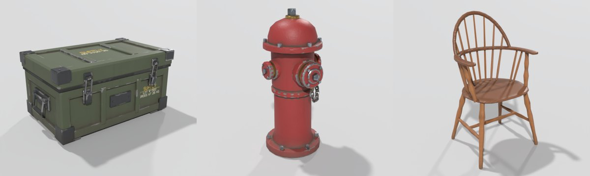

# antigravity-3d

**Ask for a game prop in one sentence. Get a package your engine can use as it is, already checked.**



*Each of these was asked for in one sentence. Real output of the plugin in script mode, no image model, rendered in Blender.*

antigravity-3d is a plugin for the Antigravity coding agent, with a command line beside it. It builds the model, its
textures, lower-detail versions for distance and collision shapes. It checks the result in real engines and installs
it into your Godot project.

[How it compares with a stock agent](#how-it-compares) · [What is checked](#what-is-checked-and-what-is-not) ·
[All commands](docs/commands.md)

## What you can do

| You want to | Say to Antigravity | You get |
|---|---|---|
| Make a prop | "Make a military supply crate for Godot" | A package your engine imports: the model, one texture atlas, lower-detail versions, collision shapes, and a record of every check it passed |
| Put it in your game | "Install the crate into this project" | One scene in your Godot project, imported and checked by your own Godot. One command takes it out again |
| Change it later | "Make the two side handles 30 % larger" | A new version in which only what you named changed. The old one is kept |
| Clean up a mesh you have | "Make chair.obj ready for Unity" | Your mesh repaired, unwrapped, with lower-detail versions and collision shapes |

On the command line:

```bash
agy3d prop "military supply crate" --preview --token-ceiling 600000 --max-images 0 --engine godot_4 --out out/crate
agy3d install out/crate/runs/<id>/package --project path/to/your/game
agy3d edit out/crate "make the two side handles 30 % larger" --token-ceiling 250000
agy3d sanitize chair.obj --engine unity_urp --out out/clean
```

`prop` and `edit` need a Gemini API key; "Try it" shows how to run without one.

`install` takes the package folder the run prints, writes one folder with a scene to drag into a level, then checks
it in a copy of your project with your own Godot:

```text
  check import           passed   headless import and scene load logged no error or warning naming the asset
  check collision        passed   one StaticBody3D with 8 convex shape(s), each within 256 points ...
  check level_switching  passed   rendered: the expected level alone at every stop, ...
  install_godot  installed  agy3d/WoodenCrateIron  checks: 7 passed, 0 failed, 0 skipped
```

`edit` changes only the parts you name; `--undo` puts the old version back, and `install` again updates your game.

## How it compares

| | This plugin, default | This plugin, script mode | Stock agent with a Blender tool |
|---|---|---|---|
| Game-ready checks passed, of 33 | 32 | 33 | 28 |
| Time to a package, minutes | 4 to 5 | 4 to 5 | 6 to 10 |
| Blind verdicts won against the stock agent: crate / hydrant / chair | 6 of 6 / 6 of 6 / 0 of 6 | 6 of 6 / 5 of 5 / 0 of 6 | |
| A change request finished on its own | 2 of 3 | 3 of 3 | 1 of 3; 2 stopped at their limit |
| Installed into a Godot project and checked there by one command | yes | yes | not offered |

Three briefs; our runs are from round six, the stock agent's from round five, one or two runs each. Looks were
judged blind by a general model, six times per pair. Our chairs lose every verdict; for the script-mode chair the cause is
the surface we paint, not the shape. Details and tokens: [round six](benchmarks/ROUND_SIX.md),
[round five](benchmarks/ROUND_FIVE.md).

## Try it

1. From a clone of this repository, with Python 3.11 or newer: `pip install -e ".[dev]"`.
2. In your game's folder, run `agy3d-plugin`. It puts the plugin in `.agents/plugins/antigravity-3d`.
3. Open that folder in Antigravity and ask for a prop. Expect a first build to take four to five minutes.

Without a Gemini API key the plugin judges with a stand-in, so delivery waits until you allow an unverified preview
and give it a token and an image limit.

On a key without the calibrated judge, a run is a preview and you set its two limits: tokens and images. With
`--max-images 0` the textures are generated from the geometry and no image model is used. In round five such a prop
spent 0.37 to 0.45 million tokens, an edit 62 to 86 thousand ([keys and cost](docs/keys_and_cost.md)).

`--offline` needs no key and takes about 15 seconds, but builds a built-in template, not your sentence.

## What Antigravity gives it

- You ask in your own words; the right playbook (a skill) loads by itself.
- Your export is held until the checks pass; the agent is sent back if it stops before.
- You are asked before anything is written into your project or a preview spends tokens.
- You review the asset in a 3D panel beside the conversation; your notes reach the agent.
- At install you choose: the agent drives scene tools, or writes each asset as a Python file.

## What is checked and what is not

- **Godot 4**: a real Godot imports every package when installed; the seven checks above run in your project.
- **three.js**: every package is loaded in headless Chromium and compared with its manifest.
- **Blender**: with a worker attached, a script this project did not write checks the GLB.
- **Unreal, Unity, Roblox**: packages and FBX files follow each engine's documented rules; none of these engines
  has opened them here or in CI.
- **Looks** are judged by a model; without the calibrated judge, look yourself.
- **The review panel** is tested against the MCP Apps host bridge, not inside a running Antigravity.

## Reference

- [Commands](docs/commands.md), [keys and cost](docs/keys_and_cost.md), [how it works](docs/how_it_works.md),
  [what is verified and known limits](docs/verification_and_limits.md),
  [package provenance](docs/package_provenance.md).
- [The plugin](plugin/antigravity-3d/README.md) and [the measurements](benchmarks/).

## License

See [LICENSE](LICENSE).
