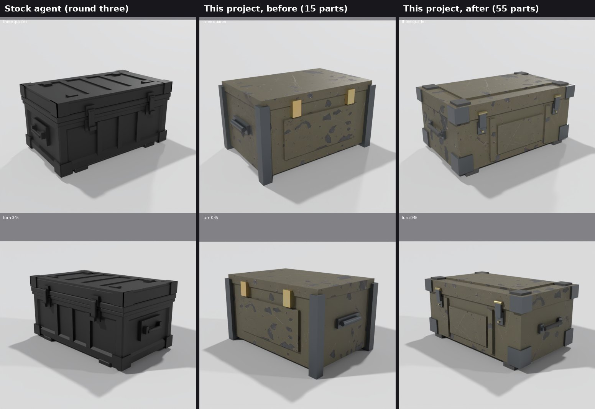
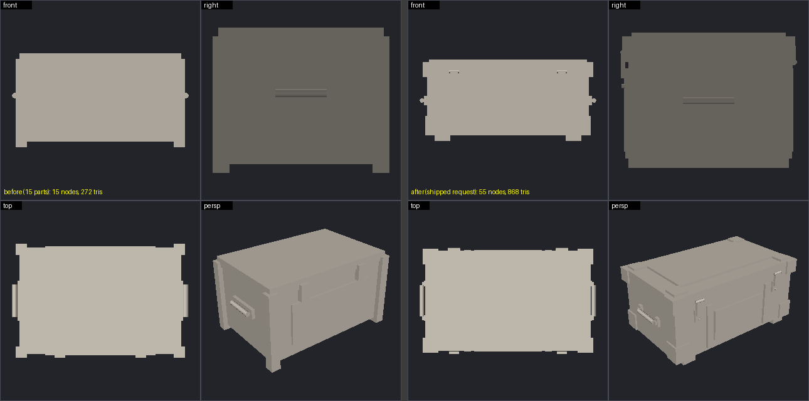

# Fourth round: where the stock agent did better, why, and what changed (2026-11-21)

The third round ended with a comparison this project lost. A stock Antigravity agent with a Blender it could script
delivered a supply crate that a blind judge preferred, and this project's own command twice ended without a
package ([`UPSTREAM_SKILLS.md`](UPSTREAM_SKILLS.md), "The comparison"). This round asks why, for each of the three
things that were worse, and fixes the causes that could be fixed without redesigning the project.

The rule of the earlier rounds holds: remove waste and raise quality, and never buy either by cutting capability.

## The short answer

| What was worse | The cause | What changed |
|---|---|---|
| **Quality.** The crate was a rough box with blocks stuck on: 15 parts, 272 triangles of the 3,000 allowed | The request to the model that writes the design was format rules and one sentence. Nothing said what a good prop is, or to use the budget | The request now says so, in seven lines. The same brief gives 55 parts and 868 triangles |
| | The judge that ranks designs and asks for repairs was never shown what the user asked for. It could say "this part floats", never "this is not a military crate" | The judge is shown the brief and asked two questions about it. It ranks the detailed crate above the plain one |
| | The scene format has five shapes (box, cylinder, cone, sphere, capsule) and no way to round an edge or cut a recess. The stock agent used Blender's bevel and inset tools | Not changed. See "What is left" |
| **Completion.** Two command runs, no package | A detailed design has many parts that sit flush, and flush faces fail the project's own Blender check. The only remedy was a repair by the model | Flush faces are moved 2 mm apart by arithmetic, with no model call. All four detailed designs recorded so far failed that check; all four pass it now |
| | The same check failed sound parts that touch at a corner, on Roblox | The check reads each part on its own |
| | A failure at any of about ten model and image calls ended the run, and the design it had paid for existed only in memory | A rerun in the same folder continues from the design and the images the failed run paid for |
| | An image request that came back without an image left its material untextured | It is asked once more |
| **Efficiency.** | The command was already the cheaper of the two (104,382 tokens against the stock agent's 625,818). Its waste was in what failure cost: a second run paid for a new design, and the images of the first no longer fitted it | The rerun above. Two ledger faults that could let a ceiling be passed unseen are fixed |

The stock agent finished because it works in twenty small steps and looks at each result. This project asks for the
whole design in one answer and then checks it. That is why it costs a sixth of the tokens, and it is also why a
weak request and a blind judge did so much damage: there was no second look that could have caught either.

The crate on the right is indicative, not the output of one live run. Its design is what the shipped request
returned live. It was then taken through the pipeline offline, with real Blender and Godot and a stand-in for the
judge, and one of its four materials carries a texture that an earlier live run paid for; no new image was
generated. See "What was verified".

## Quality

### The request never asked for a prop

Before this round the author received the scene format's rules, the triangle budget, and this:

> Build design 2/4 for a rugged military supply crate kit-bashed from panels, corner guards, latches and two side
> handles. Return one JSON SceneIR with asset_name='RuggedMilitarySupply', nodes and materials. Ground all parts.
> Include material assignments.

Five live designs made from it had 15 to 21 parts and 272 to 356 triangles, 9 to 12 % of the budget. The model did
what it was asked. The request now adds what a modeller would be told (`PROP_CRAFT_GUIDANCE` in
`tactics/metered_author.py`; the native modelling stage carries the same rules):

> Model a production game prop, not a blockout.
> - Every part the brief names gets its own nodes, built from the pieces a real one has: a latch is a base plate, a
>   clasp and a hinge barrel; a handle is two brackets and a grip; a corner guard wraps its corner.
> - Add the secondary forms an object of this kind has wherever they change the silhouette or catch the light: rims,
>   ribs, frames, skids or feet, straps, hinges, bolt heads. Break large flat faces with raised or recessed panels
>   made from thin boxes.
> - Aim for 50 to 90 parts, within max_tris [...] Do not pad with hidden or repeated filler.
> - Keep parts in proportion: thin plates and slim bars, not chunky blocks.
> - Attach by contact: a part's face lies exactly on the surface it is mounted on, with no gap and no overlap [...]
> - Set collider false on small detail parts; keep it for the main solids.

| | Before | After |
|---|---|---|
| Parts | 15 to 21 (five designs) | 55 (the shipped request, through the shipped code) |
| Triangles, of 3,000 | 272 to 356 | 868 |
| Tokens for one design | about 9,100 to 10,700 | 15,752 |
| Seconds | about 14 | 36 |

A design costs about 1.6 times what it did and has 3.7 times the parts. The reservation for an authoring call grew
with it (the answer may now be 16,384 tokens, where 8,192 was enough for 20 parts), so a long answer is not cut
off; a call is still billed what it used. A kit piece's request is unchanged and keeps the old figures.

The first wording told the author to sink parts a millimetre or two into what they sit on. That produced 103 to
116 interpenetration warnings and 28 to 38 z-fighting warnings per design, so the wording that ships says contact.

### The judge was never shown the brief

The judge looks at renders and answers fixed questions: does a part float, do parts clip, is the silhouette clean.
None of them mentions what was asked for. The geometry ranking, which picks one of four designs, asked only about
floating and clipping, so a bare box that neither floats nor clips ranked as well as anything. A question about
missing parts existed, but it compares against a reference drawing that the router had decided not to pay for.

The judge now receives the request, quoted, and two questions about it (`decisions/questions.py`): whether a part
the request names is missing or unrecognisable, and how completely the shape depicts the requested object as a
finished prop, from "does not depict it" through "a crude blockout" and "recognisable but plain" to convincing.
Both count in the ranking, in the review that decides on repairs, and in the gate: a design below 2.5 of 4 on the
second question is sent back with "reads as a blockout of what was asked". A request with no brief is judged
exactly as before.

Checked live with the real (fallback) judge and the shipped ranking code, on the 15-part design the comparison
used and the 55-part design above, in both orders:

| | 15 parts | 55 parts | Winner |
|---|---|---|---|
| Plain design shown first | 2.12 | 2.89 | 55 parts |
| Detailed design shown first | 1.94 | 2.69 | 55 parts |

The figures are the answer to the second question, of 4. The plain design is under the 2.5 bar both times and the
detailed one over it. Each ranking cost about 5,000 tokens. This judge is the uncalibrated fallback; the native one
has still not been available on the development key.

### The comparison's judge, asked again

The third round's blind judge compared the stock agent's crate with this project's and preferred the stock agent's
overall, in both orders. The same judge (`gemini-4-carbon`, the same rubric and renders made the same way) was
asked again with the crate on the right of the picture above:

| Criterion | Third round | Now |
|---|---|---|
| Reads as the brief | Stock agent, both orders | This project, both orders |
| Proportion and scale | Stock agent, both | Stock agent, both |
| Surface and material | This project, both | This project, both |
| Fewer visible defects | This project once, a tie once | A tie, both |
| Overall | Stock agent, both | This project, both |

Its words for the overall verdict the second time: this project's crate "is a more complete game asset with
colour, material separation, and wear that clearly convey a rugged military supply crate, despite" the stock
agent's "having slightly nicer geometric detailing". On proportions it still prefers the stock agent's "well-
integrated" corner guards and ribbing to this project's "blocky corners".

This is one brief, two calls, an uncalibrated judge, and a crate that no single live run produced. It says the gap
in the model has narrowed and where the rest of it is; it is not a win rate.

### What is left: the shapes

The scene format builds from boxes, cylinders, cones, spheres and capsules. It cannot round an edge, cut a recess
into a face, or sweep a profile. The stock agent's script called Blender's bevel three times and its inset twice,
and those are much of why its crate reads as manufactured and this one as assembled. The judge's remaining
preference is exactly that. More parts help, and the picture shows it, but 55 boxes are still boxes. See "Open
decisions".

## Completion

### Flush faces failed the project's own check

Two parts whose faces lie in one plane and overlap are drawn at the same depth, and the surface flickers. The
upstream Blender check that every package must pass fails an asset for it, rightly. A plain design rarely has such
faces. A detailed one has them everywhere: a handle grip whose end is level with its bracket, a latch plate as
thick as the panel it sits in, corner plates whose ends meet, a hinge barrel as wide as the clasp it runs through.
Every detailed design recorded for this round failed that check, and the only remedy was to ask the model for a
repair and pay for each attempt.

`kernel/separate.py` does it by arithmetic. For each such pair it moves one face of the smaller part 2 mm along
its normal: a plate lying on a larger face stands proud of it, anything else sits back, so the outline does not
grow. A cylinder whose flat side facet is the problem has its radius changed instead. The face a part is mounted
by is never moved, and a move that would open a gap, make a new flush pair, or thin a part below half its
thickness is not made. Parts set at an angle are left to the author, as before, and the step says so. It runs
after the design is chosen and after each repair, in 0.05 to 0.4 s.

| Design | Faces moved (Godot 4) | Upstream check before (Godot 4) | After, Godot 4 | After, Roblox |
|---|---|---|---|---|
| 55 parts, the shipped request | 2 (the two hinge barrels) | failed, 1 error | passed | passed |
| 55 parts, wording experiment | 6 | failed, 2 errors | passed | passed |
| 63 parts, wording experiment | 48 | failed, 3 errors | passed | passed |
| 64 parts, wording experiment | 56 | failed, 1 error | passed | passed |

Each row is the design through the whole pipeline offline with real Blender. Before the round the four also failed
for Roblox, with 2, 3, 3 and 1 errors. Triangle counts and bounding boxes
are unchanged, no part floats, and the outline of each design overlaps its unseparated self by at least 0.999 in
every view. The four designs are test data (`tests/data/coplanar/`).

### Parts that touch were read as one broken surface

The package's GLB stores each part split along its texture seams, so the Blender worker merges vertices that lie at
one position before the check reads the file. It merged them across the whole mesh. Two separate parts in contact
also have vertices at one position: a lid on a body of the same footprint shares its four rim corners. Merged
together they stop being two closed boxes and read as one surface whose faces are wound against each other. One of
the designs failed the Roblox profile on "16 edges with inconsistent face winding" while every one of its parts
was closed and correctly wound.

The worker now finds the parts first and merges within each (`daemon.weld_within_parts`). Where the faces of two
parts meet along an edge it pairs each face with the one that bounds the same solid. A face that really is wound
the wrong way stays in its part and still fails, which a test confirms on the same file. On the six packages
checked before and after, nothing else in the check's findings changed.

### A failed run kept nothing

A run makes about ten calls to three services: the author, the judge and the image model. In the third round one
unanswered call ended a run after its design and its images were paid for. The images were cached; the design
existed only in memory, so the next run paid for a new design, for which the cached images no longer fitted.

Each answered authoring request is now recorded beside the image cache, keyed by the whole request
(`DesignRecord` in `tactics/cached.py`). A rerun into the same `--out` takes the design and the images from there,
says so in its ledger, and pays only for what the failed run did not reach. `--new-design` asks for a fresh design
and keeps the images whose requests did not change. The spend ledger now belongs to the asset and covers all its
runs, so a ceiling holds across reruns.

An image request that comes back complete but without an image is asked once more. In the third round that answer
left a material untextured.

## Efficiency

The command was the cheap side of the comparison, and still is: about ten calls instead of twenty turns that each
re-read the conversation. What it wasted was the cost of failing, which the rerun removes, and images for designs
that lost the ranking, which the third round removed.

Two faults in the ledger could let a run pass its ceiling without the ledger showing it. Both were found by review
of the pull request and are fixed:

- A judge call that was blocked part-way was booked at zero tokens. It now books what the service reported, and
  the whole reservation when that is not known.
- An image whose answer carried no breakdown of its tokens was not counted against the image limit. An image that
  was extracted from an answer now always counts.

The richer request costs more per design, by design: about 15,750 tokens against about 9,500. With four candidates
that is about 25,000 tokens more per run, for designs with 3.7 times the parts.

## What was verified, and how

- On the head: the engine suite on real Blender 5.3 and Godot 4.7.2 (386 tests, all 86 that the workflow requires),
  the whole suite with a browser (1,813 passed) and with the browser hidden, as CI's plain jobs run (1,756 passed).
- Five live calls, 32,636 tokens, no image: one design through the shipped authoring path; the shipped geometry
  ranking twice; the comparison's blind judge twice.
- Each of the four detailed designs through the whole pipeline offline with real Blender, for Godot 4 and for
  Roblox: flush faces separated, upstream check passed, exported, loaded in three.js; the Godot 4 package of the
  first also imported in Godot. None of these eight runs passed the upstream check when the round began.
- **Not done: a complete live run of the command since these changes.** About 55,000 of the 2,000,000 tokens and
  one of the 30 images were left, which is less than one run needs. So the crate in the pictures is assembled
  from verified parts, as said above; whether the whole chain completes live in one go is the next thing to
  measure. Its repair loop, its texture ranking and the judge's behaviour on a detailed design were not
  exercised live this round.
- `results/round4/checks.json` holds every figure quoted here, with the judge's answers in full.

## What it cost

| | Tokens | Images |
|---|---|---|
| Third round (see its table) | about 1,864,000 | 29 |
| Authoring experiments for the wording: three designs | 48,197 | 0 |
| The five live calls above | 32,636 | 0 |
| Total | about 1,945,000 | 29 |

## Open decisions

- **Rounded edges and recesses.** The largest remaining difference from the stock agent's model. Two ways: a
  `bevel` parameter on boxes and cylinders, made by the kernel and so available with or without Blender, which
  touches the UV, collider, level-of-detail and contact-face code for those shapes; or a pass in the Blender worker
  that bevels the finished design, which is less code and makes Blender a requirement for it. Either changes what
  every run ships.
- **A complete live run**, first with one candidate (about 100,000 tokens and four images for this brief), then in
  the default mode with four candidates and ranked textures (about 300,000 tokens and 9 to 11 images).
- **A hovering group of parts** (two parts that touch each other and nothing else) is a warning from the project's
  own check and passes the upstream one, which only looks at single pieces. A single hovering part fails.
- **The reference drawing** that the missing-parts question was written for is still skipped by the router for
  most briefs. With the brief now shown to the judge it matters less; whether it is worth an image is undecided.
