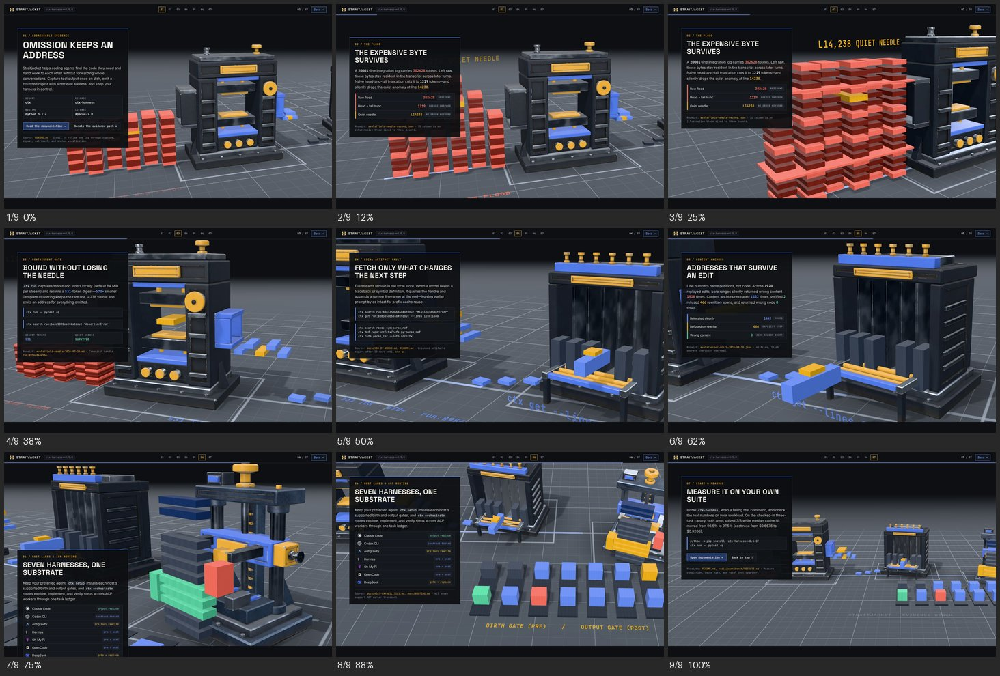
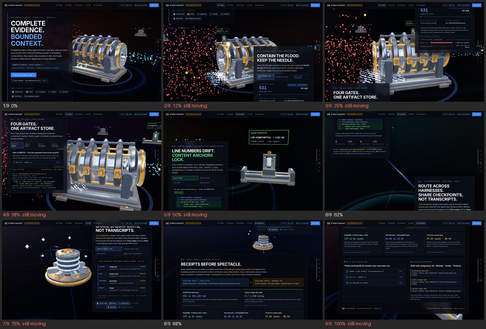

# Eighth round: what Antigravity needs from the plugin to build a 3D website (2026-11-24)

The owner asked for a world-class, scroll-driven 3D website for Straitjacket, generated entirely by Antigravity on
the Neon model with this plugin, and said: "when I see the website I will make corrections to how well it must use
threejs and other contemporary libraries, else it must be added to the plugin."

The first run (`results/site_run1/`) delivered a working site. Its logs show five places where the plugin held the
agent back. None of them depends on taste, so this round did not wait for the corrections: it fixed the five, ran
the same request again from the fixed plugin (`results/site_run2_plugin/`), and compared the two sites. The owner's
own corrections have not been given yet. When they are, they go into the new website skill and the run is repeated.

**Two parts of the planned measurement are missing.** The same request without the plugin (a stock agent, as a
baseline) and the blind comparison of the sites both need the model service, which stopped answering on the day
after run 2 finished (three first requests of the baseline run were each dropped after five minutes; the judge
model gave no answer in 90 s). Everything below that compares "run 1" and "run 2" is measured. Nothing below says
how either compares with a stock agent, and nothing says which site a blind judge prefers.

## The short answer

Run 1 used the plugin as it was after round seven. Run 2 used this branch at commit 5e3c0a8. Same owner's sentence,
same model, same sandbox; run 2 had more web packages installed in its seed (see "What was not equal").

| | run 1 | run 2 |
|---|---|---|
| sessions needed | 2: the second repaired a 17.4 MB model the host refused | 1 |
| time inside tool calls | 40.5 min (33.6 of it in the plugin's tools) | 15.8 min (15.3 in the plugin's tools) |
| plugin calls the host cut off at 3 minutes | 6, their work lost | 0 |
| first build of the site | minute 53 | minute 9 |
| props installed by the plugin's installer | 0 of 3 (files copied by hand) | 3 of 3, each 12 of 12 checks |
| how the agent looked at its site | 9 screenshot scripts of its own | `check_site` 4 times; 2 scripts, for the stills of the no-WebGL page |
| model calls / tool calls | 199 / 274 | 64 / 128 |
| tokens, all / not served from cache | 21.7 M / 10.4 M | 8.0 M / 6.4 M |
| the page downloads | 22.8 MB | 5.3 MB |
| texture memory on the graphics card | 454 MB | 52 MB |
| 3D canvas showing something, nine scroll steps on a desktop | 10 to 52 %; five steps under 20 % | 36 to 81 %; one step under 60 % |
| draws while nothing moves | every frame | none |
| a visitor who asked for reduced motion | not handled | handled |
| a browser without WebGL | a script error and no picture | the whole text and seven stills |
| numbers and code on the page that name their source | none; 43 numbers and 1 code specimen without one, several invented | 31, all equal to their source |
| other hosts the page asks | 1 (a font service) | none |

Wall time is not in the table because it measured the model service, not the work. Run 1 took 69 and 36 minutes.
Run 2 took 103 minutes, of which 87 were spent waiting for the model: a call took 44 s at the median against 12 s
in run 1, and four calls were dropped after five minutes each (19 minutes).

What the table cannot say is how the sites look. My own reading of the frames, as the one who integrated this
round and so not a blind one:

- Run 2 is one continuous scene: a bench that the camera travels along, with the text panel in the same place at
  every step, on a desktop and on a phone. Each chapter shows the part of Straitjacket it talks about. Run 1 has a
  striking first screen and then long stretches where the 3D is a small object or nothing.
- Run 2's objects are plainer than run 1's. Run 1's first object is a chrome and gold chamber with reflections.
  Run 2's three machines are dark painted boxes with blue and amber parts, evenly lit; they read as diagrams more
  than as objects one wants to look at. The plugin's own review scored each about 1.8 of 4 and the agent
  delivered them as they were.
- Run 2 follows Straitjacket's design page (flat colours, no glow, no gradients). Run 1 did not. That makes run 2
  correct and also less showy.

*Run 2. Below, run 1 at the same nine steps. "Still moving" marks a frame the check photographed while the page had
not come to rest.*

## What run 1's logs showed

- **Tool calls were cut off.** Antigravity ends every MCP tool call after three minutes. This is a fact of the
  host; no setting of the plugin or the SDK changes it. Six calls ran longer (two deliveries, two level-of-detail
  runs, two exports) and each lost its work. A 70-part object could not be delivered by that tool at all.
- **Web models were far too heavy, and the agent had no lever.** One model was 17.4 MB: four 4096 px PNG maps. To
  get smaller textures the agent scaled the object to 0.65 inside the plugin and loaded it at 1/0.65.
- **The installer was not used.** It existed, with a loader that switches levels of detail. The delivery's answer
  named no next step, the tool's description spoke of asking the user first, and in the run tooling the stand-in
  for the user refused the one install the agent tried. The agent copied files by hand and wrote its own loader.
- **The agent had to build its own eyes.** It wrote screenshot scripts, looked at six scroll positions and missed
  the empty stretches between them. Nothing measured weight, and nothing compared the page's facts with their
  sources: the page shows a "digest specimen" whose log line and identifier are in no file.
- **No skill covered building a site.** 45 of the first session's 69 minutes went to three props before a single
  page existed.

## What was built

1. **Long calls answer inside the host's limit and keep their work** (`harness/keeper.py`). Every tool answers
   within 150 s: with its result, or with `STILL WORKING`, the step it is at, and the exact call to repeat. The
   work goes on after that answer. The repeated call joins it and no step runs twice. A change to the design makes
   kept work stale and removes its folders.
2. **A web package is web-sized.** `max_texture_px` is a parameter of the session, the script API and the command
   line, and it holds for every map. A web model carries WebP textures when three.js frames of the WebP and the
   PNG versions agree within the installer's existing tolerance. The delivery's answer states the atlas size, the
   download, the graphics memory, up to how many pixels on screen the textures stay sharp, and ends with the
   install call to make next. Run 1's three models, built again: 17.4 to 4.0 MB, 9.6 to 2.5 MB, 4.2 to 0.9 MB.
3. **`check_site`** (a tool in both modes of the plugin, and `agy3d check-site`). It opens a built site the way a
   visitor does, at desktop and phone size, and answers in text: what is broken, what a visitor would notice, what
   the scene costs, and where the contact sheets are. It photographs even scroll steps, names the steps where the
   3D shows little, counts draw calls, triangles and texture memory inside the page, visits again with reduced
   motion and without WebGL, and compares every element marked `data-src` with the file it names.
4. **The skill `scroll-3d-website`.** The order of work (page first, props second), twelve instructions each with
   its reason, what went wrong in run 1, a guide to current libraries in which every example was run against the
   versions it names, and a starter whose plumbing (scroll, camera path, loading, reduced motion, the page without
   WebGL) is run in a browser by the tests.
5. **The site task as a repeatable run** (`benchmarks/site_task.py`): the same seed with the plugin or without it,
   Node and the browser declared for every arm, results written with this machine's paths replaced by labels.
   `benchmarks/site_compare.py` judges two sites' frames blind, in both orders.

Found on the way and fixed: the KTX2 encoder the installer uses refuses 4096 px maps, so run 1's first model could
not have been installed even if the agent had tried (the install now falls back to uncompressed files and says
why). The installer's fixture project and loader are checked against three 0.187.0.

## Run 2, minute by minute

| minute | what the agent did |
|---|---|
| 0.2 to 1.0 | read the website skill, its library guide, its recipes and every file of the starter; looked at the reference pictures |
| 3 to 8 | wrote a storyboard, then the page, the camera shots and the scene from the starter |
| 8.5 | first build |
| 8.6 | first `check_site`: two facts on the page did not match their source |
| 10.7 to 35.9 | three props: for each, a session, about four modelling calls, one preview, the delivery, the install. One delivery was refused for two faces in the same plane and passed after a fix |
| 37.5 | `check_site`: one fact still refused (see the next section: the check was wrong) |
| 44 to 49 | captured seven stills for the page without WebGL |
| 52.8 | `check_site`: nothing broken |
| 56 to 88 | lighting, labels in the scene, phone layout. Most of this half hour is the four dropped model calls |
| 98.9 | last `check_site`: nothing broken; final report |

- No call was cut off. The longest took 150 s. Three of four deliveries answered with the finished package in one
  call (142, 151 and 76 s); the fourth was the refusal, after 78 s.
- The agent chose `max_texture_px: 1024` for all three props, from the size they have on screen.
- It used three 0.187, three-custom-shader-material (two shaders that extend the standard material and so keep
  shadows and reflections), troika-three-text for labels in the scene, lenis, GSAP ScrollTrigger, detect-gpu,
  locally bundled fonts, and one instanced mesh for all the small evidence slabs. Its own list, with reasons, is
  in `results/site_run2_plugin/report.md`.
- It says plainly what it could not do: this key has no image model and no calibrated judge, so the three props
  are unverified previews with generated surfaces.

## What run 2 exposed in the plugin, fixed after it

Run 2 ran from a fixed tree, so these four fixes are in the branch but not in run 2.

- **The site check refused a correct quote, and the site lost its best receipt.** The agent showed the first five
  lines of Straitjacket's real digest output, copied exactly from `evals/field-needle-record.json`. The check
  wanted at least half of a quoted value and called the fact broken; its message printed the value as JSON with
  quotes and `\n`, so it read like a formatting fault. The agent gave up and put README command lines in its
  place. A quote is now all of a value or one unbroken passage of 20 characters or more, and a refusal says which
  of three things is wrong and where. Two reviews of this round's code had passed that rule. A run found it.
- **Each install spent 114 of its 130 seconds on compression it then threw away.** The installer encoded three
  KTX2 variants and compared two of them in a browser, then kept none, because the package's WebP files were
  smaller than every one of them (766,200 bytes against 916,515 for the smallest). It now tests the size as soon
  as the first variant exists and stops, and it encodes the three texture maps side by side instead of one after
  the other (the same bytes). The same install takes 24 s and writes the same files.
- **The install's answer was too long for the host to show.** At 10,292 characters Antigravity saved it to a file
  and the agent saw a title. It is now a few lines: the outcome, the import to write, the checks as a count.
- **The collected results were incomplete.** The agent's final report was cut at 8,000 characters, and the check's
  own pictures were counted among the agent's source files. Both are fixed, and run 2's folder was collected again.

## What was not equal between the runs

- **The seed.** Run 1's project had three 0.170, gsap, lenis and vite installed. Run 2's had three 0.187 and
  about twenty more packages a current site might use (post-processing, text, shader helpers, React Three Fiber,
  compression tools, fonts). The sandbox has no internet, so an agent can use only what is installed. Some of run
  2's library use was not possible in run 1.
- **The task text.** Run 2's says where the site will live (under `/straitjacket/`, with the documentation at
  `./docs/`) and that nothing may be loaded from another host. Run 1's first task said neither; its second session
  added the host's rules.
- **The model service.** Four times slower per call in run 2.
- **One run each.** The same request run twice gives two different sites. Differences of a few percent between
  two single runs mean nothing; the differences in the table are not of that size.

## What is still worse, or not done

- **The baseline and the blind comparison**, as said at the top. The run tooling for both is in the branch and
  tested offline.
- **The props' look.** The plugin's review scored each of run 2's props about 1.8 of 4 (an uncalibrated judge;
  the targets are 3.3 to 3.4). The delivery reports this as findings for a person, and the agent went on. Nothing
  in the skill asks for a second round on a prop that reads as a box.
- **No image model and no calibrated judge on this key.** Every prop in both runs is an unverified preview with
  surfaces generated from geometry.
- **A delivery still takes about two and a half minutes for a 66-part prop.** A profile of one delivery shows
  where: the search for the atlas layout (about a third of the checks step) and the painting of the generated
  surfaces. The second writing of the package, which looked wasteful in the logs, costs under 10 s at the new
  web default and was left.
- **An install still waits about 20 s for one texture map.** Encoding a single 1024 px map in the format that
  stays compressed on the graphics card takes that long, and about four times that at the 2048 px default.
- **A quick call made together with a slow one waits for it.** The server runs tool calls in the order they
  arrive. In run 2 the agent twice opened the next prop's session in the same turn as a delivery or an install,
  and that call waited up to 117 s. It cost no time there, because the host returns a turn's answers together.
- **The check's measures move a little between visits** on a page that never comes to rest, and one of its browser
  tests failed once while two other jobs were using the machine's four cores.

## Decisions for you

1. **A web atlas stops at 2048 px unless a size is named** (`EngineRules.default_texture_px`). A browser holds
   every map uncompressed: four 4096 px maps are 341 MiB of graphics memory for one prop. 4096 is one parameter
   away and the delivery's answer says what it would give. Other engines are unchanged. Yours to reverse.
2. **Which site is Straitjacket's front page.** Run 1's is live now. Run 2's is lighter, sourced and works for
   every visitor, and its objects are plainer. A draft pull request can put it there; merging is yours.
3. **Your corrections on three.js and library use.** They go into the skill, and the run is repeated with them.
4. **Should a prop that the review scores under its target get one more round before it is installed?** It would
   cost a few minutes per prop. Run 1 spent too long on props; run 2 may have spent too little.

## Mistakes in this round's process

- **The baseline was left to the end.** It was to run after the plugin arm and after that site had been
  published for the owner. By then the model service was failing, so the comparison with a stock agent, which
  this round built the tooling for, is not in this report.
- **Two reviews did not find what one run found.** An independent code review and a separate audit of every
  agent-facing text both passed the site check's quote rule. Neither tried a faithful excerpt against it.
- **Red CI twice after the first push.** My local stand-in for CI's first job still had the browser library
  installed, so 13 tests that need it ran here and failed there. The second failure was a race in a test of the
  run tooling that this machine's timing hid.
- **Run 1's harness refused the agent's install** (the stand-in for the user answered "refused" to every
  question). That is one reason run 1 has no installed prop, and it was the tooling's fault, not the agent's.
- **Helpers' commits carried their own attribution lines.** They were rewritten before anything was pushed.

## What was verified, and how

- **Tests.** Both whole suites ran on the merged round: with Blender 5.3, Godot 4.7 and the browser (3,304
  passed), and in CI's configuration without them (3,192 passed). Four tests failed in each at first; all four
  are fixed. CI is green on the pushed head for both Python versions and the engines job. The fixes made after
  run 2 each came with a test and were run with the files they touch.
- **Reviews.** An independent code review of the round found seven defects, two of them serious (the run tooling
  followed links an agent could leave in its workspace; a slow build and a delivery could overlap). All seven are
  fixed, each with a test. A second audit compared every agent-facing text with the code.
- **The 3-minute limit.** Replay of run 1's largest model: a delivery the host cut off every time now completes in
  two calls. In run 2 no call was cut off.
- **The install fix.** Measured on run 2's first prop with the project's real tools: 129.9 s before, 30.1 s with
  the early stop, 24.3 s with the maps encoded side by side as well; the same 12 checks and the same installed
  files. Encoding side by side gives the same bytes as one by one (a test compares them).
- **Run 2's site.** Checked by `check_site` after the run, from a copy of the built folder: nothing broken,
  nothing a visitor would notice. Its answer is `results/site_run2_plugin/site_check.txt`.
- **Not verified:** how either site compares with a stock agent's, and which site a blind judge prefers.
