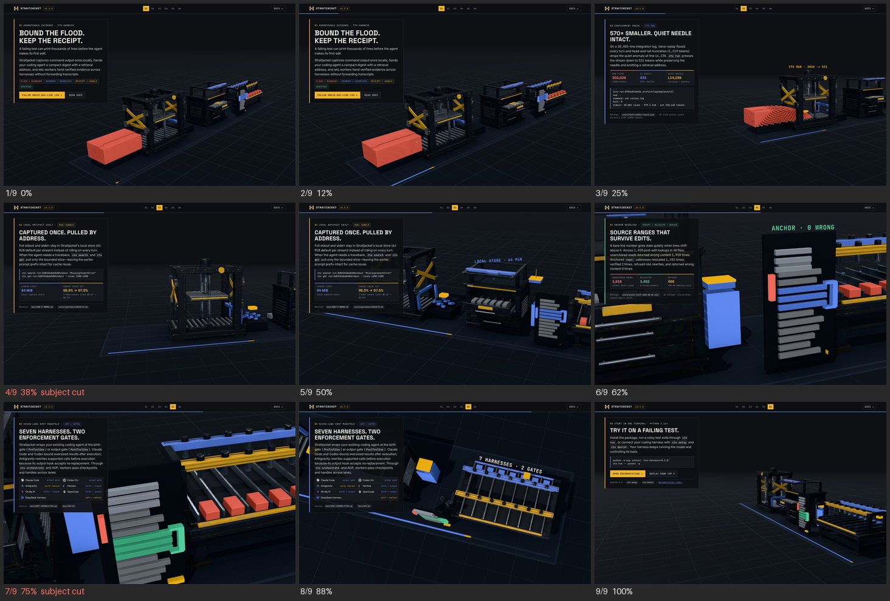
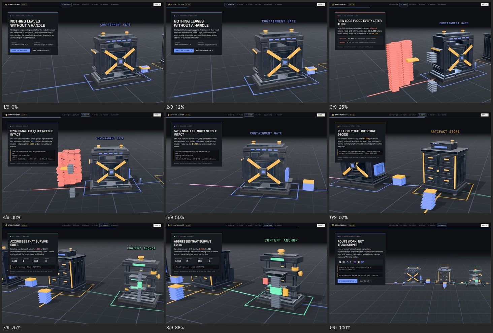
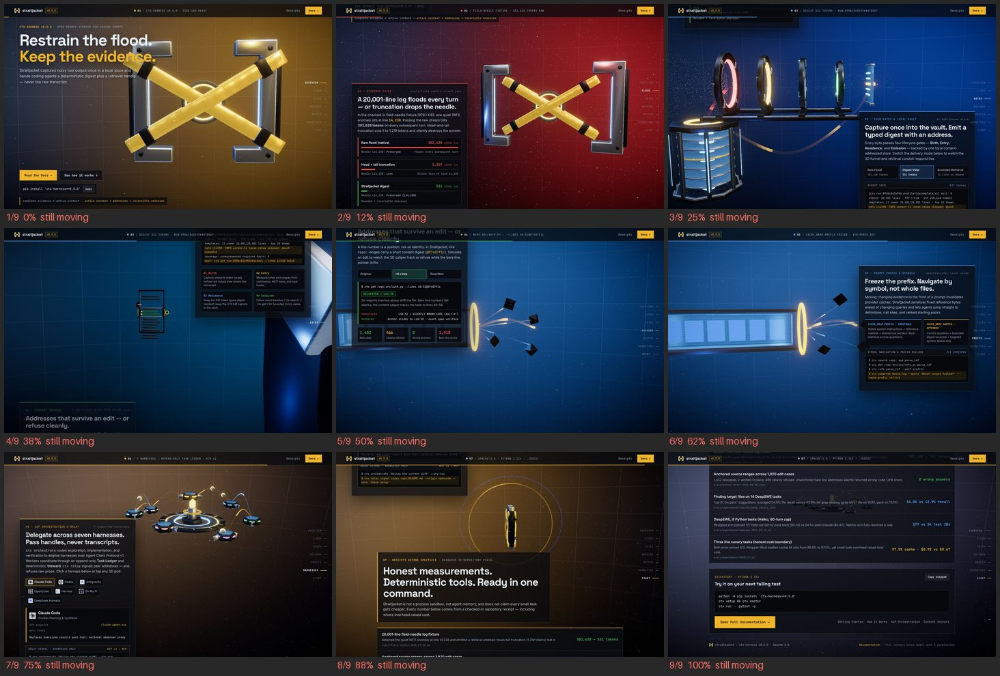

# Eighth round: what Antigravity needs from the plugin to build a 3D website (2026-11-24)

The owner asked for a world-class, scroll-driven 3D website for Straitjacket, generated entirely by Antigravity on
the Neon model with this plugin, and said: "when I see the website I will make corrections to how well it must use
threejs and other contemporary libraries, else it must be added to the plugin."

The first run (`results/site_run1/`) delivered a working site. Its logs show five places where the plugin held the
agent back. None of them depends on taste, so this round did not wait for the corrections: it fixed the five and ran
the same request again (`results/site_run2_plugin/`). An independent review of that site's three.js found fourteen
faults, half of them taught by this round's own skill. Those were corrected, and the request was run a third time
(`results/site_run3_plugin/`). Each run exposed faults of the plugin that no review had found; they are fixed too.
A second review, of the third site, again traced its two worst faults to the starter and the skill. Those were
corrected, the same request was given once to the agent without the plugin, and it was run a fourth time with it
(`results/site_run4_plugin/`). The owner's own corrections have not been given yet. When they are, they go into the
website skill and the run is repeated.

**The fourth run's site is the one a blind judge prefers** (`results/site_run4_plugin/`). A general model compared
the five sites, every pair six times, without being told which is which (`results/round8/site_compare_corrected/`).
Run 4 is preferred to run 2 in six of six verdicts, to run 3 in four of six, to run 1 and to the stock agent's in
six of six, and it is the better explanation of the project in all 24. It is also dark, which the judge says in
every verdict on craft that goes against it, and it downloads twice what it needed to, because this round's own
skill told the agent to compress its textures and named a tenth of the cost.

**The plugin's sites are preferred to a stock agent's, and cost twice as much.** The same request was given to the
same agent without the plugin (`results/site_stock/`). The judge preferred the second, third and fourth plugin site
to it in all 18 verdicts and on every criterion, and the first in four of six. The stock agent needed 37 model
calls and 5.0 M tokens; the plugin's runs 2 to 4 needed 64 to 73 calls and 8.0 to 10.5 M.

**Every run has shown a fault of the plugin's own that no review found.** In the judge's eyes run 2 is better than
run 1, run 3 level with run 2, and run 4 better than all three. After run 4 the faults are a check that photographed
a heavy page before it had arrived, and a paragraph of the skill with a number nobody had measured. Both are corrected. What is not yet corrected is listed
under "What is still worse".

## The short answer

Run 1 used the plugin as it was after round seven, run 2 this round at commit 5e3c0a8, run 3 at f3b2266 (run 2's
tree and everything that was corrected after it). Same owner's sentence, same model, same sandbox. Runs 2 and 3 had
the same task text and the same installed packages, file for file; run 1 had fewer (see "What was not equal").
Run 4 used the plugin at 1b81144, with the corrections made after run 3's review and the first blind verdicts. The
stock agent had the task text, project copy and packages of runs 2 to 4, Blender and a browser, and no plugin.

| | run 1 | run 2 | run 3 | run 4 | stock agent |
|---|---|---|---|---|---|
| sessions needed | 2: the second repaired a 17.4 MB model the host refused | 1 | 1 | 1 | 1 |
| time inside tool calls | 40.5 min (33.6 in the plugin's tools) | 15.8 min (15.3) | 8.3 min (8.2) | 20.2 min (16.2), three and a half of them calls waiting behind an install made in the same turn | 3.3 min |
| plugin calls the host cut off at 3 minutes | 6, their work lost | 0 | 0 | 0 | no plugin |
| the three props: deliveries and installs, in all | not comparable (cut off, copied by hand) | 13.2 min | 5.2 min | 8.8 min, the installs with compression as the skill then said | five models from one Blender script of its own, run in 3 s |
| props installed by the plugin's installer | 0 of 3 (files copied by hand) | 3 of 3 | 3 of 3 | 3 of 3 | no plugin: five `.glb` files, no textures, one level of detail, its own loader |
| how the agent looked at its site | 9 screenshot scripts of its own | `check_site` 4 times; 2 scripts, for the stills of the no-WebGL page | `check_site` 4 times; 6 scripts, all spent on a fault in the check's own pictures (below) | `check_site` 4 times, no script of its own | 1 screenshot script of its own, run 3 times; 30 pictures opened |
| model calls / tool calls | 199 / 274 | 64 / 128 | 73 / 132 | 69 / 123 | 37 / 91 |
| tokens, all / not served from cache | 21.7 M / 10.4 M | 8.0 M / 6.4 M | 10.4 M / 9.0 M | 10.5 M / 6.2 M | 5.0 M / 4.3 M |
| the page downloads | 22.8 MB | 5.3 MB | 3.6 MB | 7.4 MB (3.8 with the installer's default) | 1.9 MB |
| texture memory on the graphics card | 454 MB | 52 MB | 89 MB (38 of it render targets) | 147 MB (133 of it render targets: the occlusion pass, which the check now draws and counts) | 32 MB, all of it render targets, and 36 MB of render buffers |
| draw calls in the heaviest frame, on a desktop | 33 | 14 | 18 | 119, the occlusion pass's own among them | 132 |
| 3D canvas showing something, nine scroll steps on a desktop | 0 to 50 %; four steps under 20 % | 36 to 81 %; one step under 60 % | 66 to 81 % | 4 to 34 %; six steps under 10 %: a dark scene | 50 to 79 % |
| props and 3D labels hidden by text or cut by the window's edge | not measured (the page does not say where they are) | 18 | 0 | 6 at two of nine steps; the agent's own checks took twelve steps and saw none | not measured (the page does not say where they are); the judge names text over the 3D in four of nine frames |
| draws while nothing moves | every frame | none | none | none | every frame |
| a visitor who asked for reduced motion | not handled | handled | handled | handled | not handled: the picture keeps changing |
| a browser without WebGL | most of the text, a script error, no picture | the whole text and seven stills | the whole text and six stills | the whole text and six stills | an empty page: no text, a script error |
| numbers and code on the page that name their source | none; 43 numbers and 1 code specimen without one, several invented | 31, all equal to their source | 22, all equal to their source, the real digest output among them | 24, all equal to their source | none in a form the check can compare: 35 numbers and 4 code specimens, most with a file name beside them in small type; the 11 looked up are in the project's files |
| other hosts the page asks | 1 (a font service) | none | none | none | none |

Wall time is not in the table because it measured the model service, not the work. Run 1 took 69 and 36 minutes,
at 12 s per model call. Run 2 took 103 minutes and run 3 took 105, and a model call was in flight for 88 and 98 of
them: 44 and 45 s per call at the median, with four and three calls lost after up to five minutes each. Run 4
took 39 minutes, in the evening, at 12 s per call and with no call lost. The stock agent took 53 minutes with a call in flight for 50: 34 minutes in its 37 answered calls (33 s at the median)
and 16 minutes in eight calls that failed, three of them after five minutes or more.

**What run 3 shows about the corrections.**

- **They did what they were for.** The dark floor is dark (run 2's rendered light grey from a colour fault in the
  skill's own example). No prop or label lies under the text or runs out of the window at any of the nine steps,
  on a desktop or a phone, where run 2 had 18 such faults and its check saw none. The real digest output is on the
  page with its source (run 2 lost it to a fault of the check). The stills for the page without WebGL came from the
  check, not from scripts of the agent's own. The three installs took 50 s together, where run 2's took 5.7
  minutes.
- **The page is lighter and uses more memory.** 3.6 MB against 5.3, and 89 MB of textures against 52: the scene
  keeps 38 MB of render targets (shadows and its lighting environment) where run 2's kept 13.
- **It cost more tokens than run 2**, 10.4 M against 8.0 M. The agent read the skill, both guides and all eight
  files of the starter before it wrote anything, and built first at minute 45 (run 2 copied the starter and built
  it at minute 9). The first check of that first build already said "nothing broken".
- **16 of the 105 minutes went on a fault of the plugin's own pictures**, and the props were again installed
  without their review being acted on. Both are fixed now and described below.

**What run 4 shows about the corrections made after run 3.**

- **The picture now explains.** The skill asks for one thing a visitor follows and for props modelled open where
  their work happens. The agent's three briefs begin "An open-throat", "An open-drawer" and "An open seven-lane", a
  log of 6,053 slabs (one for every 50 tokens) goes into the press and 11 come out, and the judge finds this site
  the better explanation in all 24 verdicts against the other four.
- **The camera speaks in shots.** A wide opening, a low shot into the press, a medium of the vault, a close of the
  anchored lines, a view from above of the seven lanes, a low group to end on. On a phone the picture travels and
  changes scale, where run 3's showed one gate at one size for half the scroll.
- **The page came first.** The starter was copied, built and checked with stand-ins at minute 7 (run 3: minute 45).
  No screenshot script was written (run 3: six). The look-first line was shown twice and followed: each render
  was opened in a turn of its own before the install.
- **It is dark.** The props are steel at `#242931` and three quarters metal on a ground of `#0D0F12`. The starter's
  light was set after run 3 so that a colour shows as its hex value, and metal that dark then shows as almost
  black: at six of nine steps under a tenth of the canvas differs from the background. Run 2's 3D is judged better
  made in six of six verdicts for that reason, and run 3's in three.
- **It downloads 7.4 MB where 3.8 would do**, on this round's own advice (see "Run 4" below).
- **It cost what run 3 cost**: 69 model calls and 10.5 M tokens. Nothing in the corrections aimed at that.

**What the stock agent's run shows.**

- **Its site is judged worse and costs half.** The verdicts are below. In model calls, tokens and time the plugin's
  second and third runs cost about twice what the stock agent's did.
- **Where the plugin's runs spend the other half.** Run 3 made 73 model calls where the stock agent made 37. It read
  the skill, both guides and the starter before it wrote anything (20 minutes). It modelled three props call by
  call: 22 plugin calls (three sessions opened, ten modelling calls, three previews, three deliveries, three
  installs) and a model turn for each, where the stock agent wrote one Blender script of 866 lines for five models
  and Blender ran it in 3 seconds. It looked at its site four times and revised after three of them, where the
  stock agent looked three times and revised twice. And 16 of its minutes went on the fault in the check's own
  pictures.
- **What the check finds in the stock agent's site.** Without WebGL the page is empty and throws an error. Reduced
  motion is asked for and not honoured. It redraws every frame while nothing moves, with 132 draw calls where the
  plugin's sites have 14 to 33. Text lies over the 3D on a desktop and covers most of it on a phone. One of three
  checks saw an uncaught error. It is also the lightest of the four pages, 1.9 MB, because its models carry no
  textures.
- **What it did that no plugin run did.** Three controls on the page change the 3D: which output the gate emits, an
  edit that moves the anchored lines, a harness to pick (by its own report and screenshots; I did not operate
  them). A shader moves a stream of particles through the stations. It built five models, not three. It also read
  the project's design page and used what that page rules out, a coloured gradient behind every act, a bloom pass
  and a glass shader (see the decisions).

**How the sites look.** A general model judged the five blind, on nine desktop frames of each taken with the
corrected check: every pair six times, three in each order, never told which run made which or that one had no
plugin (`results/round8/site_compare_corrected/verdicts.md` has every verdict with its reasons).

| | every position composed | explains the project | craft of the 3D | type and layout | overall |
|---|---|---|---|---|---|
| run 2 against run 1 | run 2, 6 of 6 | run 2, 6 of 6 | run 2, 6 of 6 | run 2, 6 of 6 | run 2, 6 of 6 |
| run 3 against run 1 | run 3, 6 of 6 | run 3, 6 of 6 | run 3, 4 of 6 | run 3, 6 of 6 | run 3, 6 of 6 |
| run 3 against run 2 | run 3, 6 of 6 | run 2, 4 of 6 | run 2, 4 of 6, 2 ties | run 3, 6 of 6 | 3 each |
| run 4 against run 1 | run 4, 6 of 6 | run 4, 6 of 6 | run 4, 4 of 6 | run 4, 6 of 6 | run 4, 6 of 6 |
| run 4 against run 2 | run 4, 6 of 6 | run 4, 6 of 6 | run 2, 6 of 6 | run 4, 6 of 6 | run 4, 6 of 6 |
| run 4 against run 3 | run 4, 4 of 6 | run 4, 6 of 6 | 3 each | run 3, 5 of 6, 1 tie | run 4, 4 of 6 |
| run 1 against the stock agent's | stock, 6 of 6 | 3 each | run 1, 6 of 6 | run 1, 4 of 6 | run 1, 4 of 6 |
| run 2 against the stock agent's | run 2, 6 of 6 | run 2, 6 of 6 | run 2, 6 of 6 | run 2, 6 of 6 | run 2, 6 of 6 |
| run 3 against the stock agent's | run 3, 6 of 6 | run 3, 6 of 6 | run 3, 6 of 6 | run 3, 6 of 6 | run 3, 6 of 6 |
| run 4 against the stock agent's | run 4, 6 of 6 | run 4, 6 of 6 | run 4, 6 of 6 | run 4, 6 of 6 | run 4, 6 of 6 |

- **Run 4 is preferred to every other site.** Against run 2 it wins all six verdicts overall, where run 3 only
  drew. The judge's reasons are the explanation ("a literal physical assembly line", with the press, the drawers,
  the caliper on the shifting lines and the seven lanes each named) and the camera ("a more dynamic camera
  journey"). Against it: "dark machinery blends into the dark floor", "denser text", a button that reads
  "ONE20,001-LINE", and other props that run behind the text panel in two close shots.
- **The judge prefers the plugin's sites to the stock agent's, and says why.** The stock site's objects are
  "ungrounded, glowing geometric primitives floating in space", against "grounded industrial machinery with beveled
  edges, worn textures, and contact shadows". Its 3D "relies mostly on abstract floating rings and emblems", where
  the plugin's sites show "data compression, rare needle preservation, and agent routing through sequential
  machinery". Its cards "collide with the header and obscure the 3D". The one thing it has over run 1 is a subject
  in every frame.
- **My own first reading was the other way round.** I saw the stock site's frames before its verdicts and found
  them the more striking of the four: colour, glow, a large object close to the camera. The judge was asked which
  site answers the request and looked for a floor, contact, worn surfaces and text that leaves the 3D room. Both
  sites are published and their contact sheets are below; this is one model's judgement of nine still frames.
- **Run 3 did not beat run 2.** Its corrections did what they aimed at: no text over the 3D, compact panels, every
  frame composed. The judge's reasons for run 2 are about what the 3D shows: run 2's machines are open and show
  their working (a press over the log, rollers that fetch lines, seven lanes for seven hosts), where run 3 "hides
  the digestion inside a closed box" and shows "closed cabinets"; and run 2's objects have "richer mechanical
  detail".
- **The overall verdict between the two followed the order they were shown in.** All three calls with run 2 first
  chose run 3, and all three with run 3 first chose run 2. For a pair this close, this judge prefers what it saw
  last; asking both orders is what makes that visible. "Explains the project" leaned the same way (five of its six
  verdicts went to the site shown second). The other three did not move with the order: composition and layout
  went to run 3 in every call, and the craft of the 3D to run 2 or to a tie in every call.
- **The judge sees desktop frames only.** What the review of run 3 found on a phone, and whether a picture travels
  between two frames, is not in these verdicts.
- The six verdicts of this round's first comparison, all for run 2 over run 1, were given on frames that had the
  fault in the check's pictures (a 48 px black band along the bottom of every frame of both sites). They are kept
  in `results/round8/site_compare/` as what was asked then; the comparison above replaces them.

The judge disagrees with one line of my own reading, which was written before its verdicts and is left as it was: I
found run 3's instruments more made than run 2's.

My own reading of run 3's frames, as the one who integrated this round:

- Run 3 is the tidiest of the three. Every step is a composed picture: the instrument the chapter is about stands
  to the right of the text on a desktop and above it on a phone, with its name over it, readable. Its three
  instruments look more made than run 2's: a gate strapped with crossed amber bands, a cabinet of drawers, a
  press. The plugin's uncalibrated review put them at 2.1 to 2.3 of 4, against 1.8 for run 2's.
- It travels less than run 2. Five of its nine steps show the same gate from nearly the same place, while the
  evidence around it changes. Run 2 moves along a bench and comes closer to its objects. Run 3's last step is a
  wide view in which the three instruments are small.
- Neither is what the request calls world-class. The objects are careful assemblies of boxes and cylinders with
  surfaces generated from their geometry, evenly lit. This key has no image model and no calibrated judge, and
  after a check that says "0 things a visitor would notice" the agent finishes: it has no critic for the picture
  as a whole (see the decisions).

*Run 4. "Subject cut" marks a step at which the check finds what the chapter is about partly outside the frame.*

*Run 3. Below, run 2 and run 1 at the same nine steps. All three were photographed again with the corrected check.
"Still moving" marks a frame the check photographed while the page had not come to rest.*

*The stock agent's site. "Still moving" is on every frame because its scene never rests.*

## What run 1's logs showed

- **Tool calls were cut off.** Antigravity ends every MCP tool call after three minutes. This is a fact of the
  host; no setting of the plugin or the SDK changes it. Six calls ran longer (two deliveries, two level-of-detail
  runs, two exports) and each lost its work. A 70-part object could not be delivered by that tool at all.
- **Web models were far too heavy, and the agent had no lever.** One model was 17.4 MB: four 4096 px PNG maps. To
  get smaller textures the agent scaled the object to 0.65 inside the plugin and loaded it at 1/0.65.
- **The installer was not used.** It existed, with a loader that switches levels of detail. The delivery's answer
  named no next step, the tool's description spoke of asking the user first, and in the run tooling the stand-in
  for the user refused the one install the agent tried. The agent copied files by hand and wrote its own loader.
- **The agent had to build its own eyes.** It wrote screenshot scripts, looked at six scroll positions and missed
  the empty stretches between them. Nothing measured weight, and nothing compared the page's facts with their
  sources: the page shows a "digest specimen" whose log line and identifier are in no file.
- **No skill covered building a site.** 45 of the first session's 69 minutes went to three props before a single
  page existed.

## What was built

1. **Long calls answer inside the host's limit and keep their work** (`harness/keeper.py`). Every tool answers
   within 150 s: with its result, or with `STILL WORKING`, the step it is at, and the exact call to repeat. The
   work goes on after that answer. The repeated call joins it and no step runs twice. A change to the design makes
   kept work stale and removes its folders.
2. **A web package is web-sized.** `max_texture_px` is a parameter of the session, the script API and the command
   line, and it holds for every map. A web model carries WebP textures when three.js frames of the WebP and the
   PNG versions agree within the installer's existing tolerance. The delivery's answer states the atlas size, the
   download, the graphics memory, up to how many pixels on screen the textures stay sharp, and ends with the
   install call to make next. Run 1's three models, built again: 17.4 to 4.0 MB, 9.6 to 2.5 MB, 4.2 to 0.9 MB.
3. **`check_site`** (a tool in both modes of the plugin, and `agy3d check-site`). It opens a built site the way a
   visitor does, at desktop and phone size, and answers in text: what is broken, what a visitor would notice, what
   the scene costs, and where the contact sheets are. It photographs even scroll steps, names the steps where the
   3D shows little, counts draw calls, triangles and texture memory inside the page, visits again with reduced
   motion and without WebGL, and compares every element marked `data-src` with the file it names.
4. **The skill `scroll-3d-website`.** The order of work (page first, props second), twelve instructions each with
   its reason, what went wrong in run 1, a guide to current libraries in which every example was run against the
   versions it names, and a starter whose plumbing (scroll, camera path, loading, reduced motion, the page without
   WebGL) is run in a browser by the tests.
5. **The site task as a repeatable run** (`benchmarks/site_task.py`): the same seed with the plugin or without it,
   Node and the browser declared for every arm, results written with this machine's paths replaced by labels.
   `benchmarks/site_compare.py` judges two sites' frames blind, in both orders.

Found on the way and fixed: the KTX2 encoder the installer uses refuses 4096 px maps, so run 1's first model could
not have been installed even if the agent had tried (the install now falls back to uncompressed files and says
why). The installer's fixture project and loader are checked against three 0.187.0.

## Run 2, minute by minute

| minute | what the agent did |
|---|---|
| 0.2 to 1.0 | read the website skill, its library guide, its recipes and every file of the starter; looked at the reference pictures |
| 3 to 8 | wrote a storyboard, then the page, the camera shots and the scene from the starter |
| 8.5 | first build |
| 8.6 | first `check_site`: two facts on the page did not match their source |
| 10.7 to 35.9 | three props: for each, a session, about four modelling calls, one preview, the delivery, the install. One delivery was refused for two faces in the same plane and passed after a fix |
| 37.5 | `check_site`: one fact still refused (see the next section: the check was wrong) |
| 39.6 | the one round of changes made from the contact sheets: camera shots framed again for desktop and phone, a label raised clear of a stack, smooth scrolling off under reduced motion, the refused specimen replaced |
| 44 to 49 | captured seven stills for the page without WebGL |
| 52.8 | `check_site`: nothing broken |
| 56 to 81 | seven model calls of three to five minutes each, four of them dropped. One change came out of them, at minute 81: where the text panel sits while it is pinned |
| 88 to 94 | captured the stills again without a scrollbar; last build |
| 98.9 | last `check_site`: nothing broken; final report |

- No call was cut off. The longest took 150 s. Three of four deliveries answered with the finished package in one
  call (142, 151 and 76 s); the fourth was the refusal, after 78 s.
- The agent chose `max_texture_px: 1024` for all three props, from the size they have on screen.
- It used three 0.187, three-custom-shader-material (two shaders that extend the standard material and so keep
  shadows and reflections), troika-three-text for labels in the scene, lenis, GSAP ScrollTrigger, detect-gpu,
  locally bundled fonts, and one instanced mesh for all the small evidence slabs. Its own list, with reasons, is
  in `results/site_run2_plugin/report.md`.
- It says plainly what it could not do: this key has no image model and no calibrated judge, so the three props
  are unverified previews with generated surfaces.

## What run 2 exposed in the plugin, fixed after it

Run 2 ran from a fixed tree, so these five fixes are in the branch but not in run 2.

- **The site check refused a correct quote, and the site lost its best receipt.** The agent showed the first five
  lines of Straitjacket's real digest output, copied exactly from `evals/field-needle-record.json`. The check
  wanted at least half of a quoted value and called the fact broken; its message printed the value as JSON with
  quotes and `\n`, so it read like a formatting fault. The agent gave up and put README command lines in its
  place. A quote is now all of a value or one unbroken passage of 20 characters or more, and a refusal says which
  of three things is wrong and where. Two reviews of this round's code had passed that rule. A run found it.
- **Each install spent 114 of its 130 seconds on compression it then threw away.** The installer encoded three
  KTX2 variants and compared two of them in a browser, then kept none, because the package's WebP files were
  smaller than every one of them (766,200 bytes against 916,515 for the smallest). It now tests the size as soon
  as the first variant exists and stops, and it encodes the three texture maps side by side instead of one after
  the other (the same bytes). The same install takes 24 s and writes the same files.
- **The install's answer was too long for the host to show.** At 10,292 characters Antigravity saved it to a file
  and the agent saw a title. It is now a few lines: the outcome, the import to write, the checks as a count.
- **The collected results were incomplete.** The agent's final report was cut at 8,000 characters, and the check's
  own pictures were counted among the agent's source files. Both are fixed, and run 2's folder was collected again.
- **A package's manifest carried a path of the machine that made it.** The review of a preview package names the
  render it judged, and it did so by absolute path. The installer copies the manifest into the developer's
  project, so their local path would be committed with their site. The manifest now names the render relative to
  the session's folder; the tool's answer keeps the full path.

## What an independent review of run 2's three.js found

The owner's corrections were to be about how well the site uses three.js and current libraries. Before they came, a
reviewer that had no part in this round read the site's source, the skill and the starter, looked at the frames
and ran the built site. Its fourteen findings, each with evidence and a fix, are in
`results/round8/threejs_review.md`. By cause:

| cause | findings |
|---|---|
| the skill or its starter caused it | 7: a shader example that types sRGB colour values as plain numbers, so run 2's near-black floor renders light grey and the picture looks washed out; text panels invisible when the script fails to load; props cropped at the sides on a phone; the phone's text panel sliding over the 3D while the camera holds; the canvas sized from the wrong height and re-measured at every address-bar change; smooth scrolling switched off over every panel; two WebGL contexts created and never released |
| the skill says nothing about it | 6: labels lying flat on the floor, cut by the frame or hidden; chapter links landing on the previous chapter's picture; a "bevel" that is a constant darkening, and hard edges without anti-aliasing; a lost WebGL context never handled; loading in sequence instead of side by side; timings tied to raw numbers and a fixed chapter count |
| the skill says it and the agent did not do it | 1: subjects under the text panel or off the edge of the frame |

Half of what is wrong with run 2's use of three.js was taught to the agent by this round's own skill. The first
row's first item is the most visible: it is the reason the scene reads as flat and grey.

What has been done about it so far:

- **The site check now sees hidden and cut subjects.** When a page says where its 3D subjects are (the starter's
  `window.__site.info().onScreen`, one projected box per prop and label), `check_site` measures at every step how
  much of each lies outside the window and how much lies under HTML a visitor cannot see through, and names the
  ones a visitor would notice, and any label that is never large enough to read. Run 2's own check said "nothing
  broken, 0 things a visitor would notice". Run again on the same site with that report added to its page, the
  check says "nothing broken, 18 things a visitor would notice" (`results/round8/run2_site_check_extended.txt`):
  the gate under the digest chapter's panel, the clamp cut by the right edge in the last two shots, labels cut or
  hidden on the desktop and on the phone, one label too small to read. That covers eight of the reviewer's nine
  examples. Where a page says which prop a shot is about, props in the background are not reported.
- **The skill, its library guide and the starter are corrected** for the seven faults they caused and the six they
  were silent on. Each has a test that runs in a real browser:
  - shader colours are passed as colour objects, and a test reads a pixel back to see that the intended colour
    reaches the screen (the old example fails it by about 50 levels of 255);
  - with the script blocked, every text panel is visible and in order;
  - the view fits the window's shape: side by side it keeps what the shot shows across, and on a portrait phone it
    fits what the shot is about into the space above the panel. Before this the subject was either cropped (run 2)
    or, after a first correction, a fifth of the phone's width; it is now about three fifths;
  - the text panel is one fixed layer, so it no longer slides over the 3D;
  - the canvas is sized from its own box, and an address bar sliding in or out no longer re-measures the page;
  - smooth scrolling stays on over the panels; chapter links land where a chapter rests;
  - a lost WebGL context is redrawn with its lighting rebuilt, or the page becomes the article;
  - a shot can name what it is about, labels are registered, and the page reports where each is on screen, which
    is what the site check above reads.
- **The check writes the stills for the page without WebGL.** Run 2's agent wrote its own screenshot script for
  them, twice, because the first set had a scrollbar in every picture. Where a page lists its chapters, the check
  now saves each chapter's resting picture, the 3D canvas alone, as a 1280 px WebP (41 to 64 kB each on run 2's
  scenes), and the skill's recipe says to copy them.

  Left as it is in the starter and known: the article layout shows for a moment before the 3D takes over; a label
  tied to a prop appears and disappears with it instead of rising with it; once a lost context has turned the page
  into the article it stays one.
- **Run 2's site itself is unchanged.** It was built before all of this. Run 3 is the site built with these
  corrections.

## Run 3: what the corrected plugin did, and what it exposed

| minute | what the agent did |
|---|---|
| 0 to 5 | waited: its first model call was dropped after 300 s |
| 5 to 26 | read the skill, its two guides and all eight files of the starter, the project's documents and the reference pictures (six model calls of 141 to 276 s each) |
| 28 to 43 | wrote a storyboard and the whole site: page, styles, camera shots, the scene with a shader floor and instanced evidence slabs, stand-in shapes where the props would go |
| 45.4 | first build |
| 46.6 | first `check_site`: nothing broken, 8 things a visitor would notice (props and labels under the text or cut by the edge, a phone step showing almost nothing) |
| 51 to 61 | compared the phone frames with the canvas-only frames and wrote two screenshot scripts: a black box lay over the 3D label (the check's fault, below) |
| 61.4 to 83.3 | three props: for each, a session, two to six modelling calls, one preview, the delivery, the install. Every delivery answered with the finished package in one call |
| 87.6 | wired the props in; framed the shots again from their real sizes |
| 89.2 | `check_site`: 5 things |
| 93 to 99 | four more scripts on the black box; then the panel's colour set to 0.99 opacity to make it go away, and the camera fixes for the 5 things |
| 100.4 | `check_site`: 0 things |
| 101.7 | copied the six stills the check had written into the page for visitors without WebGL |
| 103.0 | last `check_site`: nothing broken, 0 things; final report |

Three faults of the plugin came out of this run. All three are fixed in the branch, after the run.

- **The check's pictures had a fault that no visitor sees, and the agent spent 16 minutes on it.** A Chromium that
  puts pages together without its GPU path leaves a WebGL canvas black opposite every opaque box that lies over
  it, mirrored top to bottom, in screenshots only. The plugin starts its browser on SwiftShader, which avoids this.
  The container these runs happen in wraps the browser in a script that removes that switch from every headless
  start, so the check's frames had the fault in all three runs: a 48 px black band along the bottom of every
  desktop frame, and on the phone a black box over the 3D label whenever the text panel showed a code block. Run
  2's review noticed the band and I wrote it into the documentation as the browser's, without looking for the
  cause. In run 3 the agent compared the frames with the canvas-only frames, wrote six screenshot scripts of its
  own (started the same way, they showed the same box), concluded it was a browser fault on phones and changed
  the site's styles twice to get rid of it.
  `check_site` now tests its camera before it believes it: once per browser it photographs a page of its own, a
  canvas of one colour under an opaque bar. Where the canvas does not show opposite the bar, every visit gives
  each canvas a layer of its own, and the answer says so and warns that a script of the agent's own will show the
  boxes. Where even that does not help, the answer says the frames have the fault and that the site is not to be
  changed for it. Measured on run 3's site: frames taken with the layer differ from those of the same browser on
  its GPU path in at most 0.06 % of their pixels; before, in 1.7 to 8.2 % on the phone and 5.3 % on every desktop
  frame.
- **The delivery's answer told the agent not to look.** The three props were delivered at 2.31, 2.14 and 2.07
  against a target of 3.4. The skill says to open each render and to give a plain prop one more round. The
  delivery's own answer said "do not inspect, re-check or copy it" and "NEXT: install", and the agent opened each
  render in the same turn in which it installed the prop, so what it saw could change nothing. When an
  uncalibrated review puts an asset a point or more under a target, the answer now has one `LOOK FIRST` line
  between its last two: it names the render and what one more round consists of. It is said once in a session.
- **The React component of an installed prop was never checked in a current Vite project.** The installer bundles
  it with the project's esbuild before mounting it in a browser. Vite 8, which runs 2 and 3 were built on, ships
  Rolldown instead, so each install said "11 passed, 1 skipped". These sites do not use the component; a React
  Three Fiber project would have got it unchecked. The check now uses whichever of the two the project has. On run
  3's project it mounts the gate's component and finds its three levels of detail in 6 s.

What run 3 did not need any more: no script for the stills, no second look for the loader file (the install's
answer names it), no waiting for an install (18 s at the longest).

## What an independent review of run 3's three.js found, and what was done

As after run 2, a reviewer with no part in the plugin or the site read the third site's source, the skill it was
taught from and the frames (`results/round8/threejs_review_run3.md`; it started no browser, and one sentence of it
about the check is corrected and marked). All fourteen findings of the second review are fixed in run 3. It found
eleven new ones:

| cause | findings |
|---|---|
| the starter, the skill or the installer caused it | 5: on a phone the starter fitted the named prop to one size at every frame, so the hold was cancelled and the slabs a chapter was about fell out of the frame; the skill taught one shot ("holds, with a slow push-in"), and five of six shots stood 5 to 6 m off, 13 to 14 degrees up, on one lens; the installer's loader fetched every level of detail up front (856 kB of 1.56 MB of models, never shown); the guide's progress-bar example made the page write its progress twice; the stills kept the desktop's panel offset |
| the skill says nothing about it | 3, and part of 2 more: the 570 times of the text shown as 96 slabs against 6; a rail held at a blend of two palette colours; slabs passing through each other; no check of a rendered colour against the design's; no lower limit for a label that is shown |
| the skill says it and the agent did not do it | 1, and part of 3 more: no ambient occlusion though the packages were installed; two lights added to the starter's one, which washed out the design's amber and lit the floor at 2.5 times its colour; the last picture framed as a small row over empty floor |

So the two worst things about the third site (every chapter the same shot; on a phone a picture that does not move)
were again taught by this round's own starter and skill. Three helpers corrected the three places side by side;
their work is merged and tested together.

- **The starter and the skill.** A shot vocabulary (wide, medium, close, top, low) with the numbers that make each,
  and the rule that a chapter's shot differs from the one before in scale or by 30 degrees of angle. A hold now
  travels: it closes in by 12 % and turns 6 degrees round its subject, as a function of the scroll position alone.
  The starter's own placeholder shots are three scales and a low group shot to end on. On a phone the subject is
  fitted once per shot, at the size it has beside the desktop's panel, so the travel and the change of scale show
  there too. A shot can be about a layer (an instanced set of slabs, generated geometry), which is fitted and
  reported as a prop is. A 3D label under 16 px is hidden until a closer shot makes it readable. The lights are
  inside a measured budget (an upward face is lit at about 1, so a colour shows as its hex value), and the guide
  says what more light does under the tone mapping. Ambient occlusion is a module of the starter that switches
  itself on where the project has the packages and the visitor a GPU. A recipe shows a number as thousands of
  instances, each with its own delay and lane. Each behaviour is run in a browser by a test that reads boxes or
  pixels: the subject's box grows by more than 5 % through every hold on a desktop and a phone; the three scales
  step up by at least 1.3 and 1.25 times; with occlusion forced on, the foot of the prop darkens and the rest of
  the frame stays within 1.5 levels.
- **The site check.** Where a page says what each shot is about, the check now says three more things. Under "A
  visitor would notice": the picture does not travel (the subject keeps its box, every edge within 2 % of the window,
  over at least three steps and a quarter of the scroll), and a label of the shot's subject is under 16 px where it
  is shown. Under "Measures": one scale throughout (three quarters of the steps within a factor 1.25 of the median
  size). Run on the third site, whose own check said "0 things": 7 things. On the phone the gate keeps its place and
  size from step 1 to step 5, half the scroll; the three labels of the last step are 11 to 15 px on a desktop and 5
  to 7 px on a phone; and on the desktop the subject fills 49 to 64 % of the window at all eight steps that name one.
- **The web loader.** The generated loader fetches the nearest level of detail and resolves; a farther level is
  fetched the first time the camera comes within 80 % of the distance where it appears. On the third site's three
  props a default load is 1,532,065 bytes where it was 2,388,265, a third less, and nothing a visitor sees changes.
  The installer's check verifies every level as before and has a new one that counts, from the requests its page
  server answered, that only the nearest level is fetched until the camera goes out.
- **Fitted together.** The starter's label limit is the check's. The check's browser draws in software, where the
  starter left occlusion off, so its frames lacked something most visitors see; the page said so and the check's
  answer passed it on (changed since: the next section). The skill was also given a rule for when to install with `compress: "always"`, with numbers
  taken from a helper's report and not measured again. They were wrong by a factor of ten, and run 4 paid for it
  (below).

Not taken from the review: a check that compares a rendered colour with the design's (the guide has an example that
reads the canvas instead); a measure of how alike the camera angles are (the one-scale measure covers size only);
anything about how the props are modelled, which the review left out as well.

The fourth run was built with all of it. What it shows is under "Run 4" below.

## What the blind verdicts and one measurement added

Two more corrections were made after the verdicts and before the fourth run.

- **The skill asks for the mechanism in the picture.** Its storyboard now starts from the one thing a visitor
  follows down the page and writes each chapter's 3D as what happens to that thing there: what goes in, what is done
  to it, what comes out. The props are described open where their work happens. The look step asks of each frame,
  with its text covered, what a visitor would say happens in it. Why: the judge chose run 2's open press and
  rollers over run 3's closed gate as the better explanation in four of six verdicts, although run 3 was the
  better composed in all six, and nothing in the skill asked for either.
- **The starter's occlusion pass holds less than half the memory, and the check draws and measures it.** Measured
  on the starter at 1440 x 900 with the check's own record: 38 MB of graphics memory without the pass; 254 MB with
  it as the last round wrote it (two multisampled buffers were 124 MB of that); 140 MB now, without multisampling
  and with an SMAA pass for the edges, which at four times zoom are as smooth. While the pass is on, the picture
  is drawn at a pixel ratio of at most 1.5 and at most 3 million pixels: a 1440 x 900 window on a screen of
  density 2 holds 267 MB, where the first version would have held about 900 (an estimate, not measured). The pass
  was off in the check's browser, which draws in software, so the check's frames lacked the contact shading most
  visitors see and its memory measure lacked the pass. The check now marks the page before its scripts run
  (`data-agy3d-camera` on `<html>`: this browser stands in for a visitor's), the starter turns the pass on for it
  at the desktop size, and a check takes 12 s longer.

## Run 4: what those corrections did, and what it exposed

Run 4 ran from 21:12 to 21:51 UTC with the plugin at 1b81144 (`results/site_run4_plugin/`).

- **Minutes 0 to 7.** The skill, the starter, the project. A storyboard that names the followed thing (one log of
  20,001 lines) and what happens to it at each of three stations. The starter copied and built.
- **Minute 7.** The first check, with stand-ins: eleven things, most of them labels under the panel or out of the
  frame.
- **Minutes 9 to 27.** Three props, each opened with a brief that begins "An open ...". One delivery refused (two
  parts lying in one plane), fixed in one call. Each render opened before its install.
- **Minutes 27 to 39.** The layers (6,053 slabs, the vault's cartridges, the lanes), three more checks (two things,
  one, one), the stills, the report.

Three faults of the plugin showed in this run.

- **The check photographed a heavy page before it had arrived.** The check takes its steps coarse to fine, so the
  end of the page comes straight after the top. This site needed 3.5 s for its first frame there: 188,000 triangles
  and the occlusion pass, which the check has drawn since this round, in a software browser running four visits at
  once. The four seconds a step may take were counted from the scroll, so the check stopped half a second into the
  cross-fade of the two chapters' panels. Its last frame showed the first chapter's text over the last one's,
  marked "still moving", in all four of the agent's checks. The agent left it alone; run 3's agent spent 16 minutes
  on a fault of the same kind. The four seconds now count from the page's first two frames at the new position,
  with twelve seconds as the most a step may take. A page whose first frame after a jump takes 4.3 s is the test;
  on the check as it was it fails.
- **A paragraph of the skill named a tenth of a cost.** After the review of run 3 the skill said to install with
  `compress: "always"` where the props' textures pass 32 MB of graphics memory, "for a third of a megabyte more
  download". The number came from a helper's report and I did not measure it. Measured now on run 3's three props:
  2.3 MB more files and a 0.6 MB transcoder, for 50 MB of graphics memory brought to 12. The agent did as it was
  told, and its page downloads 7.4 MB; installed with the default the same site downloads 3.8. The paragraph now
  says to leave the default and gives the measured trade.
- **A sourced number lost its spaces.** The skill has every number carry its source in an element of its own. In a
  button laid out with flex, the spaces around such an element are dropped, and the first button reads "FOLLOW
  ONE20,001-LINE LOG". The recipe now says how to write it.

Three more are found and not corrected yet (see "What is still worse").

For the hosted copy the three props were installed again without compression and the site rebuilt, because the
page host does not serve the compressed textures. Nothing the agent wrote was changed, and at most 0.2 % of the
pixels of any desktop frame differ from the agent's build.

## What was not equal between the runs

- **The seed.** Run 1's project had three 0.170, gsap, lenis and vite installed. Run 2's had three 0.187 and
  27 more packages a current site might use (post-processing, text, shader helpers, React Three Fiber,
  compression tools, fonts). The sandbox has no internet, so an agent can use only what is installed. Some of run
  2's library use was not possible in run 1.
- **The task text.** Run 2's says where the site will live (under `/straitjacket/`, with the documentation at
  `./docs/`) and that nothing may be loaded from another host. Run 1's first task said neither; its second session
  added the host's rules.
- **The model service.** Four times slower per call in runs 2 and 3 than in run 1.
- **Runs 2 and 3 differ in the plugin only.** Same task text, same copy of the project, same installed packages
  (`run.json` of each holds the same digests).
- **The stock agent's run** had the task text of runs 2 and 3 in its stock reading (no word of the plugin), the same
  project copy and packages (`run.json` holds the same digests), Blender and a browser, and no plugin. It ran in
  the afternoon, when the model service answered again; the plugin's runs ran in the morning.
- **The machine was not quiet for it.** During its first 20 minutes a helper's browser tests and my own tests ran
  here, and at its minute 35 a file search of mine ran for two minutes. Its tools took 3.3 minutes in all, so this
  cannot have moved its result by much; the plugin's runs had the machine to themselves.
- **Run 4 ran in the evening**, when the model service answered in 12 s at the median (45 s for run 3 in the
  morning). Its 39 minutes against run 3's 105 say that and nothing about the plugin. Model calls and tokens are
  the measures that compare.
- **Run 4's frames come from a later check than the others'.** The correction made after run 4 changes what the
  check photographs only where a page had not settled within four seconds of a scroll. Every frame of runs 2 and 3
  had; run 1 and the stock agent's site never settle at all.
- **One run each.** The same request run twice gives two different sites. Differences of a few percent between
  two single runs mean nothing; the differences in the table are not of that size. How far run 3's calmer camera
  or its later first build come from the corrected skill, and how far from chance, one run cannot say.

## What is still worse, or not done

- **The scene is dark, and the plugin's own light made it so.** After run 3 the starter's light was set so that a
  plain colour shows as its hex value, and the skill told the agent not to add lights. A dark metal under that
  light is nearly black on a dark page. The check sees it (under a tenth of the canvas differs from the background
  at six of nine steps, where the subject fills half the window) and says nothing, because it has no measure of a
  subject against its ground. Neither the skill nor the modelling guide says what a prop's main material should
  be on a dark page.
- **The text names a subject the camera has not reached.** A chapter's panel changes at its first pixel and the
  camera takes the chapter's first third to arrive, so for that third the text is about one thing and the picture
  about another. The check calls that "runs out of the frame" when a step happens to fall there.
- **What the check finds depends on how many steps it takes.** It reads where the subjects are only at the steps it
  photographs. Reading them at many more positions costs no picture, and was not built.
- **The plugin's runs cost twice what the stock agent's did**, for a site that is judged better. Part of it was
  waste that is removed now (16 minutes on the check's pictures). Part is how the plugin models a prop: call by
  call, a model turn for each. No change of this round touches that. Round six built the other way (one script per
  asset) and its stop rule left it switched off by default.
- **None of the plugin's sites has what the stock agent's has for a visitor to do**: a control that changes the 3D.
  The skill says nothing about it.
- **The props' look.** The plugin's review put run 4's props at 2.25 to 2.48 of 4, run 3's at 2.1 to 2.3 and run
  2's at 1.8 (an uncalibrated judge; the targets are 3.3 to 3.4). They were installed as first delivered in all
  three runs. In run 4 the delivery's answer said to look first and the agent did, and went on. Whether a second
  round makes a better prop on this task is not shown by any run.
- **Once the check has nothing left to name, the agent finishes.** In run 2 that was one round of changes from
  the contact sheets; in runs 3 and 4 three rounds, each for what the check named. The check finds faults:
  errors, empty frames, hidden or cut subjects, weight, wrong facts, and since the review of run 3 a picture that
  does not travel and labels too small to read. It still has no opinion on whether a frame is good or whether the
  last picture is worth ending on. This is probably the largest gap between these sites and the "world-class" the
  request asks for, and the corrections after run 3 narrow it without closing it.
- **Runs 3 and 4 cost more than run 2**: 10.4 and 10.5 M tokens against 8.0 M.
- **A long first stretch without a build.** Run 3's agent read for 20 minutes (six model calls at this service's
  speed) and wrote for 15 before it built once. Nothing broke because of it.
- **No image model and no calibrated judge on this key.** Every prop in both runs is an unverified preview with
  surfaces generated from geometry.
- **A delivery still takes about two and a half minutes for a 66-part prop.** A profile of one delivery shows
  where: the search for the atlas layout (about a third of the checks step) and the painting of the generated
  surfaces. The second writing of the package, which looked wasteful in the logs, costs under 10 s at the new
  web default and was left.
- **An install still waits about 20 s for one texture map.** Encoding a single 1024 px map in the format that
  stays compressed on the graphics card takes that long, and about four times that at the 2048 px default.
- **A quick call made together with a slow one waits for it.** The server runs tool calls in the order they
  arrive. In run 2 the agent twice opened the next prop's session in the same turn as a delivery or an install,
  and that call waited up to 117 s. It cost no time there, because the host returns a turn's answers together.
- **The check's measures move a little between visits** on a page that never comes to rest. One of them was wrong
  on a loaded machine: "the picture stays still while nothing is touched" compared two pictures a second and a
  half apart, and a motion that repeats can show the same picture at both. It failed its own test twice this round
  and now takes three pictures at uneven intervals.

## Decisions for you

1. **A web atlas stops at 2048 px unless a size is named** (`EngineRules.default_texture_px`). A browser holds
   every map uncompressed: four 4096 px maps are 341 MiB of graphics memory for one prop. 4096 is one parameter
   away and the delivery's answer says what it would give. Other engines are unchanged. Yours to reverse.
2. **Which site is Straitjacket's front page.** Run 1's is live now. Run 4's is the one the judge prefers to every
   other; it is also dark, and one more run with the light corrected may be worth waiting for. Run 3's is the lightest, sourced, composed at
   every step on a desktop and a phone, and has the real digest output back; run 2's travels more, and the blind
   judge finds that it explains the project better (overall the two are level). A draft pull
   request can put either there; merging is yours.
3. **Your corrections on three.js and library use.** They go into the skill, and the run is repeated with them.
4. **A plain prop gets one more round.** The skill tells the agent to open the render of each delivered prop and
   to give one that reads as plain boxes, or that its review puts a point or more under a target, a single further
   round before it is installed. Run 3 showed that the skill alone does not do it, so the delivery's answer now
   says it too, once per prop. It costs a few minutes and some model calls per prop. Run 1 spent too long on props
   and runs 2 and 3 one pass each; where the line sits is my call, and no run has tested the second round yet.
   Yours to reverse: one constant (`LOOK_FIRST_SHORT_BY`) and one paragraph of the skill.
5. **Whether this site keeps to the project's design page.** `docs/VISUAL-DESIGN.md` of Straitjacket says: "Do
   not add gradients, glow, glass effects, or decorative colour", and "Colour is semantic, never atmospheric". The
   skill has the agent read such a page and keep to it, and all three plugin sites do. The stock agent read the
   same page and used all three effects; its site is the more colourful, and the blind judge preferred the others.
   If you want the bolder look for this page all the same, it is one line of the task.
6. **A critic for the site, not only a checker.** The props have one: a model looks at renders and says what is
   weak. The site has none. The same could be done for a built site: a model looks at the contact sheets against
   a fixed set of questions (is the subject in frame and not cut by the text, does the picture explain the
   chapter, do the objects look made and lit) and answers with findings that name frames. It costs model calls,
   which the user allows as they do for the props. I would build this next, after your corrections, because they
   will say what the questions should be. Run 3 makes the case for it: its check ended at "0 things" and five of
   its nine frames show the same object from the same place.

## Mistakes in this round's process

- **The baseline was left to the end.** It was to run after the plugin arm and after that site had been
  published for the owner. By then the model service was failing, so it came last, after three plugin runs and two
  rounds of corrections that it could have informed. What it shows about cost was there to be seen on the first
  day.
- **A number in the skill that I did not measure.** The cost of compressing textures, taken from a helper's
  report into the skill. It was wrong by a factor of ten and made run 4's page twice as heavy to download.
- **The check's pictures were wrong on a heavy page, again after a change of mine.** Drawing the occlusion pass in
  the check made its frames slower; I measured what that cost in time and not what a slower frame does to the
  wait before a picture is taken.
- **A verdict reported before it was in.** With two of six verdicts on runs 2 and 3, both from calls that showed
  run 3 second, I told the owner that run 3 was ahead. The other order said the opposite.
- **The occlusion pass was merged unmeasured.** The starter's new pass came with tests of what it draws and none of
  what it holds: 254 MB of graphics memory at 1440 x 900, against 38 without it. I found that while measuring
  something else, a few hours before the run that would have shipped it.
- **Two reviews did not find what one run found.** An independent code review and a separate audit of every
  agent-facing text both passed the site check's quote rule. Neither tried a faithful excerpt against it.
- **The skill's examples were run, not looked at.** Every example in the library guide was executed against the
  versions it names, and the test asked whether it ran without error. The shader example ran, and drew the wrong
  colour. A reviewer who looked at the picture found it; a test that reads back a pixel would have.
- **Red CI twice after the first push.** My local stand-in for CI's first job still had the browser library
  installed, so 13 tests that need it ran here and failed there. The second failure was a race in a test of the
  run tooling that this machine's timing hid.
- **I wrote a fault of my own tooling into the documentation as the browser's.** Run 2's review noticed a blank
  band in every frame. I confirmed that a browser with a window did not have it, documented it as "headless
  Chromium's" and left the check alone. The browser with a window differed in one thing: the container's wrapper
  script had not removed the plugin's graphics switch from its start. Reading that script took a minute, a run
  later, after the fault had cost the agent 16 minutes. The frames of the first blind comparison had it too.
- **Counts written from memory, twice more.** The commit that fixed the check's pictures says "17 minutes" and
  "seven scripts" where the log has 16 and six; run 2's notes said "12 of 12 checks" where 11 passed and one was
  skipped. Both are corrected where they can be; the commit message stays as pushed.
- **Run 1's harness refused the agent's install** (the stand-in for the user answered "refused" to every
  question). That is one reason run 1 has no installed prop, and it was the tooling's fault, not the agent's.
- **Helpers' commits carried their own attribution lines.** They were rewritten before anything was pushed.

## What was verified, and how

- **Tests.** Both whole suites ran on the merged round: with Blender 5.3, Godot 4.7 and the browser (3,304
  passed), and in CI's configuration without them (3,192 passed). Four tests failed in each at first; all four
  are fixed. CI is green on the pushed head for both Python versions and the engines job. The fixes made after
  run 2 each came with a test and were run with the files they touch.
- **Reviews.** An independent code review of the round found seven defects, two of them serious (the run tooling
  followed links an agent could leave in its workspace; a slow build and a delivery could overlap). All seven are
  fixed, each with a test. A second audit compared every agent-facing text with the code.
- **The 3-minute limit.** Replay of run 1's largest model: a delivery the host cut off every time now completes in
  two calls. In run 2 no call was cut off.
- **The install fix.** Measured on run 2's first prop with the project's real tools: 129.9 s before, 30.1 s with
  the early stop, 24.3 s with the maps encoded side by side as well; the same 12 checks and the same installed
  files. Encoding side by side gives the same bytes as one by one (a test compares them).
- **Run 2's site.** Checked by `check_site` after the run, from a copy of the built folder: nothing broken,
  nothing a visitor would notice. Its answer is `results/site_run2_plugin/site_check.txt`.
- **The blind comparison.** Six calls through `benchmarks/site_compare.py` on the first frames, each kept with its
  reasons (`results/round8/site_compare/`), and sixty on the corrected frames of the five sites
  (`results/round8/site_compare_corrected/`). Many were refused at least once by a busy service and asked again; a
  kept verdict was never asked twice.
- **The stock agent's site.** Checked three times: once by the harness as the run ended, with the check as it was
  at the run's commit, and twice with the current check from a copy of the built folder. The measures in this
  report are from the current check; the uncaught error was seen in the first of the three only.
- **Run 3's site.** Checked by the corrected `check_site` from a copy of the built folder: nothing broken, nothing
  a visitor would notice. Its answer is `results/site_run3_plugin/site_check.txt`. The copy published as a hosted
  page was checked the same way against the agent's build: the same draw calls and triangles, no failed request.
- **The check's camera.** `tests/test_site_check.py`, 46 tests, passes in this container, whose browser is the
  faulty kind, so every browser test of the check ran with the layer; the three new tests also pass with the
  browser's GPU path kept. One of them starts the browser without its SwiftShader switch, finds the fault,
  photographs the truth, then takes the layer away and shows that the fault is in the frame and named in the
  answer. The test page found the fault in 12 of 12 rounds without the GPU path and in none of 12 with it.
- **The look-first line and the Rolldown check**: each with tests; the second also on run 3's real project.
- **Run 4's site.** Checked from a copy of the built folder with the check as corrected after the run: nothing
  broken, seven things (six subjects out of the frame at two positions, and the size of the download). The hosted
  copy was checked the same way against the agent's build.
- **The corrections made after run 4**: the check's wait with a test that fails on the check as it was; the
  compression figures by installing run 3's three props with compression forced; the site check's tests, the
  documentation audit and the skills' tests pass (190).
- **Not verified:** whether a site built with the corrections made after run 4 is better (no fifth run), the stock
  page's numbers beyond the eleven looked up, and anything about how these sites look on a real graphics card: every
  picture in this report was drawn in software.
