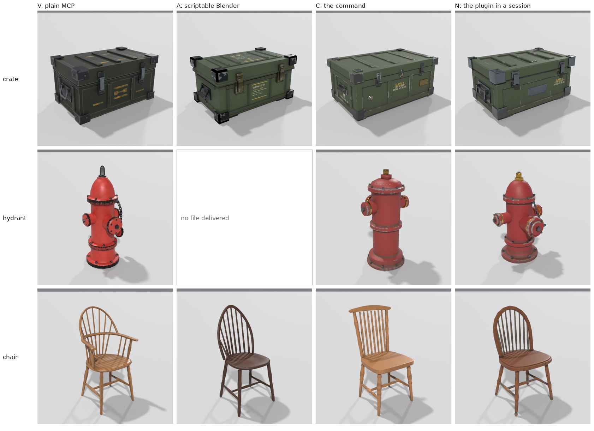

# Fifth round: against a stock agent with a Blender MCP server, row by row (2026-11-22)

The ask for this round was a system that does "100x better than the vanilla MCP systems" and solves real
developer-experience, quality and efficiency problems for game developers, with no limit on tokens. So this round
measures this project against two stock agents on three briefs, row by row, and fixes what was worse at its cause.

It is not a hundred times better, and no single number says how much better it is. The table says where it is
ahead, where it is level and where it is behind. The rule of the earlier rounds holds: remove waste and raise
quality, and never buy either by cutting capability.

## The short answer

Three briefs (a military supply crate, a cast-iron fire hydrant with a chained nozzle cap, a wooden Windsor
chair), four arms, no generated images for anyone. V is a stock Antigravity agent with a plain Blender MCP server,
A a stock agent with a scriptable Blender, C this project's command, N an Antigravity session with this project's
plugin. Each cell is one live run; values are crate / hydrant / chair.

| | V, plain MCP | A, scriptable Blender | C, the command | N, the plugin in a session |
|---|---|---|---|---|
| ended on its own with a package | yes / yes / stopped at its limit, file written | all three stopped at their limit; no hydrant file | yes / yes / yes | no / yes / yes |
| game-ready checks passed, of 11 | 10 / 9 / 9 | 9 / 0 / 8 | 10 / 11 / 11 | none / 11 / 10 |
| time to a package, seconds | 609 / 377 / 380 | 442 / 360 / 526 | 661 / 994 / 527 | (759) / 638 / 484 |
| tokens | 1.10 M / 0.69 M / 1.12 M | 1.15 M / 1.17 M / 1.13 M | 0.37 M / 0.45 M / 0.39 M | (2.42 M) / 1.16 M / 0.87 M |
| hand steps left before it is in a Godot level | 2 / 2 / 2 | 3 / none / 2 | 1 / 1 / 1 | none / 2 / 2 |
| installed into a Godot project and checked there by one command | not offered | not offered | yes / yes / yes | none / yes / yes |
| a change request left everything else alone | yes / no / no | yes / not run / no | yes / no / yes | not measured |
| the change request: seconds, tokens | 104-253 s, 0.41-0.57 M | 108-196 s, 0.33-0.43 M | 98-164 s, 0.06-0.09 M | not measured |
| says where every file came from | no | no | yes | yes |
| same request again gives the same files | not offered | not offered | no | not offered |
| blind judge, against V (verdicts won of those given) | | | 5 of 5 / 0 of 6 / 0 of 6 | none / 6 of 6 / 0 of 6 |
| blind judge, against A | | | 6 of 6 / no file / 5 of 6 | none / no file / 4 of 5 |

What it says:

- **Ahead.** The command's packages pass more of the checks a game needs (32 of 33 against 28 and 17), use a third
  to two thirds of the tokens, need one hand step instead of two or three, install into a Godot project with one
  command, and carry a manifest of where every file came from. A change request costs a sixth of the tokens and
  leaves the rest of the asset byte for byte alone on two briefs of three. The crate is preferred to both stock
  crates in every verdict, and the session's hydrant to the stock hydrant in every verdict.
- **Level or behind on time.** The command takes 9 to 17 minutes where the stock agents take 6 to 10. Six to
  nine of those minutes are the improvement rounds that give the crate its hardware.
- **Behind on the chair.** The plain-MCP stock agent built a Windsor armchair with a bent arm rail and fanned
  spindles; both of this project's chairs lose to it in every verdict. The command's hydrant also lost to the
  stock hydrant, on the brief's own words: its chain and bolted caps read less clearly.
- **Two of this project's six cells failed.** The session's crate got no answer from its delivery call
  and ran out of budget. The command refused its own crate for z-fighting between hidden faces; the package
  exists and is the one scored, but a script reading the exit code would have been told "not delivered". Both
  were fixed and run again, and both then delivered; the reruns turned up four more defects (three in the
  session's path, one that either arm could have met) and a fault in my harness. On the final code the
  command's crate and the session's crate each win 6 of 6 blind verdicts against both stock crates. See "After
  the final pass".
- **A repeat is not the same files.** The first designs are reused; the improvement rounds are not, because the
  judge's answers are not recorded and this judge does not answer the same way twice.

Every cell above is the final pass on commit b3459fd, except the stock arms, which ran once this morning. The two
failed crate cells were run again after their fixes; see "After the final pass".

In the picture the session's crate is the one from the rerun on the final code; in the final pass that cell
delivered nothing.

## How this was measured

Every arm runs in the same sandbox against the same model service and is read by the same scorecard
(`benchmarks/compare_eval.py`): the files each arm leaves are imported into Godot 4.7.2, loaded in three.js,
inspected by an independent Blender script, and measured. "Game-ready" is eleven such checks. Looks are judged
blind: a model is shown two contact sheets from the same renderer, without being told which arm made which, in
both orders, three times.

The judge inside this project's pipeline was the fallback model throughout. The calibrated judge is not served on
this key, so every score here is a general model's opinion and every package is labelled an unverified preview.

The scorecard was run three times. The first two passes are not in the table; what they found is.

## What the scorecard runs found on the way

Each of these was a failure a developer would have met, and none was caught by a test.

| found by | what a developer would have seen | cause | now |
|---|---|---|---|
| looking at a live crate's render | a three-line stencil label painted under the name plate | the test for "is something in front of this spot" used a 4 mm depth map and could not see a part 4 mm proud | exact rays against the asset's triangles |
| first pass, all briefs | one first design where the same command typed by hand proposes four and keeps the best | my comparison harness forced a single design whenever no image was allowed; the rule was older than the zero-image mode | the harness runs the command's default mode |
| first pass, hydrant | 16 minutes, 558,000 tokens, no package: three chain links touched nothing | the kernel warned about two of them all along and carried on; repairs were told a distance and a side, not a move | a detached part is moved onto its nearest neighbour, every finding carries the move that fixes it, and a design the final check will refuse stops after the design loop |
| first pass, crate | this project's own gate passed a package the independent Blender check fails | the gate exempted a detached piece that rests on the ground; a skid under the crate touched nothing in the exported file | the gate reads the script as the scorecard does; parts are left 1 mm into each other |
| first pass, repeat | the same request in a copy of its folder paid for a whole new design (298,912 tokens) | a first design rescued by a correction was recorded only under the correction's key | recorded under the request that was asked |
| CI on the first push | one of four test jobs died with a core dump | a refused edit cancelled its packaging task, but the worker thread kept writing the scene while the next attempt changed it | cancelled work waits for its thread before the scene is touched |
| a new test, run in company | in a long-running session, a package shipping the previous package's textures | the surface painter remembered what it had painted by memory address | held by reference, per thread |
| final pass, the session's crate | no answer from the delivery call; the agent spent 1.6 million more tokens looking for one | the client allows a tool call 180 s; the review's one judge call took 131 s | delivery answers within 150 s and the next call continues from where it stopped |
| the same run | four modelling calls answered with a Python error | sorting a report of unresolved faces compared None with a number | ordered by text |
| the same run | a review calling a steel-and-paint crate "CG plastic" | the review's render lit metal with two lamps and no surroundings, so metal rendered black | the review renders have an environment |
| final pass, the command's crate | 11 minutes, then "not delivered": z-fighting | an improvement round put four bolts wholly inside four pads; the kernel reported it as a warning and carried on | a part wholly inside another is removed after every patch; z-fighting the kernel reports stops the run after the design loop |
| rerun, the session's crate | a crate that is nearly black where olive drab was asked, losing every blind verdict | every tool reads a model's colour as sRGB since this round, and nothing a session reads said so; the agent converted its own colours to linear and they were converted again | the server's instructions and the two tools that take a colour say what a colour means |
| the run after that | five deliveries refused for "2 edges with inconsistent face winding", which names no part; the agent removed 16 parts looking for one and ran out of budget | this project's own step that tells parts apart before Blender's check reads them joined a top plate to the side plate it stands on, when the covered face between them had been left out of the file | a face whose partner was left out joins nothing; the same 67-part design passes |
| rerun, the session's change request | 260 s and 1.17 M tokens, nothing delivered; the agent's correct "I need your limits" was answered with "iterate and re-run QA" | my harness gave a reopened asset no limits; the delivery call then checked and rendered for 58 s before refusing with "fix what it names"; the stop hook did not know only the user could unblock it | the harness answers for both kinds of session; a session only the user can unblock says so before any work and may stop to ask |
| CI, after the final pass | the offline lamp post's base reported as floating on 15 seeds of 24, "repaired" by a move of 4 nanometres, and still read as not touching by Blender's check | a pole standing flush on a wider base ships without its bottom face, and whether the two touch is then a rounding error; the repair's first move for a part already on its neighbour was that rounding error | a part lying flush is set a millimetre into its neighbour; the lamp's pole is built that way |

Three of these are the same fault in different clothes: the kernel knew about a defect, called it a warning, and
let the run spend minutes on a design the final check was certain to refuse. That is fixed as a class for
detached parts and z-fighting. Two more are another fault twice: my comparison harness treated this project's
arms worse than a person at a keyboard would have.

## What changed in this round

### The author can describe real hardware

The scene format had boxes, cylinders, spheres and cones. It now has rounded edges and recessed panels, turned
parts, extruded parts, and `mirror` and `repeat` for parts that occur several times, all built by the kernel with
exact UV layouts and a triangle count known before anything is built. An answer that fails to read is corrected
node by node (3.4-5.2 s and 213-369 answer tokens per correction) instead of being thrown away.

### The author sees its design and improves it

A stock agent models, takes a screenshot, looks, and adds what is missing. This project's author wrote a whole
design in one answer and never saw it. It is now shown five views of its own design with every part numbered and
answers with a patch, four rounds by default. On the crate that is the difference between 44 parts and 74, and
blind the improved design is preferred to its own first version in every verdict.

### The judge compares two pictures far better than it rates one

The improvement loop and the look round both decided "keep or undo" from the difference between two ratings on a
0-4 scale. Three measurements showed that instrument is blind to changes a person sees at once: a crate that
gained ribs, a name plate and corner bolts moved from 2.75 to 2.81 and was undone; shown both versions, the same
judge preferred the improved one four times of four, and shown two identical pictures it answered "neither".
Keep-or-undo is now decided by showing the judge both states in both orders.

It also needs to be shown properly. Four separate 512 px views instead of one sheet doubled the gap between a
plain crate and a detailed one, and a crate with 26 real interpenetrations went from 0.11 to 0.83 on "parts
intersect".

### Surfaces without an image model

A run that may not generate images shipped flat colours. A material without an image now gets a surface computed
from the mesh: paint chipped at edges and corners, dirt where parts meet and near the ground, stencil markings
from a closed list of generic words chosen from the brief, every string recorded in the manifest. No model call,
the same bytes every time, 6 to 26 seconds.

Three corrections followed from blind comparisons. Dot patterns where letters would be were called "pixelated
gibberish text decals", so the markings became legible lettering. In-between metalness (64-90 % of texels, from the
author's numbers) became metal or not metal per layer (under 1 %). And the same per-texel noise in every normal
map, which read as "noisy surface artifacts" on anything dark, went: relief now comes from what happened to the
surface or from a material that has a texture of its own.

### Colours: the model writes sRGB

Every colour the model wrote in this round's live designs is right when read as an sRGB value and washed out when
read as the linear value the scene format stores: olive drab written (0.18, 0.22, 0.14) is #2e3824 as written and
shipped as #768169, a pale sage; hydrant red shipped as salmon, oak as pale tan. Thirteen materials of thirteen.

I took that for the cause of the pale look and got the fix wrong the first time. The same crate rebuilt with its
colours converted lost to the unconverted one 6 of 6, and the chair did the same. The judge's reasons were about
the generated surfaces: on dark paint the edge wear became "harsh, stylized white edge highlights". A pale base had
been hiding it. So the surfaces were corrected first, and the comparison run again, today's shipped look against
corrected surfaces with converted colours, four verdicts per brief: hydrant 4 of 4 for the new look, crate 2 of 4,
chair 2 of 4, and that crate 8 of 8 against the two stock crates. Nothing regresses and the hydrant gains, so it
ships: a colour a model writes is sRGB and is converted once, where its answer is read. The previous behaviour is
one setting away (`AGY3D_COLOUR_RULE=as_written`) and is pinned byte for byte by a test.

### One atlas, one draw call, and an install command

All opaque materials of a prop are laid out in one UV space and baked into one base colour, one normal and one
ORM map: one material, one draw call, the smallest atlas that holds the surface at the target density. `agy3d
install` puts the package into a Godot project as one scene with one shared material resource for every level of
detail, and checks it there.

### A change request edits the asset instead of replacing it

`agy3d edit OUT "<change>"` opens the asset as it shipped, shows the author the views and the instruction, takes
a patch, checks part by part that the patch did what was asked and nothing else, and delivers a new package with
the old one kept (`--undo` restores it). Parts the request does not name keep their geometry byte for byte and
their place in the atlas, so the pixels under them do not move.

In the final pass the three change requests took 98, 115 and 164 seconds and 62 to 86 thousand tokens. The
hydrant's ("make the chained nozzle cap 30 % larger") changed three parts it should not have.

### A developer can see what is happening, and the exit code means something

The call that writes a design is streamed: calls of up to 431 seconds completed where a 300-second limit used to
cut them, and the command prints which call is running, on which model, and what it is thinking about. Behind a
proxy that buffers responses it falls back to an unstreamed call instead of stalling.

Exit 0 means a package was delivered, every deterministic check passed, and the review ran. What an uncalibrated
judge found is printed as findings. `--strict` turns findings into exit 3.

### A session inside Antigravity

Traced before this round, the agent in a session never saw its design: the preview tool returned a line of text.
It now returns five views with numbered parts as pictures. Eight live runs on the crate found these causes:
the agent painted its own textures because nobody had told it surfaces are generated; the stage walk took thirty
model calls; an instruction to use "as few calls as it takes" produced one reply cut off at the output limit; the
tools the instructions named were not in the list the agent could see, so it scripted Blender instead; the review
flagged this project's own stencils as a text risk; the agent copied the package by hand and left the colliders
out; and those in the table above. `deliver_package` is now one call that checks, renders, reviews and
exports into the folder the user named, says which of three outcomes happened in its first word, and refuses in a
tenth of a second what it used to refuse after ninety.

A session uses more tokens than the stock agent on the hydrant and fewer on the chair; about three quarters of
them are cache reads. Of every call's fixed 19,700 tokens about 8,000 are not needed: two rules the comparison
sandbox injects whatever their file pattern, and built-in tools a modelling session never uses. Both belong to the
host's configuration, not to the plugin.

### Security: a package is data

A review bot on the pull request reported that `agy3d install` trusted file names from a package's manifest. It
was right and it was worse than reported: a manifest entry could write into the project root, an asset name could
too, and a tampered install record or a material name made uninstall delete files outside the destination. Every
name from a package, an install record or a stock agent's delivery now passes one module
(`antigravity3d/safe_paths.py`). The same rules were applied to `agy3d edit` on a package and to the comparison
harness, which evaluates on the host what a sandboxed agent delivered. 46 tests, each failing before its fix.

**An incident while doing this.** The first failing test for the uninstall case put the absolute name
`/etc/hostname` into a tampered install record and ran the unfixed uninstall, as root, on this sandbox. It deleted
the sandbox's `/etc/hostname`. The engineer reported it at once; I restored the file with the kernel's hostname
(I cannot prove the original content was the same string). Nothing outside the sandbox was touched and nothing in
the repository. Tests that hand a destructive call a path now use only temporary folders, as a written rule.

### Skills are tested as skills

Each skill's description is scored against requests that should and should not trigger it: precision 0.74 to
0.84, recall 0.91 to 1.00. The same author wrote the requests and the descriptions, so this is a fit, not a test;
eighteen held-out requests were added afterwards and were not re-scored on the final tree.

## After the final pass

The two crate cells that failed were run again after their fixes, in the same sandbox with the same limits. Each
column is one run.

| | the command's crate | the session's crate, first rerun | the session's crate, final code |
|---|---|---|---|
| ended on its own with a package | yes, exit 0 | yes | yes |
| game-ready checks passed, of 11 | 11 | 11 | 11 |
| time to a package | 598 s | 429 s | 304 s |
| tokens | 0.38 M | 1.11 M | 0.58 M |
| model calls | 30 | 19 | 12 |
| hand steps left before it is in a Godot level | 1 | 2 | 2 |
| installed into a Godot project and checked there | yes | yes | yes |
| a change request left everything else alone | yes: 54 parts untouched, 14 changed | yes on the second attempt: 56 and 14 | not run |
| the change request: seconds, tokens | 102 s, 0.07 M | 279 s, 1.15 M | not run |
| blind judge, against V | 6 of 6 | 0 of 6 | 6 of 6 |
| blind judge, against A | 6 of 6 | 0 of 6 | 6 of 6 |

The first two columns ran together on a quiet machine on commit ece31a7. The third ran alone on commit 46112b1
while one test process was running, so its time is if anything overstated.

With these, each of this project's six cells has ended on its own with a package that passes its checks: 11, 11
and 11 of 11 for the command, 11, 11 and 10 for the session.

The session's first rerun delivered and then lost every blind verdict to both stock crates. Looking into that
found the following.

**Nearly black where olive was asked.** Since this round every tool reads a colour a model writes as sRGB. The
command's request says so; nothing a session reads did. The session's agent wrote olive drab as
(0.22, 0.27, 0.16), then on its second pass converted its three materials to linear values itself, and they were
converted again. In all nine live sessions on record that had not been told, the first colours written were sRGB
(27 materials of 27); this was the one that then converted. The server's instructions and the two tools that take
a colour now say what a colour means and that the tools do the conversion. In both runs since, the agent wrote
`#3d4a2b`.

**Five deliveries refused for a defect the design did not have.** The run after that fix was refused with "2
edges with inconsistent face winding". The sentence names no part; the agent removed 16 parts looking for one and
ran out of budget. Reduced to two boxes, it is a top plate standing flush on a side plate, which is how a corner
guard is built. Before Blender's check reads a file, this project tells its parts apart so that two parts in
contact are not read as one surface, and that step joined the two plates when the covered face between them had
been left out of the file. It is fixed, and the same 67-part design passes with 67 parts found. The command can
build the same corner guard, so this was a failure waiting in both arms.

**The session's change request**, measured in this round for the first time, delivered nothing on its first
attempt. My harness answers a new session's question about the user's limits, because nobody can be asked in a
headless run; it did not answer for a session reopened on an existing asset, and on this key such a session cannot
deliver. That part is the harness's fault and is fixed. Two things then went wrong in the plugin itself: the
delivery call checked and rendered for 58 seconds before refusing with "fix what it names with apply_scene_ir",
when nothing the agent could change would have helped; and when the agent reported, correctly, that it needed the
user's limits, the stop hook told it to "iterate lookdev/blockout and re-run QA". A session that only the user can
unblock now says so before any work, and both stop hooks let the agent stop to ask.

On the second attempt the change was delivered and touched only what was asked. It took 279 s and 1.15 M
tokens: between two and three and a half times what the stock agents' change requests used (0.33 to 0.57 M) and
sixteen times the command's. The agent read seven tool descriptions, both copies of a 1,600-line manifest and the
scene file, and ran three inspection scripts, before sending a six-operation patch; every later call carries all
of that. This is not fixed.

On the final code the session's crate took 304 s, 0.58 M tokens and one delivery call, against 609 s and 1.10 M
for the plain-MCP stock agent and 442 s and 1.15 M for the scriptable one. That is one run, and the session's
hydrant and chair were not run again on the final code.

## What is still worse, or not done

- **The chair.** Both of this project's chairs lose to the plain-MCP stock chair in every verdict. The scene
  format has no bent rod, and the author builds a plainer chair than the stock agent does with Blender's own tools.
- **Time.** 9 to 17 minutes for the command against 6 to 10 for a stock agent.
- **A repeat is not the same files.** The judge's answers are not recorded, so a rerun's improvement rounds can
  differ from the first run's.
- **The hydrant's change request** changed three parts it should not have.
- **A change request in a session costs 1.15 M tokens**, more than a stock agent's, because the agent reads the
  package's files before it edits. The reply that opens an existing asset should carry what the edit needs (part
  names, sizes and positions) so that nothing has to be read; it does not yet.
- **A session never sees its colours.** Its previews are clay with numbered parts. The command has a look round
  that shows the author the asset as it ships; a session has none, so it chooses paint blind and only the judge
  sees the result.
- **A refusal from the Blender check can name no part.** "2 edges with inconsistent face winding" is all the
  agent gets. The false case is fixed; a true one would still leave the agent guessing.
- **The judge is uncalibrated on this key.** Nothing in this round changes that.
- **Stage agents built on the SDK still get text only.** The MCP path returns pictures; the SDK path does not yet.
- **The look round is not part of `agy3d edit`.**
- **Generated surfaces over image-textured materials** were not tested: the image allowance was spent.
- **A plain smooth prop's normal map reads "flat" to the scorecard's maps check.** That check counts a flat
  normal map against every arm; for a surface that is smooth it is the right picture and a wasted texture.
- **One in-between metal number is still wrong in kind**: a model that writes "dark gunmetal, metallic 0.85"
  means a dark coated steel, and only the generated surfaces correct that; a flat material ships what was written.
- **One offline lamp post fails the web check.** `agy3d prop "old gas lamp post" --offline` exits 1: its
  three.js silhouette agrees with the reference to 0.94 where 0.98 is required (three other lamp prompts: 0.999).
  It did the same at the start of this round; found while checking the lamp fix, not fixed.

## Decisions for you

1. **What exit 0 means.** A package was delivered, every deterministic check passed, and the review ran; a missed
   score under the uncalibrated judge is a finding. Your paired-pilot note says "failed CLI gates remain failures
   when a diagnostic GLB exists". Those two disagree for a clean package the fallback judge scores 2.6 of 4.
2. **A package the Blender check fails for something invisible.** Today that is "not delivered", exit 1, with the
   package on disk. Removing wholly hidden parts now prevents the case that occurred. Whether a detached or
   z-fighting part that survives should withhold the delivery or be delivered with a finding is yours to decide.
3. **A session's delivery when the review is slow.** Today: "not delivered, call again", and the second call
   continues. The alternative under an uncalibrated judge is to deliver and attach the review when it arrives.
4. **Colours are read as sRGB by default**, on the evidence above. `AGY3D_COLOUR_RULE=as_written` restores the
   old reading.
5. **Stencil lettering on generated surfaces**: generic words from a closed list, on by default.
6. **Generated surfaces are the default** for a material without an image (`--surfaces flat` turns them off).
7. **A package carries a `sources/` folder** so it can be edited later without the run folder: nothing for
   generated or flat surfaces, 18.5 MB per image-textured material.
8. **Four improvement rounds by default.** They add six to nine minutes and are what gives the crate its hardware.
9. **`agy3d edit` refuses a package that contains a symbolic link**, and a moved run folder whose report still
   names files outside it.
10. **A session may open a package at any path the agent names.** Limiting that to the workspace is a product
    decision; I left it.
11. **Your paired pilot** (`--paired ... --allow-c`) was not run. Your note says it needs your approval.
12. **Images.** 29 of the 30 allowed are used. Every measurement here was made with none.
13. **A session reopened on an existing asset asks for limits again.** On a key without the calibrated judge each
    new session needs the user's token ceiling and image limit before it can deliver, also when an earlier session
    delivered the same asset as a preview. Say if a package should carry that consent with it.

## Mistakes in this round's process

- I called the colour mismatch the root cause of the pale look before measuring the fix; the first measurement
  said the fix made things worse, and it took two corrections to the surfaces before it did not.
- My comparison harness ran the command with one first design for a whole pass because of a rule I had not
  revisited when the zero-image mode was added.
- I told you in a status line that triangle outlines had hidden a missing part on a hydrant; the measurement
  showed the opposite.
- A probe script was run while its author was still editing it; the calls were paid for and their results lost.
- While merging, a comment inserted in the middle of six assert lines silently cut each of them short. Found on
  review and restored.
- Four test runs started at once on a machine whose shells share 14 GB; the system killed one.
- Late in the round I merged a stricter contact rule and a new gate without a test list that covered every
  end-to-end offline run; seven tests failed on the merged tree and were fixed before the push.
- Three pushes late in the round went out with red CI. My test runs for them all had Blender, Godot and a browser,
  so none covered what CI's unit jobs run with (none of the three), and after two late merges I ran only part of
  the engine job's test file. Seven tests were affected: three expectations that had not followed a deliberate
  change, two that assumed a browser, one renamed test still named in a required list, and one real defect (the
  lamp row above). Both whole suites are now run in both configurations before a push.
- Chasing the lamp defect I first made the kernel's contact rule stricter. A survey of 60 random flush contacts
  against the real Blender check showed the existing rule already never passes what Blender refuses, and the
  stricter one would have moved every lid lying flush on a body. I took it out and fixed the repair instead.
- The colour change went into the session's tools without a word to the session's agent about what a colour now
  means. I had checked the wording of the command's request and not what a session reads. It cost the session's
  first rerun every blind verdict.
- The harness again: it did not give a reopened asset the limits it gives a new one, and the session's first
  change request failed for that.
- A commit message of this round says six sessions and 18 materials where the records show nine and 27; the
  code comment and this report have the right numbers.
- The `/etc/hostname` incident above.

## What was verified, and how

- Every change was tested by its author on the files it touches and again by me on the merged tree.
- The whole suite ran in full on the first pushed head of this round (engine set 457 of 457 with real Blender 5.3
  and Godot 4.7.2; unit suite 2,365 passed; with a browser 2,430 passed) and again on the final code, commit
  79f7fac: engine set 461 of 461, all 104 tests the engine job requires among them; unit suite as CI's unit jobs
  run it, without engines or a browser, 2,498 passed and 1 failed. The one failure is a subprocess test with a
  30-second limit that timed out while the engine set shared the machine; run alone it passed three times of
  three. After that commit one code comment was corrected (the 67 tests around it pass) and this report added.
- CI was red on the first push (the core dump in the table), green on the second and third, and red on the four
  after them: three for the reasons under "Mistakes", the fourth for one timing assertion in one job of five, in a
  test from this round, now fixed. The final head's result is on the pull request.
- Every number in the tables comes from files in `results/round5/`: the harness's records and scorecards for each
  pass and each rerun, and each blind verdict with the judge's words.
- Six verdicts per pair is a small sample, and this judge reverses itself on close pairs.
- Nothing in this round generated an image.
