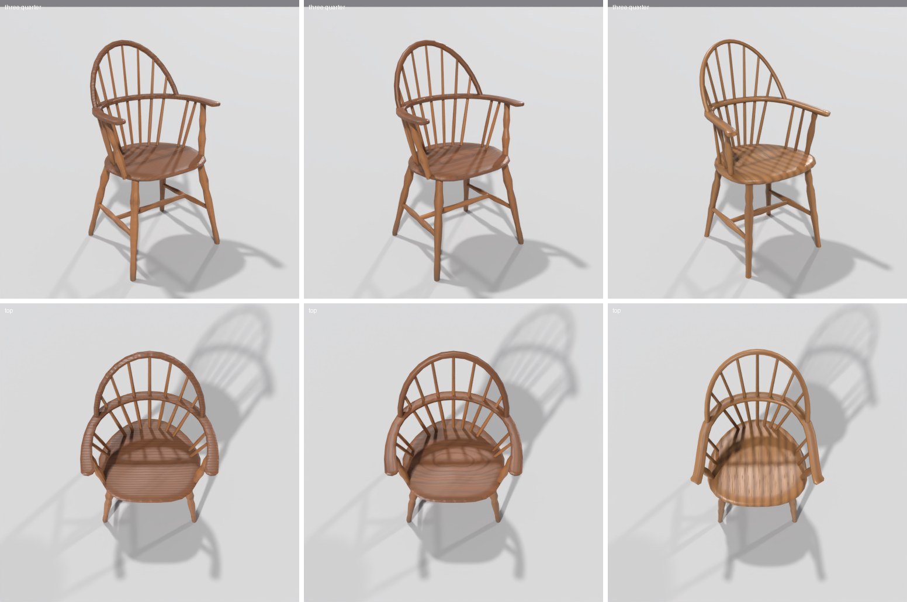
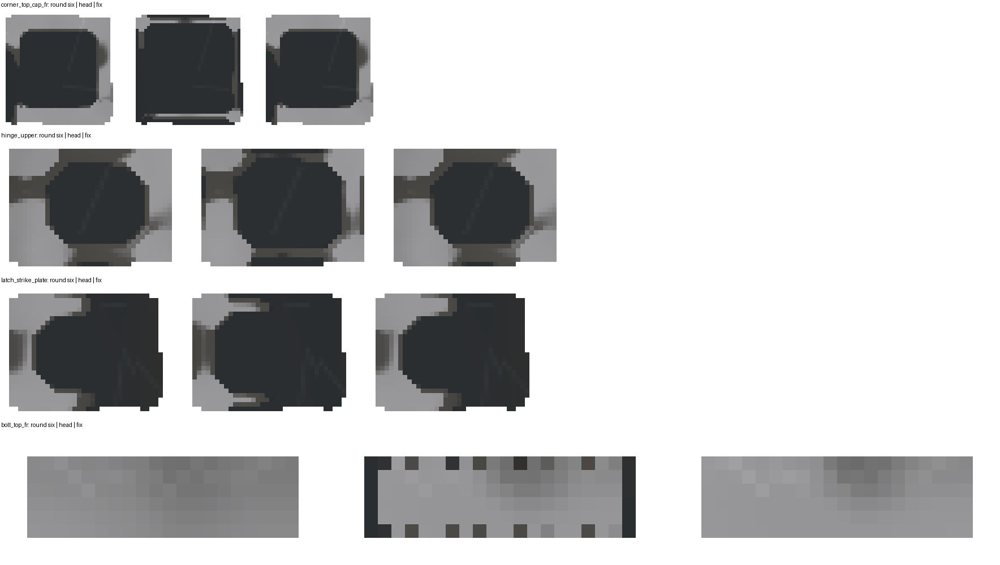
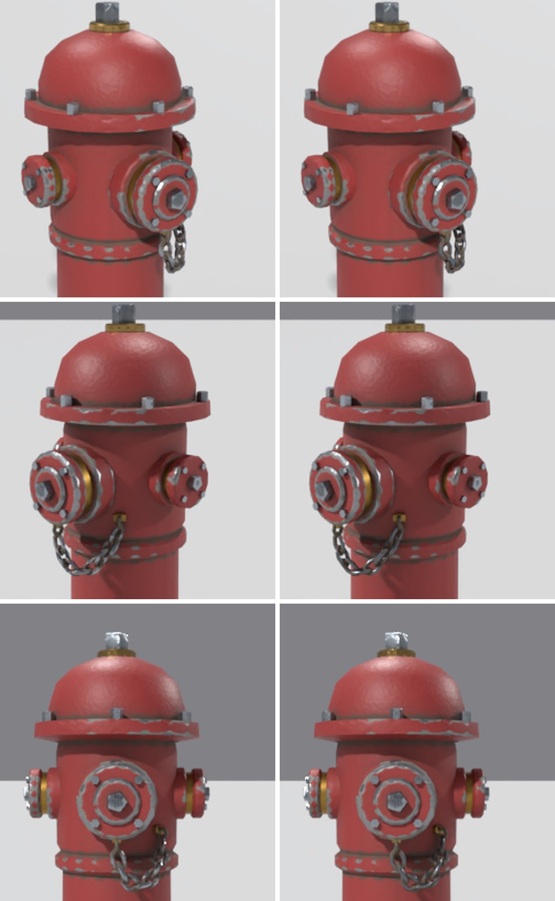

# Seventh round: three.js as a real target, surfaces that know the part, a front page for developers (2026-11-23)

Round six ended on two findings. The wooden chair lost every blind verdict to a stock agent's chair, and the cause
was the surface this project paints, not the shape. And a web project was detected and then turned away: nothing
could be installed into it. The owner said "go for it" to both, and asked for the repository's text to be
rewritten around "how its useful for devs not a laundry list of text".

As in round six, what would count as a pass was written before any code: `results/round7/measures.md`, with the
time each part was written. Three parts were written after a first number was known, and say so.

**Two of the three pieces did not meet their measure.** The three.js install works end to end and can be undone,
but its files are not half the size. The new surfaces make the chair clearly better, and were to leave the other
two props "not worse": measured twice, they missed that once on the crate and once on the hydrant. By the rule
set beforehand, the step that was to be built on them (a surface written as a function) was not built, and what
happens to them is the owner's decision. The numbers follow; the decisions are at the end.

## The short answer

| | measure, written first | result |
|---|---|---|
| three.js: one command installs it | every check passed, one hand step left, in two projects | **met**: 6 of 6 installs |
| three.js: it renders in the project's own three.js | no error, outline, materials, levels switching | **met**: 11 checks each, 12 with React Three Fiber, none failed or skipped |
| three.js: half the bytes, no visible difference | at most half of today's bytes, inside a fixed tolerance | **not met**: crate 50.4 %, chair 54.4 %, hydrant 81.6 % of today's bytes |
| three.js: undo | the project byte for byte as it was | **met**: 6 of 6 |
| surfaces: the chair | new preferred to round six's in at least 5 of 6 blind verdicts | **met**: 6 of 6, twice |
| surfaces: crate and hydrant not worse | at least 3 of 6 each | **not met**: crate 2 of 6 the first time; hydrant 0 of 6 the second |
| surfaces: checks and delivery time | 11 of 11 game-ready checks; within 10 % | **met** both times: 11 of 11; +2 % to +6 % |
| a surface written as a function | only if the surfaces pass | **not built** |
| the README | no number: read as a developer; nothing lost | done |

Beside the measures, the result the surface work was started for. The props are round six's own, their meshes
untouched, repainted by the new code and judged against the stock agent's props of round five:

| against the stock agent's | round six | round seven, first version | round seven, corrected |
|---|---|---|---|
| crate | 6 of 6 | 6 of 6 | 6 of 6 |
| hydrant | 5 of 5 | 6 of 6 | 6 of 6 |
| chair | **0 of 6** | 5 of 6 | 2 of 5 |
| chair, the judge's line for surface and material | 0 of 6 | 6 of 6 | 5 of 5 |

The chair went from losing every verdict to about even (7 of 11 over the two measurements), and its wood is
preferred to the stock agent's hand-written wood every time. The verdicts it still loses name its shape.



*Left, round six. Middle, the same mesh repainted in round seven. Right, the stock agent's chair.*

## three.js as a real target

What a web developer does now:

```bash
agy3d prop "military supply crate" --engine web_three --preview --token-ceiling 600000 --max-images 0 --out out/crate
agy3d install out/crate/runs/<id>/package --project path/to/your/web/app
```

```js
import { loadMilitarySupplyCrate } from "./agy3d/military_supply_crate";
scene.add(await loadMilitarySupplyCrate({ renderer }));
```

- The asset's files go where the dev server serves them unchanged (`public/agy3d/<asset>/`). A loader with type
  declarations, and a component when the project has React Three Fiber, go into the source tree. The loader
  returns a `THREE.LOD` that follows the camera, the collision hulls as plain arrays for a physics library, the
  bounds, and a function that frees what it made.
- The install then runs that loader in a headless browser with the project's own three.js and reports eleven
  checks (twelve with React), as the Godot install reports seven. `agy3d uninstall` removes exactly what was
  written, and an install record edited by hand cannot make it touch any other file.
- `web_three` is a fifth package target. For it the three.js check is the engine check, required as the Godot
  import is for a Godot package.
- It was run on three.js 0.152.2, 0.160.0, 0.169.0, 0.170.0 and 0.187.0. Outside r152 to r187 the files are
  written and the result says "not checked on this version".

Measured: the three props of round six, delivered for the web by changing only the engine name in their scripts,
installed into two projects made with the standard tools (Vite with three.js 0.170.0; Vite with React Three Fiber
on three.js 0.169.0).

| | crate | hydrant | chair |
|---|---|---|---|
| checks passed, Vite / React Three Fiber | 11 / 12 | 11 / 12 | 11 / 12 |
| uninstall leaves the project byte for byte | yes / yes | yes / yes | yes / yes |
| today: the highest level's file, bytes | 2,199,072 | 1,836,004 | 1,039,268 |
| the asset's files, compressed, bytes | 1,108,978 | 1,498,985 | 564,915 |
| of today's | **50.4 %** | **81.6 %** | **54.4 %** |
| a page with this one asset, transcoder included | 77.0 % | 113.5 % | 110.6 % |
| what the default (`--compress auto`) does | compresses | leaves PNG | compresses |
| install seconds, without / with compression (Vite) | 4.8 / 39.2 | 2.3 / 102.4 | 2.5 / 20.5 |
| graphics memory for the textures, MB, computed | 33.6 to 5.6 | 16.8 to 4.2 | 8.4 to 1.4 |

One run per cell, made while other jobs were using the machine. Every number and each check's detail:
`results/round7/web_install.md` and `web_install.json`.

**Half the bytes was not reached, and nothing was loosened to reach it.** Textures are compressed to KTX2 only when
a frame rendered from the compressed files stays inside a tolerance against the frame from the uncompressed ones
(mean difference 1.5 %, at most 1 % of the asset's pixels more than 8 % off, outline 0.999), fixed before the first
compressed file existed. Encodings are tried cheapest first. For the crate and the chair the cheapest one is inside
it (0.86 % and 0.10 % of pixels over, against a limit of 1 %). For the hydrant the cheapest is outside (5.62 %),
the next too (3.01 %), and only the largest is inside (0.14 %).

Three things to know about that number:

- **The gain that is real is graphics memory, and this machine cannot observe it.** Block-compressed textures stay
  compressed on the graphics card: 33.6 MB to 5.6 MB for the crate, 16.8 to 4.2 for the hydrant, 8.4 to 1.4 for the
  chair, computed from the texture format. The renderer here is software, so that is arithmetic, not a measurement.
- **The textures this project paints are already small as PNG.** Flat paint with fine noise compresses well
  without loss, so there is less to win than on photographs.
- **A page with one asset also downloads the transcoder** (584,862 bytes, once per site). Whether that counts was
  decided after the first trial number was known, and the measures file says so: the asset's own files are
  judged, the one-asset page is reported, and a page larger than today's file counts as a failure for that
  asset. By that rule compression fails for the hydrant and the chair and holds for the crate. The default
  (`--compress auto`) asks a narrower question, like with like: is the compressed install, transcoder included,
  smaller than the PNG install? For the chair it is, by 2 %, with a sixth of the graphics memory, so it
  compresses; for the hydrant it is not, so it does not.

The fixed tolerance may be stricter than an eye needs. It was not relaxed.

## Surfaces that know the part they are on

The painter that makes surfaces when no image model may be used did not know what it was painting. Grain was
rings round one straight line per part, the same 11 mm apart on a 14 mm spindle and a 45 cm seat. A rod with few
sides was painted, and shipped, as all edge. Relief sized for a crate panel landed on a spindle.

Now every part tells the painter how it runs: a tube its path, a loft the line through its sections, a ready
shape its axis, and an author can say it (`grain="x"`, or a vector, on every shape of the script API). Round
parts are round in one place for shading and painting alike. Wood is painted from how wood is made: fibres along
a rod, rings on its cut ends, long uneven lines on a board sawn from a log wider than itself.

Measured with no model writing anything. The three scripts of round six were delivered again with the old code
and the new, so the meshes are identical and only the surface differs. Blind judge, both orders, three times:
six verdicts a pair. The whole thing was done twice, on fresh deliveries and fresh verdicts.

| new against its own round-six surface | measure | first version | corrected version |
|---|---|---|---|
| chair | at least 5 of 6 | 6 of 6 | 6 of 6 |
| crate | at least 3 of 6 | **2 of 6** | 3 of 6 |
| hydrant | at least 3 of 6 | 4 of 6 | **0 of 6** |
| game-ready checks, all six packages | 11 of 11 | 11 of 11 | 11 of 11 |
| delivery time, chair / crate / hydrant | within 10 % | +3 % / +3 % / +3 % | +6 % / +2 % / +2 % |

**The first failure, on the crate, was a real fault.** The judge preferred round six's crate for "sharper edge
wear" on the corner guards and "grime details in the crevices". The cause, found in the textures before anything
was changed: the first version limited wear and relief by a part's thinness. That is right for a rod, which is
thin in two directions. A corner guard is a plate, thin in one, and its thinness says nothing about how far wear
reaches across its face. Three quarters of the change on the crate's steel plates was that narrowed wear band;
most of the rest was grime lightened for every material when only thin rods needed it. The rule now uses a
part's size across (a rod's diameter, a plate's width). The crate's panels and plates are round six's again,
most of them byte for byte, and the judge now calls the two crates "visually identical".



**The second failure, on the hydrant, is a tie-break.** Three of its six verdicts say the two sheets are
identical and take the first image, which was round six's. The other three, asked with the new one first, prefer
round six's by what the judge itself calls a "marginal" or "negligible" margin: "marginally crisper surface
texture detail", "marginally cleaner mesh shading on small hardware details". Per criterion the six verdicts read:
surface 5 ties and 1 for round six, defects 4 ties and 2 for round six. What still differs on the hydrant is
small: its bolts and nuts (9 % of its surface) carry less grime and are a little shinier, and its chain links
(3 %) are painted as round rods instead of pale worn metal all over. The cast-iron body is round six's.



Two things about the measure itself, neither changed after the fact:

- **"At least 3 of 6" is close to a coin flip when two sheets are equal.** On near-identical pairs the judge took
  whichever image came first in 5 of 6 verdicts the first time, for the crate and the hydrant alike. Asked in
  both orders that gives 3 of 6, give or take one. I should have tested the judge on two identical sheets before
  choosing that threshold.
- **So the texture files say more than the verdict count.** After the correction, by kind of part, against round
  six (`results/round7/texture_difference_by_kind.txt`): the crate's panels, gasket and plates differ by 0.00 to
  0.09 of 255 levels on average; its thin round rods (2 % of its surface) by 25, on purpose, by the rule that
  fixed the chair's spindles. The hydrant's body differs by 0.24; its bolts by 6; its chain by 17.

By the rule written before the correction existed, a second failure ends it: the surfaces have not met their
measure, and the next layer is not built.

## The chair against plain Blender

This is what the surface work was for, and it is the clearest result of the round. In round six the chair lost
6 of 6 to the stock agent's chair, on "lumpy relief" and "repetitive banding". Repainted, the same mesh is
preferred in 5 of 6 verdicts the first time and 2 of 5 the second (one call came back with a server error):
7 of 11.

On the judge's line for surface and material, the new wood is preferred to the stock agent's in all 11: "more
natural wood grain", against "overly thick, repetitive stripe texture on the seat". The verdicts the chair loses,
it loses on defects: "lumpy, uneven deformations on the armrests, spindles, and stretchers", "visible polygon
faceting along the arched back hoop". That is the mesh an agent wrote in round six: legs turned as eight-sided
rods through ten radii, a hoop of sixteen straight steps. The paint is no longer the gap. The shape of turned
and bent rods is.

## What else was found and fixed on the way

- **A run that had to be verified could be started for a target that can never be verified here**, and failed
  only at its last step, after paying for every model call. Unreal is the default target, so this was the default
  command on a key with the calibrated judge. Such a run is now refused before any call, with the command for a
  preview and the targets that can be verified on the machine. A session is told at its opening, and its paid
  tools refuse.
- **Roblox sessions rejected every design**: the up-axis rule was applied to the Z-up working stage.
- **The delivery line said "imported" when the engine check had not run.**
- **The same script could give different files** depending on what the session had built before it. The stage
  kept parts in the order they were first added, not the order the design lists them. Round six's crate could
  not be reproduced from its own script; now it can.
- **A shipped USD file held the developer's folder paths.** Every free-form part was named by its absolute path
  in the workspace: 46 times in the chair's USD. A published package told the reader the author's directory, the
  file differed between two machines, and the package could not be opened again once that folder was gone.
  Worse, `agy3d edit` on any package with a free-form part stopped at its first budget check, folder or no
  folder. A package now carries its part files (`parts/`, named by content), and a scan of every shipped file
  for the workspace, the home directory and the session id is a test.
- **Opening a package could read files outside it.** An independent review of the fix above, made before it was
  pushed, found three ways: a part given by a relative path was copied from wherever the command happened to be
  run, a part in USD form could pull in any layer it named, and the package's own USD could do the same, which
  it could before this round too. A package is now checked by what its files contain, before anything opens
  them: a part must be one file of a format that names no other (`.ply`, `.stl`, `.glb`, `.obj`), read once,
  hashed, and proven to be a mesh from those same bytes; the package's USD must be the flat single file this
  project writes. Every refusal is a sentence that names the part.
- **An install wrote the package's local path into the game project** (`.agy3d/install.json`, which a developer
  commits): since round five for Godot, and always for the new three.js install. Found by the same review. The
  record now names the package relative to the project, or only by its folder's name when a relative path would
  cross a home directory, and the check's report in the project is written without machine paths.
- **A material with little detail was packed at half the texture density** and failed the texel-evenness check by
  a hair (round six's open item): fixed in the layout.
- **USD normals disagreed with the GLB's** under a non-uniform scale.

## What a developer will see that is different

- Wooden props look different. Cylinders, cones, capsules and lathes of seven or more segments, and all tubes,
  ship smooth round their axis in both install modes (`ROUND_MIN_SEGMENTS`).
- Thin round rods of metal (handle bails, chains) are painted as rods with worn ends, not as worn metal all over.
- A command or session for Unreal, Unity or Roblox that is not a preview is refused at the start, not at the end.
  Previews, which is every run on a key without the calibrated judge, are untouched.
- The delivery line's wording for an engine check that was skipped.
- A package folder has a `parts/` folder when the asset has free-form parts. Packages written before this round
  with such parts cannot be opened for an edit; the refusal says to build them again from their script.
- An install record names its package relative to the project, not by an absolute path. Old records still work.
- A first install into a three.js project with the compression packages present takes 20 to 100 seconds (2 to 8
  without compression).

## What is still worse, or not done

- **Half the bytes on the web**, as above.
- **The surfaces did not meet "not worse"**, as above, by a tie-break on the hydrant.
- **The chair's shape**: turned legs and spindles built as few-sided rods read as lumpy, and bent rods as faceted.
  The script API interpolates a rod's radii in straight lines between its points.
- **The default mode's chair has not been judged again.** Its primitives go through the same painter, and a test
  shows the same rules apply there, but round seven's verdicts are all on the script mode's props.
- **Unreal, Unity and Roblox** are still exported by the rules and never opened. That needs machines and
  licences, and is the owner's decision.
- **Live shaders per runtime** (the third step of the plan) have not been started.
- **A part whose mesh file is not one file** (a `.gltf` with a separate `.bin`, any USD file) is not carried in
  the package; the manifest says so and a re-open is refused by name, with the formats that do travel. A part
  that is a USD file cannot be delivered at all, before this round as now.
- **There is no size limit on a part file**, as there is none on a mesh a user supplies.
- **One package per side per comparison, a general model as judge**, as in every round so far.

## Decisions for you

1. **The surfaces.** They missed their measure twice on "not worse", for a different prop each time, the second
   time by tie-breaks on a pair the judge calls identical. They also turned the chair from 0 of 6 into about
   even, with the wood preferred every time. Three choices: keep them as they are; narrow the size rule to round
   rods only, which would make the crate and the hydrant round six's except for their thin rods, and measure a
   third time; or revert them (one commit). I recommend keeping them.
2. **A surface written as a function.** Not built, by the rule. If you want it, what it would be: one optional
   function per material in an asset script, called once with what every point of the surface knows (where it is,
   which part, where along and across that part, how near an edge or a crease, how open to the sky) and the
   generated surface to start from; run where the script runs, never in the server; checked on a sample at
   `run_build` so a fault is found there; shown to the author in painted views; kept only if a chair painted with
   it beats the same chair painted without it in 4 of 6.
3. **The next gain on the chair is its shape, not its paint**: smooth interpolation of a rod's radii and enough
   steps along a bend, in the script API. Small, and measurable the same way.
4. **The compression tolerance.** Fixed today. A setting would let a developer trade a visible difference for
   bytes; I would keep the default and add the setting only if someone asks.
5. **The default engine.** `unreal_5` can only ever be a preview on this code. `godot_4` is the one engine a
   package is opened by, installed into and verified in. I recommend making it the default; I did not change it.
6. **`qa.revision` in the manifest** is a random token per session edit, so no two deliveries of one design have
   the same manifest. A value derived from the content would make the whole package reproducible and would let
   anyone check the receipt. It touches the export gate, so I left it.
7. **Steps three and four of the plan** (live shaders per runtime; Unreal and Unity opened for real) wait on the
   first two decisions and on machines and licences.

## Mistakes in this round's process

- **I wrote "thickness" into the surface contract where I meant how wide a part is across.** The first version
  did what I wrote, and the crate paid for it. The measure caught it. The reviews had not, because they were
  checking the chair.
- **The threshold for "not worse" was a coin flip for equal images**, and I found that out from the first
  result instead of before it.
- **Three parts of the measures were written after a first number was known**: how the transcoder counts, the
  rule for a second attempt, and the second attempt's result. All three are marked in the file.
- **The whole unit suite was run late.** Thirteen tests had been broken for hours by the refusal of unverifiable
  runs and by web tests that needed a browser package, in files the builders' own runs did not include. Nothing
  had been pushed.
- **The fix for local paths in a package needed four passes.** I merged its first version on its author's tests,
  sent two edges back myself, and an independent review then found three more faults in it, two of them serious.
  None of it was pushed in between. Changes to what a package may read deserve that review before the merge, not
  after.
- **Two whole test suites and three builders ran at once and filled the disk**: each web-install test copies a
  project, and the temporary folders reached 15 GB. Two suite runs died and had to be repeated. Suites now run
  one at a time and remove their temporary folders.
- **My notes carried clock times I had estimated**, which ran ahead of the real clock. No time in this report
  comes from them.

## What was verified, and how

- Both whole suites on the final tree, one at a time: the engine set with Blender, Godot and a browser (629 passed,
  all 112 required names present), and the whole unit suite without a browser, a browser package or engines (3,025
  passed, 183 skipped, 1 failed: a timing test of the parallel sanitiser that passes when run alone, as in round
  six).
- Reviews by reproduction of the web target, the install and the surfaces before each was merged, and an
  independent attempt to break the two late fixes (the order of parts; a package's own parts) before they were
  pushed: six findings, all fixed. What it tried and could not break: no local path in any shipped file, the same
  design giving the same bytes in both install modes, edits of a moved package, tampered install records.
- Live: 72 blind judge calls (71 verdicts, one server error), about 243 thousand tokens. No agent run and no
  generated image: every delivery this round is one of round six's scripts, offline.
- The install measurement twice, before and after the surfaces changed the textures; the numbers above are the
  second, on the final code.
- By hand, on the merged tree: 22 forged install records refused with nothing removed; no model call made before
  an unverifiable run is refused; the GLB, level, collider and texture files the judge saw are byte-identical to
  what the final tree delivers.
