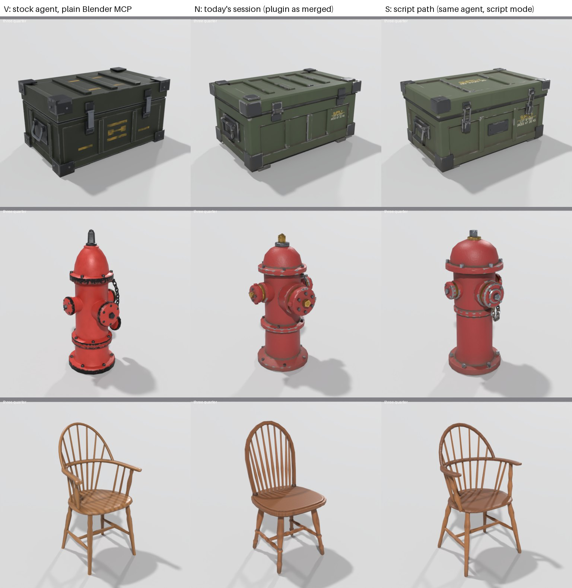
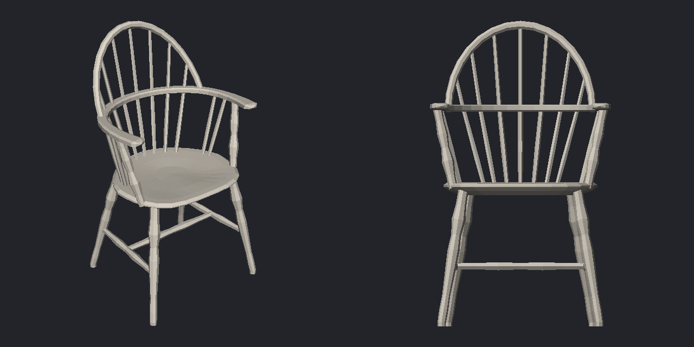

# Sixth round: an asset as one script, measured against a stop rule (2026-11-23)

Round five ended on two questions from the owner: would an agent do better writing the asset as a program (an
SDK) than driving the plugin's tools call by call, and why were its shapes limited at all. This round built the
smallest thing that could answer both, and set a rule before measuring it:

> If it does not beat today's session on time, fresh tokens and the chair, we stop.

**It did not.** The script path is not faster and not cheaper for a first build. It is better in three ways the
rule did not ask about: its assets are preferred to today's session's in 16 of 18 blind verdicts, all three pass
every game-ready check, and a change request became a small edit of one file that finished three times of three.
By the rule, nothing more is built on it until the owner decides. What exists is opt-in: an install without the
option behaves as before, apart from two small fixes listed under "What was built".

## The short answer

The three briefs of round five (a military supply crate, a cast-iron fire hydrant with a chained nozzle cap, a
wooden Windsor chair). N is today's session: a stock Antigravity agent with this project's plugin as merged in
PR #6, run twice. S is the same agent with the plugin installed in script mode, run once. V is a stock agent with
a plain Blender MCP server, from round five's runs. No generated images for anyone. Values are crate / hydrant /
chair; for N the median of its two runs, the two runs in brackets.

| | N, today's session | S, the script path | V, plain Blender MCP |
|---|---|---|---|
| ended on its own with a package | yes / yes / yes, both runs | yes / yes / yes | yes / yes / stopped at its limit, file written |
| time to a package, seconds | 240 (213, 267) / 282 (257, 306) / 276 (262, 290) | 254 / 313 / 258 | 609 / 377 / 380 |
| fresh tokens, thousands | 108 (100, 116) / 169 (126, 212) / 135 (133, 137) | 161 / 166 / 138 | 313 / 212 / 174 |
| model calls | 12 / 14 / 13 | 15 / 12 / 17 | 19 / 17 / 20 |
| game-ready checks passed, of 11 | 11 / 11 / 10 | 11 / 11 / 11 | 10 / 9 / 9 |
| blind judge: verdicts S won against this arm | 4 of 6 / 6 of 6 / 6 of 6 | | 6 of 6 / 5 of 5 / 0 of 6 |
| a change request finished | yes / yes / no | yes / yes / yes | |
| the change request: seconds, model calls | 253 s, 20 / 279 s, 19 / not finished | 180 s, 10 / 224 s, 13 / 131 s, 10 | |
| the change request: fresh tokens, thousands | 165 / 282 / none | 161 / 110 / 90 | |

Fresh tokens are what a run pays in full: input the model service did not serve from its cache, plus output, plus
thinking.

The rule, test by test:

- **Time: not met.** S is lower on one brief of three (the chair, by 6 %) and higher on the crate (6 %) and the
  hydrant (11 %). Over the three briefs: 825 s against 798 s.
- **Fresh tokens: not met.** S is lower on one brief of three (the hydrant, by 2 %, inside the spread of N's own
  two runs) and higher on the crate (49 %) and the chair (3 %). Over the three: 465 thousand against 412 thousand.
- **The chair: better than today's session, still behind plain Blender.** S's chair is preferred to N's in 6 of 6
  verdicts. Against the plain-Blender chair it loses 6 of 6, as N's does. The chair was in the rule because that
  gap was round five's worst result, and the gap is still there.

The full table (every run, every token number, the change requests, each model call) is
`results/round6/stop_rule.md`; the same as data in `stop_rule.json`; every verdict with the judge's reasons in
`results/round6/judge/`.

## How this was measured

Same sandbox, same model service and same scorecard as round five (`benchmarks/compare_eval.py`): the files an
arm leaves are imported into Godot, loaded in three.js, inspected by an independent Blender script, and measured.
Looks are judged blind: a model is shown two contact sheets from the same renderer, not told which arm made
which, in both orders, three times. "6 of 6" is therefore one package against one package, judged six times. It
is not six assets.

N ran on the merged main (commit 1668bad), S on this branch, alternating N then S for each brief on the same
night. N's second run was made a few hours earlier on the same commit. It shows how much one arm differs from
itself: 213 s and 267 s for the crate, 126 thousand and 212 thousand fresh tokens for the hydrant.

S has one run per brief. With this few runs a difference under about ten per cent in time cannot be told from
run-to-run spread. The rule asked for a clear win, and there is none.

Fresh tokens carry a noise that neither path controls. The model service's cache sometimes does not serve a call,
and the whole conversation is then paid for again: about one call in ten after a fast tool call in round five's
logs, and five of eight after a tool call longer than a minute. S's crate has one such call, straight after its
delivery (59 thousand input tokens); N's first hydrant run has one (69 thousand). Without those calls' input the three briefs read 102 / 129 /
138 thousand for S against 108 / 135 / 135 thousand for N. That explains the spread. It is not the result.

The judge inside the pipeline was the fallback model throughout, as in round five: the calibrated judge is not
served on this key, and every package is labelled an unverified preview.

## Why it is not faster

The idea was that one script and one tool call, instead of many tool calls, would mean fewer round trips, and so
less time and fewer tokens read again. The call logs show where a session's seconds go, and the tool interface
is not where.

| seconds, crate / hydrant / chair | N (first run) | S |
|---|---|---|
| inside model calls: thinking and writing | 105 / 196 / 204 | 141 / 195 / 164 |
| inside the delivery call | 71 / 67 / 50 | 67 / 70 / 54 |
| inside every other tool call together | 11 / 17 / 12 | 20 / 21 / 14 |

- **Building was already cheap.** Outside delivery, today's session spends 11 to 17 seconds in tools. There was
  almost nothing there to save.
- **A script is not a shorter way to write a design.** Over the three briefs S wrote 1.8 times the output tokens
  (57 thousand against 32 thousand: scripts of 371 to 421 lines) and thought 0.6 times as much (39 thousand
  against 68 thousand). The sum is about the same, and so is the time.
- **Five of S's twelve builds were refused.** Three for an error in the script (a recessed panel wider than its
  face, two orientations given for one part, a bend too tight for its rod), two for the triangle budget. Each
  refusal named the line and the fix and cost one edit round. The agent then used its cheap builds to improve the
  asset, not to finish sooner.
- **Delivery is the same call in both** and a quarter of the run.

## Where it is better

**Looks.** S's packages are preferred to N's in 16 of 18 verdicts. The judge's reasons: the hydrant has "an
actual linked chain" where N's is "a solid wire-like cable" (the script hangs eight oval links, each a closed
rod, along a curve it computes); the chair is a sack-back armchair with a saddle seat and splayed legs where
N's is a side chair with a slab seat; the crate has more distinct latches and hinges. The crate's two lost
verdicts are for stencil lettering that crosses a raised rib; one of them also faults the angle of the handles.

**Checks.** S passes 11 of 11 on all three. N's chair has no lower level of detail in either run: that step
emits a level only when enough triangles can go without changing the outline of thin parts, and for N's chair it
emitted none. S's chair got one (4,072 triangles, then 2,368).

**Shapes.** With nothing limited, the agent wrote the chair's seat as a mesh computed from a formula (a saddle
with two thigh scoops), an arm rail lofted through cross-sections that flare into paddles, a bow whose radius
swells toward the crest, and legs turned from a list of radii: 23 parts, 4,072 triangles, in
`results/round6/chair_script.txt`.

**Change requests.** "Make the two side handles 30 % larger", "make the nozzle cap 30 % larger", "make the back
spindles 30 % thicker", each in a new session that is given only the delivered folder.

- S's agent reads the script that travels with the package, edits lines, builds, delivers. The chair's change is
  one line (`results/round6/chair_change_request.diff`). Ten to thirteen model calls.
- N's agent gets part names from the manifest but not their sizes, and goes looking in the shipped files. On the
  crate it read the USD file and the manifest and ran five Python one-liners before its edit. On the chair it ran
  `find / -name usdcat`, which took 604 seconds; its next command never returned, and I stopped the run after 21
  minutes. It is counted as not finished.
- The scorecard's rule for "left everything else alone" passes both crates and fails both hydrants for the same
  reason: the chain hangs from the cap, so a larger cap moves the chain. It also fails S's chair, wrongly: by
  part name exactly the seven back spindles changed, but the rule compares bounding boxes, and a leaning rod's
  box hardly grows when the rod gets thicker. That is a fault in my rule. It is recorded here and not fixed.

## The chair against plain Blender

Both of this project's chairs lose every verdict to the stock agent's. S's chair is now the same kind of chair
(see the picture). The judge's reasons are the same in all six verdicts: lumpy relief along the hoop, rails and
spindles, and repeated banding across the seat, against "clean geometry and natural wood grain".

Without textures the shipped mesh is clean: a smooth hoop, an even rail, turned legs. So what loses the chair now
is the surface this project generates when no image model is allowed: wood grain that runs around a rod instead
of along it, and relief sized for flat panels. Both paths share that step. Round five's explanation, "the scene
format has no bent rod", is half answered: the rods are there, and the surface is what is left.

## What was built

Four commits, all behind an install option.

- **A script API** (`from agy3d import Asset`). The ready shapes of the scene format (box, cylinder, cone, sphere,
  capsule, lathe, extrusion, with bevels and recessed panels) and five free-form ones: a rod along any path, a
  skin through cross-sections, any triangle mesh, whatever a Blender snippet builds, and a mesh file. Parts know
  where they are (`leg.top`, `rail.along(0.6)`), so a joint is written from the parts it joins. The kernel stays
  the one source of geometry: ready shapes go through the same validation as today, free-form parts become mesh
  files the kernel loads.
- **One tool, `run_build`.** It checks the script before running it, runs it in a bare process (no key in its
  environment), opens or reuses the session, applies the design as one transaction, joins parts that lie flush,
  and answers with findings that name the part and the fix and with five colour views. `deliver_package` is
  unchanged.
- **Script mode is chosen at install** (`agy3d-plugin install --authoring script`). It replaces the agent's
  reference page and rules, and the server offers `run_build` in place of the stage tools. The default install is
  untouched.
- **The script travels with the package** (`source/build.py`), and the manifest names it as the design's source.
- **The comparison harness** has the script arm, counts fresh tokens and cache misses for every arm, and has a
  development brief (a lantern) so that the three scored briefs are never used for tuning.
- **Two fixes that stand alone,** and so change the default path too: a finding about a part that touches
  nothing now names the part whose surface is nearest, not the one whose centre is; and the mirror shortcut no
  longer refuses a rotated part that lies wholly on one side (it measured the corners of the part's box, which
  stand outside a rotated cylinder).

## What is still worse, or not done

- **First builds are not faster or cheaper**, which is what the slice was for.
- **One run per brief.** Enough to say there is no clear win. Not enough to say the two paths cost the same.
- **The surface on rods and free-form parts**, as above. It is the remaining gap to plain Blender on the chair,
  in both paths.
- **Textures from the image model are not wired into scripts.** Script mode was measured only with generated
  surfaces.
- **The check before a script runs is not a sandbox.** It refuses file access and unknown imports by reading the
  script. A determined script can get past a reader, and one test documents a bypass it does not catch. The
  process it runs in has no key and a time limit.
- **Texts that still name the stage tools in script mode:** the art-direction skill's "Apply" section, the
  nightly variant sidecar, parts of the README.
- **A material with little detail (glass) is packed at half the texture density**, and a prop mixing it with a
  detailed material fails the texel-evenness check by a hair (2.02 against 2.0). Found on the lantern trial; it
  predates this round and is not fixed.
- **Today's session still has to rediscover a design from shipped files** before a change request. That costs it
  twice the model calls, and one run of three.

## Decisions for you

1. **The rule says stop, and I have stopped.** Nothing further is built on the script path unless you say so.
2. **What happens to what exists.** Three choices: merge it as an opt-in mode and leave the default alone; merge
   only what stands alone (the nearest-part finding, the harness's fresh-token counting); or close the pull
   request. I recommend the first, on the looks, the checks and the change requests, and I recommend against
   making it the default on one run per brief.
3. **The next piece of work, if there is one.** The measurements point at two things, and neither is a new way to
   author: the generated surface on rods (the chair, both paths), and giving today's session a readable design
   beside the package so that a change request does not start by reverse-engineering the files.
4. **A second pass of runs** would say whether "about the same cost" holds. It costs about as much again as this
   round's nine first builds. I have not run it.

## Mistakes in this round's process

- **I proposed the slice on a count of round trips, not on where the seconds go.** Round five's call logs already
  showed tool time outside delivery was a few per cent of a session. Reading them first would have told me the
  script path could not win on time, and that its case had to be made on shapes and change requests.
- **"The chair" in the rule did not say against whom.** I report both readings.
- **A warning I added cost the trial run two edit rounds**: "parts overlap deeply" at half of a part's volume
  fired on honest joints. It now fires at nine tenths and states a fact instead of asking for a change. Fixed
  before the scored runs.
- **A new test read an attribute by the wrong name** and was only caught by the whole-suite run, because it
  needs the installed package and my narrower runs skipped it.
- **A probe of mine left three processes running**; I stopped them by process id.
- **Two baseline runs had to be restarted** because my chain script did not pass the flag that lets a run
  continue a ledger that already shows spending.

## What was verified, and how

- 651 tests of the changed packages on the merged tree, then both whole suites on the committed tree: the engine
  set with Blender and Godot (491 passed, all 106 required names present) and the whole suite without a browser
  or engines (2,729 passed, 175 skipped, 2 failed). Of the two failures one was the test above, fixed; the other
  is a timing test of the parallel sanitiser that passes alone and failed while the machine was also judging.
- Live: one trial run on the lantern, nine first builds, six change requests, and 54 blind verdicts (nine pairs,
  six each; one came back without a verdict).
- A script-mode install was started from the installed package over stdio and built a script there, and a script
  with free-form parts was delivered past the real Blender check and imported into Godot.
