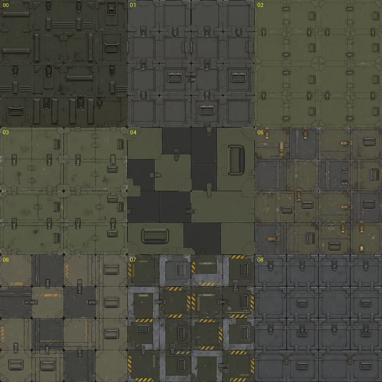
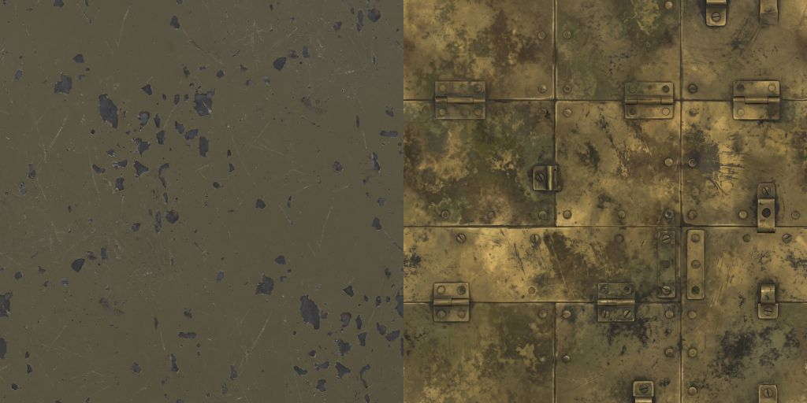
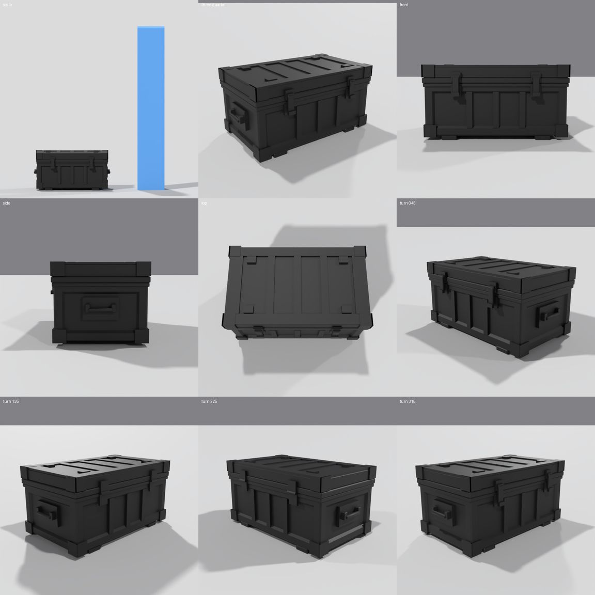
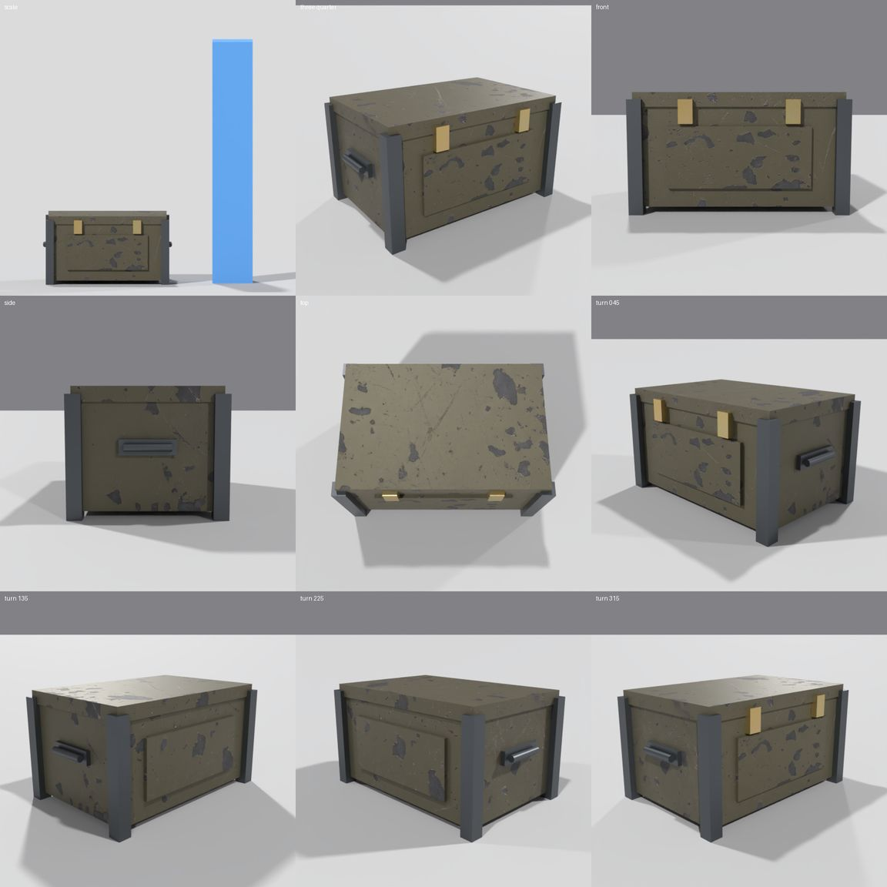

# Third round: two upstream Blender skill packs, adapted (2026-11-21)

Two public repositories of Blender "skills" for coding agents were read against this project, and what fits was
adapted. This document says what was taken, what it changed in the packages the project ships, what it showed to be
wrong in this project, and what was measured. The rule of the first two rounds held: remove waste and raise quality,
and never buy either by cutting capability.

| | EL4CTEO/blender-skills | arjun988/blender-skills |
|---|---|---|
| Commit read | `9e7e04a603c125a0d17447ab97112fa70a865067` (release 1.3.2) | `904f095` (v1.3.0) |
| Licence | MIT | MIT |
| What it is | 28 skills, 42 Python scripts that run inside Blender and return one JSON result | 94 Markdown skills and reference files, almost no code |
| What was taken | Five scripts, run inside the Blender worker; its table of Blender 5.x API changes as a checklist; its rules, audited | Eight art styles; its checklists, audited |

Neither repository is a dependency. Nothing is imported or executed from a checkout of either. The five scripts are
vendored byte for byte under `src/antigravity3d/adapters/blender_5_3/vendor/blender-skills/`, with upstream's
licence, each pinned by SHA-256 (`skills.py`); a file that does not match its pin stops the worker from loading any
of them. They run only inside the Blender worker process, with an allow-list of keyword arguments per script.

## What was taken, and where it went

| Taken | Where it runs now |
|---|---|
| `qa_check.py` (EL4CTEO) | Step `blender_asset_qa`: the exported GLB is read in a real Blender, vertices merged, with the target engine's profile. In the prop pipeline, in the native session's export (verified and preview), and in the CI survey |
| `kit_check.py` | Node `blender_kit_check` in the environment kit, per piece, with the kit's grid, pivot and sheet size |
| `mesh_stats.py`, `texel_density.py` | The CI survey (`benchmarks/upstream_survey.py`), beside the project's own numbers |
| `export_asset.py`, its `unity`, `unreal` and `roblox` presets | Step `export_fbx`: with a Blender worker attached, a package for Unreal, Unity or Roblox gets `<asset>.fbx`, re-imported in Blender and compared with the package's GLB files before it is kept. Prop pipeline and native export |
| The 5.x API change table | Twelve linter rules, each checked against the installed Blender by a test; four of the table's rows do not hold on Blender 5.3.0 and are not rules |
| 102 quality rules from both repositories | An audit against what the code enforces: 7 conflicts and 11 gaps, most of them fixed below |
| Eight art styles (arjun988) | `--art-direction <style>`: triangle budgets, shading crease, texture size, filter and palette reach the pipeline; briefs reach the authors |

A check that cannot run is skipped with its reason and never passed: no Blender worker, a fake worker, a result
marked fake, or a worker without the script.

## What changed in what ships

| | Before | After |
|---|---|---|
| Faces two parts press together | Shipped in every level | Left out of the render meshes when another opaque part covers them completely (not for Roblox, which requires closed meshes). Template crate: 144 to 122 triangles, wood atlas 823 to 966 px/m. A live-authored crate: 264 to 160 triangles. Renders pixel-identical; Godot captures identical. `--keep-contact-faces` ships them |
| Same-facing faces in one plane (z-fighting) | Not detected | Tier-1 warning with the overlapping area |
| A part beside another, not touching | "Attached" if the bounding boxes touched | Found by surface distance (2 mm, the upstream tolerance), exactly, including an edge through a face. Groups of parts that touch only each other are found too |
| Open meshes | Critical on every engine | Critical for Roblox, a warning for Unreal, Unity and Godot |
| An inside-out body among several in one mesh | Not detected | Detected per body |
| Collision hulls | No size limit | Capped to what each engine accepts: Unity 255 triangles, Godot (Jolt) 256 points, Unreal 255 vertices and faces. Godot shrank an uncapped 1,986-point hull by up to 7.1 mm |
| Roblox triangles per mesh | 10,000 | 20,000, the documented limit |
| Roblox textures | 2,048 px, packed map only, a warning on every package | 1,024 px, generated at that size; separate metalness and roughness files beside the packed one; a manifest record of what Roblox documents and what was not checked |
| Kit pieces | Heights and texel density differed by piece (133 to 256 px/m) | One metric (`--metric interior|exterior`): equal heights, 256 px/m everywhere, pivots on the module corner; a snap test with 0 mm gaps; the upstream kit check passes every piece |
| Kit triangles (eight pieces) | 1,372 | 932, pieces still closed |
| Texel density across materials | One figure per asset; a material that missed the target was lowered silently | Per material: achieved density, target met or not, atlas coverage, the map size that would reach the target; warnings for a material more than 10% under and for a spread above 1.3 |
| Prop templates | Parts meant to touch were up to 0.1 mm apart (0.45 mm on the lamp) | Exact; the contact faces are found and removed (table 8, lamp 12 to 16, shelf 12 to 20, crate 18 triangles) |
| FBX | None | In the package for Unreal (LOD0 and `UCX_` hulls, DirectX normal map), Unity (one mesh per LOD level) and Roblox (one mesh, textures embedded), listed in the manifest with its hash and what it does not carry. A failed FBX never takes the package away |
| Roblox meshes of many small parts | Forty 880-triangle spheres shipped as one mesh of 35,200 triangles and passed the project's rule | A material's parts are split into meshes of at most 20,000 triangles; the same asset ships as two meshes and passes Blender's check too |
| Material textures | One per material of every candidate design; the prompt was the asset brief | For the winning design only, allocated per material, from words that name the material (see "What the first live runs showed") |

## What running real engines showed to be wrong here

Blender 5.3.0 and Godot 4.7.2 ran on the development machine for the first time in this round.

- **Six operations of the Blender worker were wrong on Blender 5.3.** `apply_geonodes` raised on every call;
  `gpu.texture.from_image` without `gpu.init()` killed the worker, and the plugin's rules recommended that call;
  `bake_maps` stored data maps through the sRGB curve (a roughness of 0.5 was saved as 188); `import_splat` refused
  `.spz`; `render` raised after a script left the scene in multilayer output; the render pass name map was inverted.
  The worker also started with Blender's default cube, light and camera in the scene. None had a test.
- **`agy3d kit` could hang forever.** Its pieces are built in worker threads, and when two were ready together the
  process's first OpenUSD use happened in two threads at once, which can deadlock inside `Usd.Stage.CreateNew`
  (OpenUSD 0.26.11). In a minimal reproduction 12 of 150 fresh processes hung; with the first use made by one thread
  alone (`kernel/usd_boot.py`), 0 of 150. The kit scenario: 2 of 40 before, 0 of 80 after. CI had timed out on the
  offline kit command twice.
- **On a key without the native judge, nothing could produce a package live.** See "Preview mode".
- **Tests marked `live` ran whenever a key was in the environment.** They now need `--run-live`.
- **`agy3d kit` could not reach a Blender worker from the command line.** It takes `--blender` and `--pool-socket`.
- **Roblox's triangle limit was checked on authored parts, not on the merged meshes that ship.**

## Preview mode

On a key where the Decisions API answers 404, which is the development key's situation, no command and no native
session could produce a package: the fallback judge could not be reserved without a price, the spend plan required a
calibrated routing decision, kit authoring refused without text prices, and a native session was refused at visual
QA and at export after the work was done.

Two things were added, and the verified path was not touched.

- **A ledger in tokens.** `--token-ceiling N` counts tokens instead of dollars. No price is read, set or implied;
  every receipt says `unit: tokens, price_applied: false`. Because a token of image output is not a token of text,
  `--max-images M` is a second hard limit in the same ledger. For a kit the ceiling is one pool for the command.
- **A preview.** With `--preview` the uncalibrated judge may steer the run (route, rank, repair, fail a gate) and
  may never clear anything: `verified` stays false, policy is never cleared, and every place a person could read
  the result says "unverified preview" and who judged.

A run refuses at the start, before any generation, when it could not finish: no native judge and no `--preview`, a
preview without both limits, a ceiling below the largest single call, a plan that needs more images than allowed.
In a native session the limits are the user's: the plugin's hook asks the user with both numbers before a preview
session opens, and denies it when either is missing.

Preview mode ran live for the first time in this round. What that showed is the next section.

## What the first live runs showed

No command of this project had ever run live from start to finish: the development key has no native judge, and the
fallback path could not be bounded before preview mode existed. Each of the runs below got further than the one
before it and stopped on something the offline tests could not show. Every cause is fixed, and the offline stand-in
API (`tests/no_decisions_key.py`) now answers as the live service did in each case, so none can come back unseen.

| Run | What happened | Cause | Fix |
|---|---|---|---|
| 1. `agy3d prop --preview`, default mode, 11 images allowed | Failed at the geometry ranking. 71,097 tokens, 9 images, no package | The judge's token count sent a per-image resolution with a file-referenced image, which the API refuses (400). It counts an inline image with a resolution and a referenced one without | The count is made without per-image resolutions and the difference is added from a table (`7f33db1`) |
| the same run, read afterwards | 9 images were generated although the run was already lost, and they were for 10 materials | The material node started beside geometry and made one albedo for every material of all four candidate designs. About three would have shipped. With 11 images and 10 materials, best-of-N fell to 1 | The material node waits for the geometry gate and textures the winning design only; candidates are allocated per material, largest surface first; a branch nobody can use is stopped |
| the same 9 images, looked at | Every one is a picture of crate panels with latches and handles drawn in | The texture prompt was the asset brief plus a material id. The image model drew the object | A material carries words for its surface; one builder makes the prompt from them; the brief is never in it |
| 2. the pipeline with no image generation (template crate, the 9 paid-for images, the real judge) | Failed at the geometry ranking again | The judge was asked whether the contact sheet "contains legible text". The renderer draws a view label in each tile, so the truthful answer is yes | On a render sheet the question names those labels and sets them aside |
| the same run | 48,508 tokens held for two texture rankings that never answered | The judge's deadline was 60 s and had never been measured. A texture ranking took 176 s once and more than 240 s once. Each timed-out attempt kept its whole reservation and was sent again | The deadline is 600 s; an attempt that ran out its own deadline is not sent again |
| 3. the same pipeline after those fixes | Ran to the end: route, geometry ranking, two texture rankings, both visual QA stages, the LOD check, export, Godot import, three.js, the upstream Blender check. 164 s, 23,567 tokens, no image | | |
| 4. `agy3d prop --preview --single-candidate`, 3 images allowed | Geometry passed its ranking, and only then were the three texture images requested (two came back; one call returned no image). Pass A then asked the author for a repair, the service answered 503 "currently experiencing high demand" in 0.1 s, and the run ended with no package. 67,515 tokens by the relay's count, 2 images | An answer that says the request was not served was not retried, kept its whole reservation (45,486 tokens) as if it might have run, and left the pipeline as an error where a failed repair is an ordinary outcome | An answer that says the request was not served is retried on one schedule (2, 4, 8, 16, 32 s) and books nothing; a repair that cannot be made ends as "author repair failed" and passes B and C go on |
| 5. run 4 completed by hand: its own design (read from the relay's transcript) and its two textures, the real judge, no image call | A judge call's connection broke while its answer was being read, and the run was lost again | A broken connection was not treated as a transient failure, and any failure of a visual QA call ended the whole refinement | Broken connections are retried (their reservation is kept: the outcome is unknown). A judge that still cannot answer stops its pass with "judge unavailable", never approves, and the package is exported with its gates failed and the reason recorded |
| 6. the same completion on the fixed code, with the pipeline's real repair loop | Ran to the end in 322 s for 36,867 tokens and no image. The route call was answered 503 once and retried after 2 s. One repair was applied (it closed a gap under the lid and moved the handles), a second made things worse and was rolled back. Godot import, three.js and the upstream Blender check pass. The uncalibrated judge scored it 2.1 of 4, below the 3.4 an export needs, so the preview's gates read FAIL | | |

Run 3 judged the template crate textured with two of run 1's images. The judge scored it 1.2 of 4 and named baked
lighting and visible seams, and the render shows why the texture prompt had to change: a latch drawn on the front
face and handles drawn on the lid, on a model that has neither. That package is not a result of the pipeline; it is
evidence about the old prompts.

| The brief as the texture prompt (run 1) | Surface words as the prompt (run 4) |
|---|---|
|  |  |

In run 4 the author's words were "olive drab painted steel, scuffed and chipped" (left half of the second picture)
and "tarnished military brass hardware" (right half). The second names a kind of object, and the image model drew
it. The authoring rule now says to name the substance, not what is made of it.
`results/round3/template_crate_with_brief_textures.jpg` is run 3's package.

Two things about these runs are not fixed and are the owner's to weigh:

- **The fallback judge is slow and uneven on textures.** The same texture ranking took 30 s, 176 s and more than
  240 s on one afternoon. A trivial question about the same image took 5 s, and a 512 px copy of the image was no
  faster, so neither the image's size nor the question count explains it.
- **An attempt that fails with an unknown outcome keeps its whole reservation.** That protects the ceiling, and it
  means one slow call can hold about 24,000 tokens of a ledger for nothing. Whether the service bills a request it
  answered with 504 could not be found out from here.

## The comparison: a stock agent against this project

One brief was given two ways and judged the same way: "a rugged military supply crate kit-bashed from panels, corner
guards, latches and two side handles", at most 3,000 triangles, for Godot 4.

- **Stock agent.** The Antigravity agent as the SDK ships it (google-antigravity 0.1.24, `gemini-4-hydrogen`, its own
  system prompt and tools), given the brief, a list of what "game-ready" means, and a Blender it can script. It ran
  inside Linux namespaces with no network; every model call went through a relay that held the key and enforced a
  token and image limit per run.
- **This project.** `agy3d prop "<brief>" --engine godot_4 --max-tris 3000 --preview --blender ...` with a token
  ceiling and an image limit, through the same relay.

Both outputs got the same evaluation from the files they left: facts read from the GLB, a Godot import, the three.js
check, the upstream `qa_check`, Cycles renders, and a blind pairwise judge. `benchmarks/compare_agents.py` runs all
of it; nothing below is the project's own verdict on itself.

### What each left behind

| | Stock agent | This project |
|---|---|---|
| Delivered a package | Yes, in two sessions | Not unassisted. Both command runs ended without a package (runs 1 and 4 above). Run 4 was then completed by hand from what it had paid for (run 6 above) |
| Tokens (relay's count) | 625,818 over 20 model calls; 337,481 of the first session's 410,357 input tokens were re-read context | 71,097 (run 1) and 67,515 (run 4), nothing delivered by either; 36,867 more to complete run 4, so 104,382 for the package shown here |
| Images generated | 0 | 9 (run 1, for designs that mostly would not have shipped) and 2 (run 4) |
| Geometry | 1,476 triangles, 0.85 x 0.42 x 0.53 m: panels, corner guards, latches and side handles are all modelled | 266 triangles, 0.96 x 0.51 x 0.62 m, from 15 primitives: a body, a lid, one raised front panel, four corner posts, two latches, two handles. The budget was 3,000 triangles |
| Material and textures | One material; three 2,048 px maps written by script: the base colour is black everywhere, the normal map is flat, roughness is a constant 0.6 | Three materials. Two have generated 2,048 px maps: chipped olive paint, which came back as a surface, and brass, which came back with hinges drawn in because the author had written "brass hardware". The third material's image call returned no image; it ships as a flat colour and is named in the run's warnings |
| LOD files | Two | One (266 to 166 triangles); the pop check passes |
| Collision | A box inside the main GLB, without a material | Six convex hulls in their own file |
| Godot 4.7 import | Loads | Loads |
| three.js check | Fails: the collision box falls back to the loader's default material | Passes |
| Upstream `qa_check` in Blender | Fails: the collision box has no material, 98 pairs of z-fighting triangles in the crate, 27 against the collision box; 86 hidden face pairs | Passes after the repair (before it: 8 pairs of z-fighting triangles); 4 hidden face pairs |
| Texel density (upstream script) | 532 px/m, 35% of the UV square used | 984 to 1,024 px/m, 83% of the UV square used by the body's material |

| Stock agent | This project (run 4, completed) |
|---|---|
|  |  |

Both sheets are Cycles renders with the same cameras, lights and ground; the blue block is 1.8 m tall. The facts
behind the table, the judge's answers and the ledger are in `results/round3/agent_comparison.json`;
`crate_this_project_before_repair.jpg` is the same design before the pipeline's repair.

The stock agent's geometry is good. It reads as a military crate from every side, and it is the most detailed model
either side produced. What it could not do without an image model is surface it: it wrote its textures with a script,
and the base colour came out black. It also spent most of its tokens re-reading its own context: a stock agent pays
for its whole conversation again on every step.

This project's crate is the opposite case. Its surface is the better one: real paint, wear and a second metal. It
passes the technical checks the stock agent's crate fails. Its shape is a blockout: fifteen boxes and cylinders where
the brief asked for a kit-bashed crate and the budget allowed ten times the triangles.

A blind judge (`gemini-4-carbon`, the harness's rubric, each pair asked in both orders, 6,695 tokens) agreed with that
reading both times:

| Criterion | First order | Second order |
|---|---|---|
| Reads as the brief | Stock agent | Stock agent |
| Proportion and scale | Stock agent | Stock agent |
| Surface and material | This project | This project |
| Fewer visible defects | This project | Tie |
| Overall | Stock agent | Stock agent |

Its reason, in its words: the stock agent's "detailed silhouette and kit-bashed geometry successfully fulfill the
military crate brief far better than" this project's "primitive blockout".

What this does and does not show:

- **The weak point is the authored geometry, not the checks around it.** The author answers with a scene of
  primitives and stops far below the triangle budget. Nothing in the pipeline asks it to spend the budget on detail,
  and the judge's repair requests fix defects, not plainness. That is the next thing to work on, and it is a larger
  change than this round.
- **This was the pipeline's smallest configuration.** One candidate instead of the plan's four, forced by the three
  images that were left. The default mode (best-of-four geometry, best-of-N textures, a director tier for repairs)
  was run once, as run 1, and lost to a defect that is fixed. It has not run since: it needs about 9 to 11 images.
- **The token difference is real and one-sided.** 104,382 tokens against 625,818 is what a fixed pipeline saves over
  an agent that re-reads its conversation at every step. The stock agent used no image; this project used 2 here
  and 9 before them that bought nothing.
- **One brief, one run each, an uncalibrated judge.** Nothing here is a rate.

The third arm, the stock agent with the EL4CTEO skills installed, was not run again after the first attempt (below):
with the tokens left it could not have finished.

### What the pilot cost, and what went wrong in it

The first attempt gave every run 195,000 tokens, which buys a stock agent eight to ten model calls, because each
call re-sends its whole context (about 12,000 tokens before it has done anything). Four runs spent 540,857 tokens
and none had started modelling: the plain agent spent its calls probing Blender, and the agent given the EL4CTEO
skills read ten skill files and ten scripts (77,481 input tokens by its fourth call). That attempt was stopped. The
plan had been reviewed and approved without anyone asking how many calls a finished prop takes.

The second attempt told the agent its budget and ran one cell at a time.

What the whole round spent of the owner's allowance (2,000,000 tokens and 30 images):

| | Tokens | Images |
|---|---|---|
| Test runs that reached the live API unintended, before `--run-live` existed (an estimate) | about 300,000 | 18 |
| Comparison, first attempt (four runs, stopped) | 540,857 | 0 |
| Stock agent, two sessions | 625,818 | 0 |
| This project, runs 1 and 4 | 138,612 | 11 |
| Probes, the two no-image runs of the pipeline, the completion of run 4 and the blind judge | 258,721 | 0 |
| Total | about 1,864,000 | 29 |

The first three pilot rows are the relay's count. The fifth is the commands' own ledgers and includes about 150,000
tokens held for calls that never answered, which the service may not have billed. One of the two no-image runs was
made twice because a probe's output was lost to a mistake in the script that printed it.

What went wrong in the pilot, in order: the unintended test spend; the first attempt's budget; a kill that hit the
wrong process and let about 43,000 more tokens through; and two command runs of this project that each found a
defect by failing on it. The findings were worth having. They did not need to cost eleven images.

### Driving the plugin tool by tool

A native session through the stock agent was sized, not run live: against a stand-in API, an error-free session
(open, author, render, judge, repair, textures, LODs, validation, export) takes 24 agent turns and 7 calls by the
plugin itself, and the agent's input grows from about 22,000 to 36,000 tokens per turn. That is 734,000 to 887,000
tokens, of which the plugin's own calls are about 26,000: the agent's loop costs about 28 times what the work does.

## What it costs

- `tier1_qa`: isolated parts unchanged; stacked boxes 10 to 14% more; 200 stacked curved parts 55 to 100 ms.
- Export: the hidden-face test adds 2 to 60 ms per asset.
- `blender_asset_qa`: 0.05 to 0.13 s per asset on a warm worker; `blender_kit_check` about 0.4 s for four pieces.
  No worker is started for either.
- The Blender API rule file grew from 1,800 to 5,839 characters. It is loaded only when Python or `.blend` files
  are being worked on.
- `manifest.json` is `schema_version` 3; the export cache version is 10, so cached results are recomputed once.
- Existing assets can show new warnings: z-fighting, texel density, open meshes, floating groups.

## Not verified

- No Unity, Unreal Engine or Roblox Studio ran. Every FBX was re-imported in Blender and matched its sources; how
  each engine's importer reads it is documented, not observed. The same holds for the Roblox texture set.
- The inspector's interface bundle could not be rebuilt on this machine; the preview label is in its audit list.
- The plugin's "ask the user" hook was tested as a decision, not inside a running Antigravity application.

## Open decisions

- **Authored geometry stops far below its budget.** The comparison's clearest result: 266 triangles of a budget of
  3,000, and a blind judge calling it a blockout. Nothing asks the author to spend the budget on the detail a brief
  names. Options: say so in the authoring request and let the geometry ranking score detail against the brief; a
  second authoring pass that adds trim; or use the Blender worker for modelling operations the scene format cannot
  express. Each changes what every run produces, so none was done without the owner.
- **A failed run keeps nothing of its design.** Images are cached; the authored scene exists only in memory until
  export, so a rerun pays for authoring again and gets a different design, for which the cached images no longer
  fit. Run 4 could be completed only because the comparison's relay had recorded the author's reply. A record
  beside the image cache, keyed by the request, would let a rerun continue; it needs a way to ask for a fresh
  design and a "from cache" entry in the ledger.
- **A default-mode run has still not finished live.** It needs about 9 to 11 images and was not possible within
  the 30.

These are choices between things that each cost something. They were measured, not made.

- **Texel density when a material does not fit.** A 4 x 0.3 x 3 m stone wall reaches 323 px/m beside a metal knob at
  1,024. Lowering every material to the worst one is ruled out by the no-reduction rule. A larger map for the
  material that missed needs 8,192 px for that wall (above the image backend's 4,096 and Roblox's 1,024). Tiling
  large flat parts reaches the target with a 1,024 px tile but needs coordinates outside 0 to 1, which Roblox
  forbids, and repeats visibly. Cropping each texture to the region its charts use saves nothing on the benchmark
  assets. Today the mismatch is reported and warned about.
- **Edges shared by more than two faces** stay critical on every engine. The upstream script treats them as a
  warning in its game and Roblox profiles.
- **Driving the plugin tool by tool through the agent is expensive.** See the comparison above: a complete native
  session takes about 24 agent turns, and every turn re-sends the agent's context. One tool that runs the pipeline
  end to end inside a session would cut that to a few turns without changing what is built.
- **Art direction.** The hand-painted style cannot deliver painted lighting; four of the eight styles change only
  the briefs; the visual judge is not told the art direction.
- **Roblox.** No emissive mask is written (no page says how a glTF emissive texture maps to one). The importer's
  scale unit defaults to studs and the package is in metres.
- **Kits** have no corner, T, window or ceiling pieces; floor thickness puts storeys off the vertical grid; trim
  strips tile along one axis only.
- **Texture bakes** use 4,096 samples; on the test scene 64 gave the same result in the same time, because sampling
  is adaptive. The default was left alone.
- **UV gutter.** The project uses 2 px; the upstream guidance is 8 px at 1,024. Not changed.
