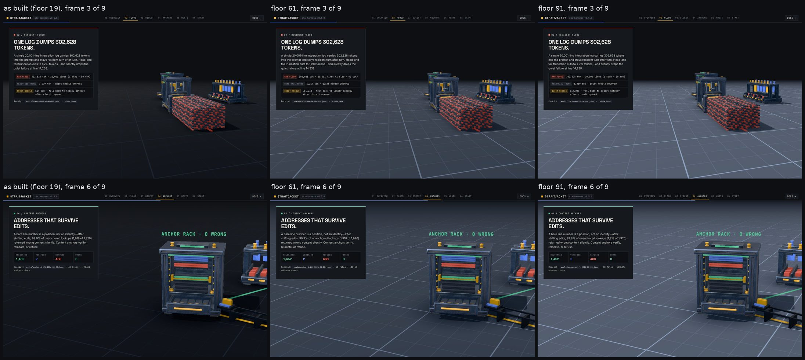

# One site on three floors, judged blind

A controlled comparison made after run 6 (`../../site_run6_plugin/`), to find out whether the floor is why a blind
judge calls the 3D of runs 4, 5 and 6 "dark", "flat" and "floating" (`../site_compare_corrected/verdicts.md`). Run 6's
project was built three times: as its agent wrote it, and twice with the four floor colours of its `src/floor.js`
(ground, minor grid, major grid, track base; not the coloured signals on the track) multiplied by 8.4 and by 16, and
nothing else changed. Each build was photographed by the plugin's check at nine desktop steps. The judge, the request
and the six calls per pair (three in each order) are those of the main comparison (`../../../site_compare.py`,
`../site_compare_corrected/request.txt`). The sites are named here by what was measured in their frames:

| | as built | floor 61 | floor 91 |
|---|---|---|---|
| the floor near the camera: the commonest luminance (of 255) in the lowest quarter of the frame, the page's text hidden; median of the nine frames, and the lowest and highest | 19 (16 to 22) | 61 (58 to 64) | 91 (91 to 94) |
| the page's colour, the same way at the top of the frame | 16 | 16 | 16 |

## What the judge said

| pair | overall | craft of the 3D | type and layout |
|---|---|---|---|
| as built against floor 61 | floor 61, 5 of 6 | floor 61, 5 of 6 | as built 3, floor 61 2, 1 tie |
| as built against floor 91 | floor 91, 6 of 6 | floor 91, 6 of 6 | as built, 6 of 6 |
| floor 61 against floor 91 | floor 61, 6 of 6 | floor 61 3, 3 ties | 6 ties |

"Every position composed" is a tie in all 18 calls and "explains the project" in 13, as they should be: nothing but
the floor differs. Each call is in `calls/`, the totals in `judge.json` (there the sites are `built`, `floor60` and
`floor90`, the names they were built under).

### As built against floor 61

| shown first | craft of the 3D | overall | the judge's reason, craft of the 3D | the judge's reason, overall |
|---|---|---|---|---|
| as built | floor 61 | floor 61 | Across frames 1 to 9, [floor 61] renders a matte slate floor with visible grid lines, crisp cast shadows, and atmospheric horizon depth, grounding the dark machinery far better than the pitch-black floor of [as built]. | While both sites share the exact same layout, copy, models, and scroll choreography, [floor 61]'s lit slate ground plane makes cast shadows, spatial perspective, and dark machinery contours read clearly instead of getting lost in a black void. |
| as built | floor 61 | floor 61 | [floor 61]'s lighter slate floor and atmospheric horizon fog across frames 1 to 9 make cast shadows clearly visible and ground the dark navy machinery much better than the near-black floor in [as built]. | Although both sites share the same 3D models, camera path, and UI layout, [floor 61]'s lighter ground plane and visible cast shadows give the 3D scene far better depth, grounding, and separation from the dark machinery and text cards. |
| as built | floor 61 | floor 61 | [floor 61]'s lighter slate ground plane across frames 1 to 9 makes cast shadows, perspective grid lines, and the grounding of the dark machinery much clearer than [as built]'s near-black floor. | While both sites share the same strong visual explanation and layout, [floor 61]'s lighter ground plane gives the dark 3D machinery better contrast, visible contact shadows, and stronger spatial depth. |
| floor 61 | floor 61 | floor 61 | In frames 1 through 9, [floor 61]'s lighter slate floor catches clear, grounded cast shadows beneath the press, anchor rack, and conveyor, whereas [as built]'s near-black floor swallows the shadows and blends the dark machinery into the ground. | Between two nearly identical builds differing only in floor shader brightness, [floor 61] feels much more like a tangible, world-class 3D tabletop scene because the lit slate surface preserves grounding shadows and spatial depth around the dark machinery. |
| floor 61 | floor 61 | floor 61 | In frames 1 through 9, [floor 61]'s brighter slate floor better reveals contact shadows, grounding, and spatial depth compared to [as built]'s near-black floor where dark shadows and rails get lost. | Although both sites share the same models, typography, and scroll choreography, [floor 61]'s lighter floor surface gives the 3D machinery clearer shadows, grounding, and spatial legibility throughout the entire scroll. |
| floor 61 | as built | as built | While the 3D models are the same, the darker floor plane and subtler grid in [as built] (frames 1 to 9) blend smoothly into the dark horizon without the harsh grey glare of [floor 61], making the machines pop with better contrast. | Both sites share the exact same design, copy, and 3D choreography, but [as built]'s darker floor material and subtler grid blend far better into the background and showcase the 3D machinery with richer contrast. |

### As built against floor 91

| shown first | craft of the 3D | overall | the judge's reason, craft of the 3D | the judge's reason, overall |
|---|---|---|---|---|
| as built | floor 91 | floor 91 | In frames 1 through 9, [floor 91]'s lighter slate floor makes contact shadows and spatial depth clearly visible, whereas [as built]'s near-black floor hides the shadows and leaves the dark navy machines floating. | With identical models, copy, and camera paths, [floor 91] wins because its lighter ground plane makes the 3D machinery, contact shadows, and spatial depth read much more clearly across the entire scroll. |
| as built | floor 91 | floor 91 | In frames 1 through 9, [floor 91]'s lighter slate grid floor clearly reveals contact shadows, grounding the dark machinery in 3D space instead of blending into a near-black floor like [as built]. | Although both sites share identical models, copy, and scroll choreography, the lighter gridded floor in [floor 91] reveals cast shadows and spatial depth that make the dark 3D machinery feel physically grounded. |
| as built | floor 91 | floor 91 | In frames 1 through 9 of [floor 91], the lighter slate floor makes contact shadows, depth, and dark structural rails clearly visible rather than blending into a near-black ground. | Although the two sites are nearly identical apart from floor shading, [floor 91]'s lighter ground plane grounds the 3D machinery with visible shadows and depth across every frame. |
| floor 91 | floor 91 | floor 91 | In [floor 91], the lighter slate-grey grid floor in frames 1 through 9 catches crisp cast shadows and separates the dark metal machinery from the ground, whereas [as built]'s near-black floor swallows the shadows and dark silhouettes. | The two sites are identical except for the floor material, and [floor 91] wins because its lighter ground plane makes the dark 3D machinery, connecting rails, and grounding shadows clearly legible throughout the scroll. |
| floor 91 | floor 91 | floor 91 | Across frames 1 through 9, the lighter slate floor in [floor 91] clearly receives cast shadows and grounds the dark blue machinery, whereas the dark floor in [as built] swallows shadows and blurs dark silhouettes. | With identical models, choreography, and UI, [floor 91] wins because its lighter ground plane makes the dark 3D machinery, shadows, and spatial depth clearly legible instead of blending into a nearly black floor. |
| floor 91 | floor 91 | floor 91 | In frames 1 through 9, the slate-grey gridded floor of [floor 91] catches cast shadows and grounds the dark-blue machinery, whereas [as built]'s near-black floor swallows shadows and dark base parts. | Despite being nearly identical builds, [floor 91] wins because its lighter studio floor grounds the dark 3D machinery with visible cast shadows and clearer connecting rails across every scroll step. |

### Floor 61 against floor 91

| shown first | craft of the 3D | overall | the judge's reason, craft of the 3D | the judge's reason, overall |
|---|---|---|---|---|
| floor 61 | tie | floor 61 | Every 3D model, material, shadow, and grid surface in frames 1 through 9 is completely identical between the first and second site. | The two sets of 9 frames are completely identical, so [floor 61] is selected arbitrarily as the schema requires a non-tie overall choice. |
| floor 61 | tie | floor 61 | The 3D models, materials, lighting, and ground shadows across all frames (Frames 1–9) are pixel-for-pixel identical between the two sites. | Both sets of frames (Frames 1–9) are completely identical in every visual detail, making them equal in quality with [floor 61] selected arbitrarily to satisfy the tie-breaker. |
| floor 61 | tie | floor 61 | Frames 1 through 9 in both sets render identical 3D machinery, materials, lighting, and shadows on the grid floor. | Both submissions are pixel-for-pixel identical across all nine frames, so [floor 61] is selected arbitrarily as the schema requires a non-tie overall winner. |
| floor 91 | floor 61 | floor 61 | While models and lighting are identical in frames 1 through 9, [floor 61] features a darker, lower-contrast floor grid that better grounds the machinery without visual distraction. | Both sites are nearly identical in layout, text, and 3D choreography, but [floor 61] edges ahead with a more subdued, cohesive floor plane that lets the 3D diagram stand out more clearly. |
| floor 91 | floor 61 | floor 61 | While the 3D models and animations are identical, [floor 61] renders the ground grid and ambient scene in frames 1 through 9 with a slightly deeper, cleaner slate contrast than the washed-out grey in [floor 91]. | Although both sites appear to be nearly identical builds with the same 3D models, camera choreography, and layout, [floor 61] has slightly richer contrast and darker ground shading that makes the 3D scene pop better. |
| floor 91 | floor 61 | floor 61 | [floor 61] renders a slightly darker, richer floor plane in frames 4 through 8 that improves contrast and grounds the shadows and glowing floor lines better than [floor 91]. | While the two sites are nearly identical in layout, typography, and 3D choreography, [floor 61] edges ahead with slightly deeper floor shading that gives the 3D machinery and data lanes better contrast. |

## What it shows

- **A floor as dark as the page costs the 3D its ground.** Eleven of twelve verdicts prefer the same site with a lit
  floor, and they say why: a lit floor "catches cast shadows and grounds the dark machinery", the near-black one
  "swallows the shadows and leaves the dark navy machines floating". A shadow cannot darken a surface that is already
  as dark as the page.
- **More is not better.** Floor 61 is preferred to floor 91 in six of six, and against floor 91 the page's type wins
  for the dark floor in six of six: labels drawn in the scene and the text cards read better over a quieter ground.
  The one verdict for the dark floor against floor 61 names "the harsh grey glare" of the lit one and its grid.
- **Where the dark floor came from.** Not from the agent: run 6's `--ground` (`#15181D` on a page of `#0D0F12`)
  follows the starter's (`#1a1d22` on `#101215`) and the library guide's rule that the ground comes out as the
  page's ground colour so that it fades into the page. That rule was written after run 3, and every site since has
  a floor as dark as its page:

  | | run 2 | run 3 | run 4 | run 5 | run 6 | stock agent |
  |---|---|---|---|---|---|---|
  | the floor near the camera, measured as above | 94 | 52 | 16 | 19 | 19 | (no floor) |
  | share of the canvas more than 24 levels from the page's colour, median of the nine frames | 73 % | 75 % | 6 % | 16 % | 13 % | 71 % |

  The two-lights comparison (`../rig_compare/`) had already heard it and filed it under its limits: under run 2's
  light the floor came out lighter too, and the judge named "floor grid visibility" and "grounded floor shadows".

## What it changed

The starter's ground is a lit slate (`plugin/antigravity-3d/skills/scroll-3d-website/starter/src/style.css`,
`--ground`), the fog still takes it to the page's colour at the horizon, and the guide says what a ground is for
(`libraries.md`, the light section). A test reads the starter's pixels: the floor near the camera, the far floor, and
the hero's shadow against the floor beside it.

## Limits

- One judge, nine still frames of a desktop window, six calls per pair, one site.
- The variants scale the floor's colours; they do not retune its grid, which gains contrast with the floor (one
  verdict against floor 61 and all six "type and layout" verdicts against floor 91 name the grid, the noise or the
  glare).
- Nothing was tried between 19 and 61, nor between 61 and 91.
