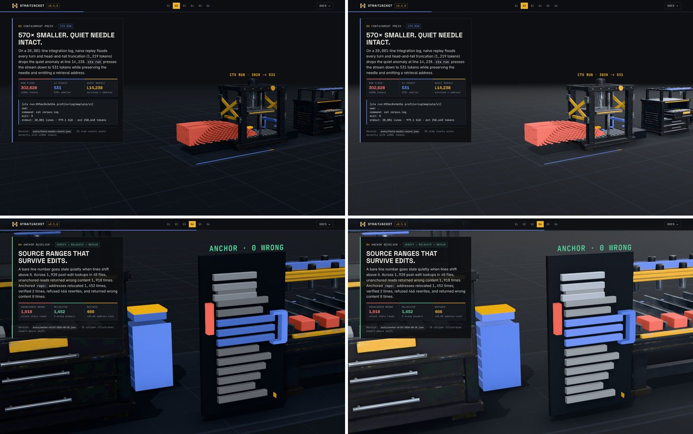
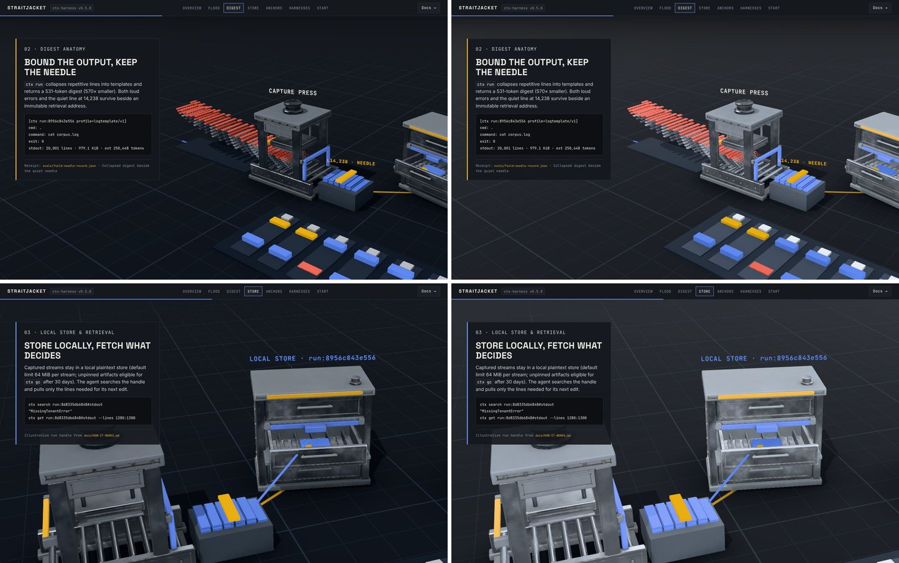

# One site under two lights, judged blind

Two controlled comparisons made after run 5 (`../../site_run5_plugin/`), to find out whether the light is what makes
a blind judge prefer run 2's 3D to run 4's and run 5's (six of six verdicts on craft each, in
`../site_compare_corrected/`). In each, one built site was photographed twice with the plugin's check: as its agent
built it, and with three numbers of its `src/stage.js` changed to run 2's light and nothing else. The judge, the
request, the nine desktop frames per site and the six calls per pair (three in each order) are those of the main
comparison (`../../../site_compare.py`, `../site_compare_corrected/request.txt`).

| | as built | run 2's light |
|---|---|---|
| key light | 1.8 | 2.35 |
| rim light from behind | none | 0.85 |
| environment | 0.25 (run 4), 0.28 (run 5) | 0.65 |
| the floor's colour | as written | multiplied by 0.49 (run 4) and 0.52 (run 5), so that the floor's diffuse colour stays where it was |

## Run 4's site: dark machines (steel at `#242931`)

Six of six verdicts on craft and six of six overall for run 2's light, in both orders. The other three criteria
are ties in all six, as they should be: nothing else differs.

| shown first | craft of the 3D | overall | the judge's reason on craft |
|---|---|---|---|
| run 2's light | run 2's light | run 2's light | [run 2's light] has slightly brighter ambient lighting and floor grid visibility in frames 1-5 and 9, making the dark 3D machinery forms easier to read against the background than in [as built]. |
| run 2's light | run 2's light | run 2's light | [run 2's light] has slightly brighter, clearer lighting and material definition on the machinery and floor grid in frames 1 through 9, whereas [as built]'s dark metals lose detail in shadow. |
| as built | run 2's light | run 2's light | [run 2's light] features sharper ambient lighting and ground visibility across frames 1 to 9 compared to [as built]'s darker scene. |
| run 2's light | run 2's light | run 2's light | [run 2's light] has clearer ambient lighting and more distinct surface shading on the dark machinery and floor grid in frames 1 through 5, whereas [as built] is darker and loses cabinet detail in shadow. |
| as built | run 2's light | run 2's light | [run 2's light] renders brighter ambient lighting, clearer floor shadows, and sharper metallic specular detail across frames 1 to 9 than the darker [as built]. |
| as built | run 2's light | run 2's light | [run 2's light] has balanced lighting and grounded floor shadows across frames 1 to 9, whereas [as built]'s environment and shadows are overly dark and crushed. |

## Run 5's site: light grey machines (`#7A838E` to `#B8C1CC`)

Three verdicts each, and each call chose the site it was shown second: this judge has no preference between the two
lights here.

| shown first | craft of the 3D | overall | the judge's reason on craft |
|---|---|---|---|
| run 2's light | as built | as built | [as built] renders darker, richer metallic finishes with less washed-out mottling on the cabinet and press in frames 1, 5, and 6. |
| run 2's light | as built | as built | In frames 1 through 9, [as built] renders darker, better-grounded metallic materials on the press and cabinet with less washed-out lighting than [run 2's light]. |
| as built | run 2's light | run 2's light | [run 2's light] exhibits brighter, clearer lighting and higher contrast on metallic surfaces and white lane indicators across frames 1 to 9 compared to [as built]'s dimmer, muddier shading. |
| run 2's light | as built | as built | [as built] applies darker, higher-contrast metallic materials and more grounded shading on the press, cabinet, and relocator across frames 1 to 9 compared to [run 2's light]'s washed-out gray surfaces. |
| as built | run 2's light | run 2's light | [run 2's light] features brighter, higher-contrast metallic lighting and clearer reflections on the press and cabinet in frames 1, 5, and 6. |
| as built | run 2's light | run 2's light | [run 2's light] features brighter directional lighting, clearer metallic surface reflections, and crisper shadows on the press and cabinet across frames 1 to 9. |

## What it changed

The starter's light is run 2's again (`plugin/antigravity-3d/skills/scroll-3d-website/starter/src/stage.js`,
`LIGHT`), and the skill no longer tells an agent to give a prop light grey bodies (`../../ROUND_EIGHT.md`, "Run 5").

## Limits

- One judge, nine still frames of a desktop window, six calls per pair.
- The floor was not held exactly: only its diffuse colour was scaled, and a dark floor mostly shows the
  environment's reflection, so under run 2's light the floor of both sites is lighter than as built (the judge says
  so: "floor grid visibility"). The starter's ground now takes the environment at its own strength; measured there,
  the floor far from the camera is (28, 31, 35) where it was (24, 26, 30).
- `run4/` and `run5/` hold the six calls of each comparison as they were answered.
