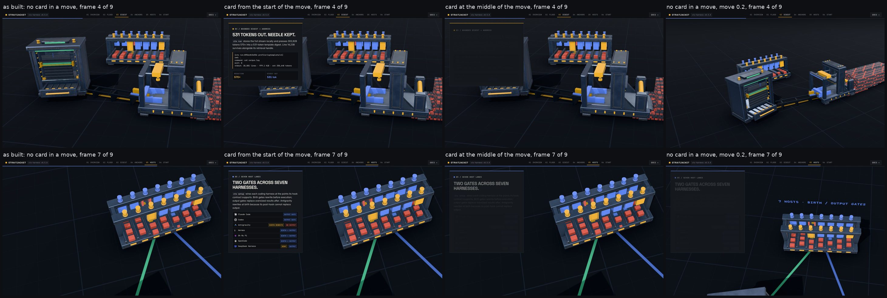
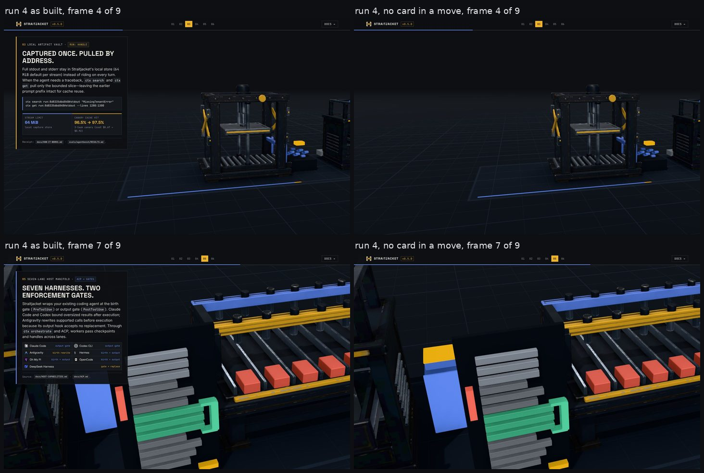

# When a chapter's text comes: two sites, one thing changed at a time, judged blind

Controlled comparisons made after run 6 (`../../site_run6_plugin/`). In the main comparison every verdict on
composition against run 6 names its frames 4 and 7, where the camera is between two shots and the starter shows no
text card ("drops its card"). The starter hides the cards during a move because run 5's card over a picture in
transit was named in all thirteen composition verdicts against it. The question here: is no card during a move the
better rule, on one site with nothing else changed? Run 6's project was built four more times, each differing from
the agent's build only as the table says, and photographed by the plugin's check at nine desktop steps. The judge,
the request and the six calls per pair (three in each order) are those of the main comparison
(`../../../site_compare.py`, `../site_compare_corrected/request.txt`). Then the same question was put the other way
round on run 4's site, whose cards stay up through the move: **the two sites give opposite answers** (below).

| the site | a chapter's card | the camera's move takes | against as built, overall |
|---|---|---|---|
| as built | hidden while the camera moves, shown when the shot is held | 0.35 of the chapter | |
| card from the start | shown from the chapter's first pixel, over the move (the starter's timing in runs 2 to 5) | 0.35 | as built, 6 of 6 |
| card at the middle | the last chapter's card stays until the middle of the move, the new one comes then | 0.35 | as built, 6 of 6 (not a clean reading, see below) |
| card at the middle, move 0.2 | the same | 0.2 | 3 each, by the order shown |
| no card, move 0.2 | hidden while the camera moves | 0.2 | as built, 6 of 6 (for another reason, see below) |

## Card from the start of the move: as built, six of six

The clean reading. The card is whole in both sites wherever it shows; the only difference is a card over the picture
while the camera travels. Every verdict gives the reason: the card covers a machine the camera is passing.

| shown first | every position composed | overall | the judge's reason, every position composed | the judge's reason, overall |
|---|---|---|---|---|
| as built | as built | as built | [as built] hides the text card during camera transitions in frames 4 and 7 so the 3D anchor rack is not covered by the overlay as it is in frame 4 of [card from the start], though both still clip the card over the rack in frame 5. | Both sites are nearly identical builds of the same 3D factory visualization, but [as built] handles scroll transitions cleaner in frames 4 and 7 by clearing the text card while the camera moves across the left side of the viewport. |
| as built | as built | as built | [as built] hides the left-hand card during camera transitions in frames 4 and 7 so the Anchor Rack is never obscured, whereas [card from the start] keeps the card visible in frame 4 and covers almost the entire 3D rack. | Both sites share the same strong visual metaphor and 3D scene, but [as built] handles scroll transitions cleaner by hiding text cards during camera moves so the 3D subject isn't covered up as seen in frame 4. |
| as built | as built | as built | [as built] hides the left text card during camera transitions in frames 4 and 7 so the 3D anchor rack is never covered, whereas [card from the start] keeps the card visible in frame 4 right on top of the left 3D cabinet and keeps a persistent card in frame 7. | Although both sites are nearly identical builds of the same 3D visualization, [as built] times its UI cards to clear the viewport during camera moves (frames 4 and 7) so the text panel never obscures the 3D machinery. |
| card from the start | as built | as built | [as built] clears the text card during camera transitions in frames 4 and 7 so the anchor rack on the left in frame 4 is not covered by the UI panel as it is in [card from the start]'s frame 4. | Both sites share the same visual design and 3D explanatory scene, edit-for-edit, except [as built] properly fades out the text cards during camera transitions so the 3D machinery is never occluded. |
| card from the start | as built | as built | [as built] clears the text card during camera transitions in frames 4 and 7 so the 3D anchor rack in frame 4 is not covered by the UI panel like it is in [card from the start] frame 4. | [as built] improves upon the shared design by hiding the left-hand text card during intermediate scroll transitions so it never collides with the 3D machinery. |
| card from the start | as built | as built | [as built] clears the text card during camera transitions in frames 4 and 7 so the 3D anchor rack is not covered like it is in [card from the start]'s frame 4, while both sites share a minor overlap in frame 5. | [as built] improves upon the same strong 3D explanatory design by hiding the text panel during scroll transitions so the 3D subject remains unobstructed as the camera moves. |

## No card, with a shorter move: as built, six of six, and every verdict names a half-faded card

Here the card rule is the same and only the move is shorter, yet as built wins every call, and every reason is the
same frame: "illegible faded text", "half-faded text panel", "dim, unreadable card fade" in frame 7. That card is not
the timing under test. Run 6's agent tied each panel's lines to the scroll (a GSAP stagger with `scrub: true` from
the end of the move over the next 0.16 of the chapter, `site_src/src/entry.js` in the run's folder), as the plugin's
library guide showed in its ScrollTrigger example. With the move at 0.35 that stretch falls between the photographed
steps; with the move at 0.2 it falls on frame 7. A visitor who stops anywhere in that stretch of any chapter of the
site as built sees the same thing.

| shown first | every position composed | overall | the judge's reason, every position composed | the judge's reason, overall |
|---|---|---|---|---|
| as built | as built | as built | [as built] frames 4 and 7 show clean transitional views of the 3D machinery without cut-off text, whereas [no card, move 0.2] frame 7 awkwardly catches an unreadable, faded-out text card. | Although both sites are nearly identical builds, [as built] has cleaner scroll transitions in frames 4 and 7 without lingering, unreadable faded-out text cards. |
| as built | as built | as built | While both sites clip the text card against the 3D rack in frame 5, [as built] presents clean transitional views in frames 4 and 7, whereas [no card, move 0.2] shows an illegible, half-faded dark text box in frame 7. | Both sites appear to be nearly identical versions of the same well-crafted 3D interactive explainer, but [as built] wins for cleaner scroll transitions in frames 4 and 7 without the dim, unreadable card fade seen in frame 7 of [no card, move 0.2]. |
| as built | as built | as built | Both sites share the same overlap in frame 5, but [as built] gives clean, unobstructed 3D transition views in frames 4 and 7 whereas [no card, move 0.2] shows an awkward near-invisible faded card in frame 7. | While the two sites are nearly identical variants of the same build, [as built] handles scroll transitions cleanly in frames 4 and 7 without leaving illegible faded text on screen like [no card, move 0.2] does in frame 7. |
| no card, move 0.2 | as built | as built | [as built] fills transition frames 4 and 7 with clean, commanding close-ups of the machinery rather than leaving a ghostly faded-out card box on screen like [no card, move 0.2]'s frame 7. | While both sites appear to be nearly identical builds of the same great 3D scroll visualization, [as built] wins for its cleaner scroll transitions in frames 4 and 7 that spotlight the 3D hardware without lingering faded UI boxes. |
| no card, move 0.2 | as built | as built | [as built] composes transition frames 4 and 7 with clean, dramatic close-up camera sweeps over the 3D machinery without leaving an awkward half-faded ghost card in frame 7 like [no card, move 0.2] does. | Although both versions share the same clever 3D token-press visualization and layout, [as built] delivers cleaner scroll choreography and avoids the awkward half-faded text panel seen in [no card, move 0.2]'s transition frames. |
| no card, move 0.2 | as built | as built | [as built] fills transition frames 4 and 7 with dynamic, screen-filling close-ups of the 3D machinery instead of leaving faint ghosted UI cards like [no card, move 0.2]'s frame 7 or distant compositions like [no card, move 0.2]'s frame 4. | Although the two sites are nearly identical variants of the same strong visual metaphor, [as built] features bolder camera choreography during scroll transitions (frames 4 and 7) and cleaner card fading without semi-transparent ghosting. |

## Card at the middle of the move

At 0.35 the same scrubbed stretch moved with the switch and landed on frames 4 and 7 (an empty card, then a faded
one, in the picture above), so its six verdicts for as built repeat the finding above and do not read the timing. At
0.2 the cards are whole at every photographed step, and the judge has no preference: three verdicts each, each call
for the site it was shown second, with both arguments on record ("keeps its explanatory card present across frames 4
and 7 so every scroll stop feels complete" against "clears the text card so the 3D subject can occupy the full stage
unobstructed").

| shown first | every position composed | overall | the judge's reason, every position composed | the judge's reason, overall |
|---|---|---|---|---|
| as built | card at the middle, move 0.2 | card at the middle, move 0.2 | [card at the middle, move 0.2] keeps its explanatory UI card anchored in frames 4 and 7 alongside the 3D scene, whereas [as built] drops the text card completely in frames 4 and 7 leaving awkward, unlabeled transition gaps. | [card at the middle, move 0.2] delivers the exact same strong 3D mechanical metaphor and clean technical typography as [as built] while keeping the explanatory text cards consistently composed during scroll transitions in frames 4 and 7. |
| as built | card at the middle, move 0.2 | card at the middle, move 0.2 | [card at the middle, move 0.2] keeps its explanatory text cards and 3D labels synced across all scroll positions (including frames 4 and 7), whereas [as built] drops the text card completely in frames 4 and 7, leaving awkward unannotated transitional states. | [card at the middle, move 0.2] delivers a more cohesive scroll experience by keeping the explanatory UI cards consistently visible alongside the 3D visualization in every frame rather than dropping out mid-scroll. |
| as built | card at the middle, move 0.2 | card at the middle, move 0.2 | [card at the middle, move 0.2] keeps its explanatory card present across frames 4 and 7 so every scroll stop feels complete, whereas [as built] drops the text card completely in frames 4 and 7 leaving unbalanced compositions. | [card at the middle, move 0.2] delivers the exact same strong 3D visualization and clean typographic design as [as built], but fixes the scroll pacing so the explanatory UI cards remain consistently visible across every step of the scroll. |
| card at the middle, move 0.2 | as built | as built | [as built] clears the text card during camera transitions in frames 4 and 7 so the 3D machinery is completely unobstructed, whereas [card at the middle, move 0.2]'s text card overlaps and clips into the 3D Anchor Rack in frames 4 and 5. | [as built] delivers the exact same strong 3D visual explanation and craft as [card at the middle, move 0.2], but with cleaner scroll choreography that gives the 3D scene breathing room during transitions instead of letting UI cards collide with the models. |
| card at the middle, move 0.2 | as built | as built | [as built] clears the text card in frames 4 and 7 so the 3D subject can occupy the full stage unobstructed, whereas [card at the middle, move 0.2]'s left card overlaps the anchor rack in frames 4 and 5. | [as built] delivers a cleaner scroll choreography by fading out the UI cards during camera transitions so the 3D visualization is never occluded by text. |
| card at the middle, move 0.2 | as built | as built | In [as built], frames 4 and 7 clear the UI card to give unobstructed, centered views of the 3D machinery during transitions, whereas [card at the middle, move 0.2]'s text panel overlaps the top-left of the 3D rack in frames 4 and 5. | Built from the same core assets and copy, [as built] wins by pacing its scroll transitions so that frames 4 and 7 present clean, unobstructed 3D compositions rather than letting the UI card overlap the machinery. |

## The same question on run 4's site: the other answer

Run 4's site (`../../site_run4_plugin/`) was built with the starter as it then was: a chapter's card is up from the
chapter's first pixel, through the camera's move. It is the site the judge prefers to every other, and its stations
stand on one line. It was rebuilt with the card hidden during the move, as the starter does now, and nothing else
changed; the two builds differ in frames 4 and 7 only. **As built, with the card kept up, is preferred in five of
six verdicts, and on composition in six of six**: "keeping the explanatory panel continuously visible during
transitions rather than abruptly blanking out", "dead transition gaps". The one verdict for the hidden card names
what the card covers ("letting UI cards overlap the 3D machinery or mismatch the active scene").

| shown first | every position composed | overall | the judge's reason, every position composed | the judge's reason, overall |
|---|---|---|---|---|
| as built | as built | as built | [as built] maintains a complete, balanced composition with both the text card and 3D scene present in every frame, whereas [no card in a move] loses the text card entirely during transitions in frames 4 and 7. | [as built] delivers a smoother, uninterrupted scroll experience by keeping its explanatory UI cards consistently present alongside the 3D visualization in every frame, avoiding the empty left-side gaps seen in [no card in a move]. |
| as built | as built | as built | [as built] keeps the left-hand narrative card pinned across every step (frames 4 and 7), whereas [no card in a move] drops the text card completely during transitions in frames 4 and 7, leaving an awkward empty void on the left. | While both sites share an identical 3D scene and visual design, [as built] keeps its explanatory text card consistently present across every scroll position rather than dropping out into empty space during transitions. |
| as built | as built | as built | [as built] maintains a balanced composition with a persistent text card in every frame, whereas [no card in a move] drops the text card completely during transitions in frames 4 and 7, leaving an empty void on the left. | [as built] provides a smoother, uninterrupted reading and visual experience across the entire scroll without the jarring disappearance of explanatory cards seen in frames 4 and 7 of [no card in a move]. |
| no card in a move | as built | as built | [as built] keeps its explanatory text card anchored and paired with the 3D scene across all frames, whereas [no card in a move] drops the UI card completely during transitions in frames 4 and 7, leaving large empty spaces on the left. | [as built] delivers a more continuous and composed scroll experience by keeping the explanatory UI cards visible across every scroll position rather than leaving dead transition gaps. |
| no card in a move | as built | no card in a move | [as built] keeps its UI card continuously visible across transitions in frames 4 and 7, whereas [no card in a move] drops the text entirely and leaves the left side empty. | Although both versions share the same 3D scene and typography, [no card in a move] manages scroll transitions more cleanly by hiding text panels during close-up camera moves rather than letting UI cards overlap the 3D machinery or mismatch the active scene. |
| no card in a move | as built | as built | [as built] maintains a complete UI-plus-3D composition across all steps, whereas [no card in a move] drops the UI card entirely in transitional frames 4 and 7. | Although nearly identical, [as built] provides a steadier scroll experience by keeping the explanatory panel continuously visible during transitions rather than abruptly blanking out. |

By the check's measure, the card in run 6's frame 4 hides 56 % of the rack the camera is moving to, and the card in
run 4's frame 7 hides 54 % of the vault it is leaving; in run 4's frame 4 nothing stands under it. So what the card
covers does not sort the two answers by itself. What the verdicts say is that the judge of nine stills faults both
things: a card over a machine, and a frame with no card.

## The faded card as a visitor meets it

`run6_card_lines.txt` is the site as built, read in a browser: at fourteen places in each chapter the page is taken
there, left for a second and a half, and the opacity of the card and of each of its lines is read (its own times its
ancestors'). In chapters two to five the card is up from 35 % of the chapter and its lines are part way until about
50 %; the chapter `flood`:

| place in the chapter | the card | its lines, first to last (1 is whole) |
|---|---|---|
| 20 % | hidden, the camera is moving | 0, 0, 0, 0, 0, 0 |
| 35 % | up | 0.01, 0.01, 0.01, 0.01, 0.01, 1 |
| 36 % | up | 0.16, 0.01, 0.01, 0.01, 0.01, 1 |
| 40 % | up | 0.76, 0.41, 0.05, 0.01, 0.01, 1 |
| 45 % | up | 1, 1, 0.81, 0.45, 0.09, 1 |
| 50 % | up | 1, 1, 1, 1, 0.85, 1 |
| 55 % | up | 1, 1, 1, 1, 1, 1 |
| 60 % | up | 1, 1, 1, 1, 1, 1 |
| 64 % | up | 1, 1, 1, 1, 1, 1 |
| 70 % | up | 1, 1, 1, 1, 1, 1 |
| 80 % | up | 1, 1, 1, 1, 1, 1 |
| 90 % | up | 1, 1, 1, 1, 1, 1 |
| 95 % | up | 1, 1, 1, 1, 1, 1 |
| 100 % | hidden, the camera is moving | 0, 0, 0, 0, 0, 0 |

The last chapter is worse, and the reason is in the plugin too. The guide said to start such an effect at the
chapter's top plus `MOVE` of its height; the starter's last chapter runs on its height less the window (there is
nothing below it to scroll through), so its card is up at 35 % and the effect starts at 64 %. The menu's link to a
chapter lands at 70 %. The chapter `start`, the page's call to action:

| place in the chapter | the card | its lines, first to last (1 is whole) |
|---|---|---|
| 20 % | hidden, the camera is moving | 0, 0, 0, 0, 0, 0, 0 |
| 35 % | up | 0.01, 0.01, 0.01, 0.01, 0.01, 0.01, 1 |
| 36 % | up | 0.01, 0.01, 0.01, 0.01, 0.01, 0.01, 1 |
| 40 % | up | 0.01, 0.01, 0.01, 0.01, 0.01, 0.01, 1 |
| 45 % | up | 0.01, 0.01, 0.01, 0.01, 0.01, 0.01, 1 |
| 50 % | up | 0.01, 0.01, 0.01, 0.01, 0.01, 0.01, 1 |
| 55 % | up | 0.01, 0.01, 0.01, 0.01, 0.01, 0.01, 1 |
| 60 % | up | 0.01, 0.01, 0.01, 0.01, 0.01, 0.01, 1 |
| 64 % | up | 0.01, 0.01, 0.01, 0.01, 0.01, 0.01, 1 |
| 70 % | up | 0.56, 0.2, 0.01, 0.01, 0.01, 0.01, 1 |
| 80 % | up | 1, 1, 0.79, 0.44, 0.08, 0.01, 1 |
| 90 % | up | 1, 1, 1, 1, 1, 0.67, 1 |
| 95 % | up | 1, 1, 1, 1, 1, 1, 1 |
| 100 % | up | 1, 1, 1, 1, 1, 1, 1 |

## What it shows

- **Whether a card belongs over the camera's move is not settled.** On run 6's site no card is preferred in six of
  six, for the reason the rule was made: the card covers the machine the camera is going to. On run 4's site the
  card kept up is preferred in five of six: a still without its card reads as a gap. The starter still hides the
  card during a move. That is a choice, not a finding, and the judge sees stills where a visitor sees a camera in
  motion.
- **Text half faded where a visitor can stop is a fault of its own**, and a stronger one: it turned a comparison of
  two near-identical sites into six of six, twice. The guide's example taught it.
- **A frame with no card is not preferred to a held shot with its card** (three each). The complaint "drops its
  card" in the main comparison is about how much of the scroll has no text, not about the rule.

## What it changed

The library guide's ScrollTrigger example is a timed entrance played once when the panel comes up, not a scrubbed
one, and says why (`plugin/antigravity-3d/skills/scroll-3d-website/libraries.md`); its check holds, on the starter's
page, that the lines of a panel are whole wherever a visitor stops while it is up, the last chapter included. The
starter's page says where on the page a story time is (`window.__site.scrollAt`), so that such an effect starts
where the film says and not where a sum over the chapter's height puts it.

## Limits

- One judge, nine still frames of a desktop window, six calls per pair, two sites and one question each way.
- No judge has seen either timing in motion.
- The length of the move was not read cleanly: the shorter move was only seen with the half-faded card (no card,
  move 0.2) or together with the other card rule (card at the middle, move 0.2).
